# Extra practice - code and saved evidence

[Topic index](README.md)

[Dataflow half subtractor](#halfsubdataflow) · [Full subtractor using half subtractors](#fullsubusinghalf) · [2-to-1 and hierarchical 4-to-1 muxes](#mux4to1) · [2-to-4 dataflow decoder](#decoder2to4)

<a id="halfsubdataflow"></a>

## Dataflow half subtractor

RTL compilation: **PASS**. Selected testbench: **PASS**. These are compile/elaboration checks, not functional simulation results.

Synthesis provenance: saved RTL/TB hashes match the imported source. Waveform provenance: saved RTL/TB hashes match the imported source.

**Saved simulation waveform**

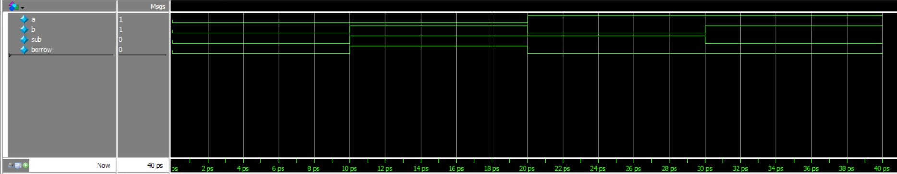

**Saved synthesis RTL schematic**

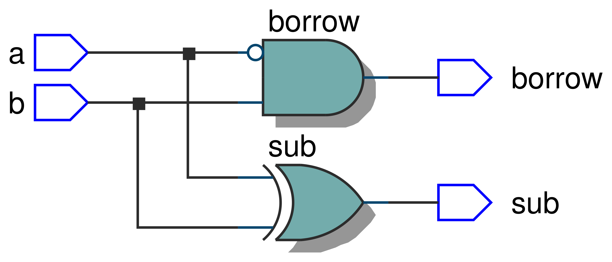

### RTL: halfSubDataflow.v

[Editable source](rtl/halfSubDataflow.v)

```verilog
module halfSubDataflow(
    input wire a , b,
    output wire sub, borrow
);
assign sub = a ^ b ;
assign borrow = ~ a & b ;
endmodule
```

### Testbench: halfSubDataflow_tb.v

[Editable testbench](tb/halfSubDataflow_tb.v) · Simulation top: `halfSubDataflow_tb`

```verilog
module halfSubDataflow_tb;
 reg a , b ;
 wire sub ;
 wire borrow;
 halfSubDataflow dut (
    .a(a),
    .b(b),
    .sub(sub),
    .borrow(borrow)
 );

 integer i ;
 initial begin
   for(i=0;i<4;i=i+1)begin
    {a,b} = i;
    #10;
    $display("values of a : %0d and b is :%0d and the subtraction is : %0d with borrow of %0d" , a, b, sub, borrow) ;

   end
   $finish;


 end

endmodule
```

<a id="fullsubusinghalf"></a>

## Full subtractor using half subtractors

RTL compilation: **PASS**. Selected testbench: **PASS**. These are compile/elaboration checks, not functional simulation results.

Synthesis provenance: saved RTL/TB hashes match the imported source. Waveform provenance: historical source hashes differ from the current RTL or selected TB.

The original waveform record predates the current RTL/TB. The separate fixed-timing capture has no accompanying source-hash record. Both captures are preserved as earlier illustrations; the synthesis source hashes match the current code.

One or more saved exports use older source. The provenance notes above identify the affected kind. Re-run the current RTL and TB before using those exports as evidence of today's behavior.

**Saved simulation waveform**

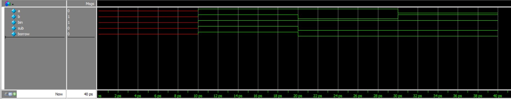

**Saved synthesis RTL schematic**

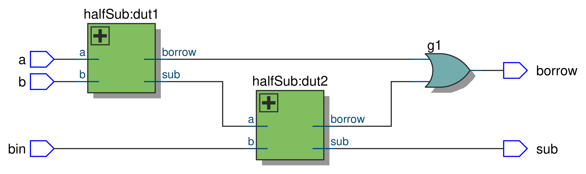

**Saved alternate waveform - source provenance unrecorded**

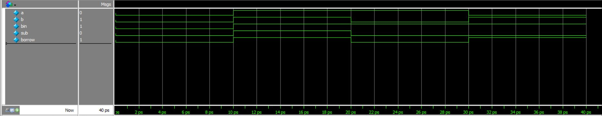

### RTL: fullSubUsingHalf.v

[Editable source](rtl/fullSubUsingHalf.v)

```verilog
module fullSubUsingHalf(
    input wire a , b, bin,
    output wire sub , borrow
);
  wire w1,w2,w3;
  halfSub dut1 (
    .a(a),
    .b(b),
    .sub(w1),
    .borrow(w2)
  );
  halfSub dut2 (
    .a(w1),
    .b(bin),
    .sub(sub),
    .borrow(w3)
  );
   or g1 (borrow , w2, w3) ;

endmodule

module halfSub(
    input wire a , b,
    output wire sub , borrow
);
assign sub = a ^ b ;
assign borrow = ~a & b ;
endmodule
```

### Testbench: fullSubUsingHalf_tb.v

[Editable testbench](tb/fullSubUsingHalf_tb.v) · Simulation top: `fullSubUsingHalf_tb`

```verilog
module fullSubUsingHalf_tb;
  reg a , b, bin;
  wire sub, borrow ;
  fullSubUsingHalf dut (
    .a(a),
    .b(b),
    .bin(bin),
    .sub(sub),
    .borrow(borrow)
  );

  initial begin
    a = 0;
    b =0;
    bin= 0 ;
  end


task valuesForSub;
    input aVal , bVal, borrowIn ;
    begin
        a = aVal;
        b = bVal;
        bin = borrowIn ;
        #10 ;
        // this delay should be in the beginning or at the end
        $display("Values for a, b, bin, sub and borrow are %0d %0d %0d %0d %0d",a, b, bin, sub, borrow);

    end
endtask
initial begin
    #10 ; // this is creating those, red values, now i will try to fix it
    valuesForSub(1'b1 , 1'b1 , 1'b1);  // sub is : 1 borrow 1
    valuesForSub(1'b1 , 1'b0 , 1'b1);  // sub is 0 borrow 0
    valuesForSub(1'b0 , 1'b1 , 1'b1);  // sub is 0 borrow 1
    /*
    valuesForSub(1'b1 , 1'b1 , 1'b1);
    valuesForSub(1'b1 , 1'b1 , 1'b1);
    valuesForSub(1'b1 , 1'b1 , 1'b1);
    valuesForSub(1'b1 , 1'b1 , 1'b1);
    */
    // have given 3 values via task
end
endmodule
```

<a id="mux4to1"></a>

## 2-to-1 and hierarchical 4-to-1 muxes

RTL compilation: **PASS**. Selected testbench: **PASS**. These are compile/elaboration checks, not functional simulation results.

Synthesis provenance: saved RTL/TB hashes match the imported source. Waveform provenance: saved RTL/TB hashes match the imported source.

**Saved simulation waveform**

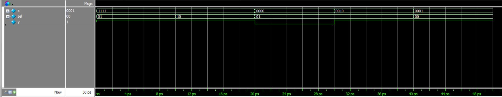

**Saved synthesis RTL schematic**

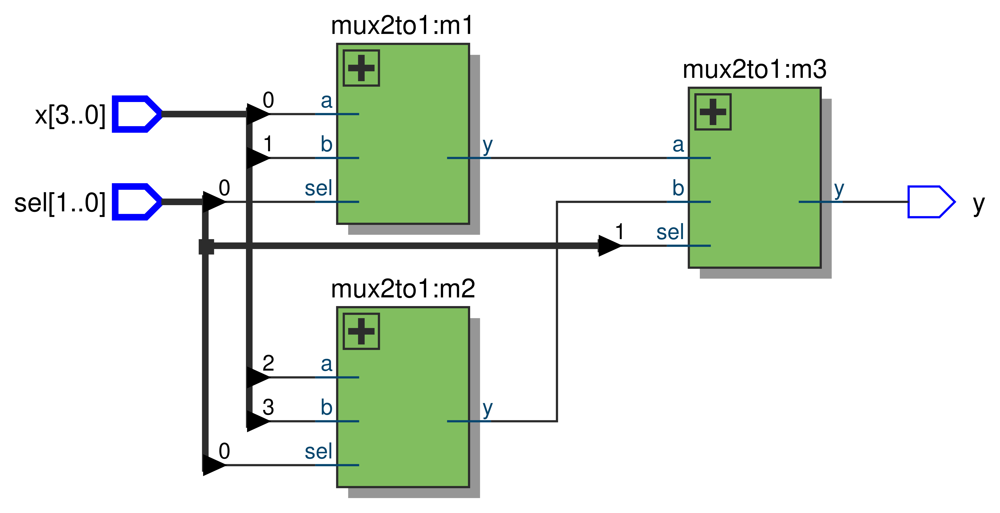

**Saved simulation waveform**

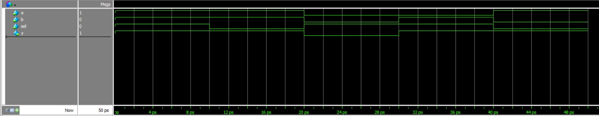

**Saved synthesis RTL schematic**

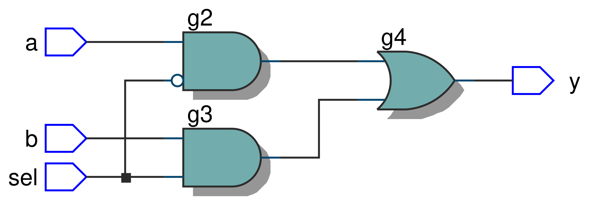

### RTL: muxQ3andQ4.v

[Editable source](rtl/muxQ3andQ4.v)

```verilog
//q3 : Design a 2 to 1 mux gate level abstraction

module mux2to1(
    input a , b,
    input sel ,
    output y
);
wire w1 , w2 , w3 ;
not g1 (w1 , sel ) ; // ~sel
and g2 (w2 , w1, a ) ; // ~sel & a
and g3 (w3 , sel , b ) ; // sel & b
or g4 (y, w2, w3) ;
endmodule
// q4 : 4 to 1 mux using 2 to 1 mux
module mux4to1(
    input wire [3:0] x ,
    input wire [1:0] sel ,
    output wire y
);
wire w1,w2 ;
mux2to1 m1 (x[0],x[1],sel[0],w1); // lower values
mux2to1 m2 (x[2],x[3],sel[0],w2); // upper values towards the msb
mux2to1 m3 (w1,w2,sel[1],y);

endmodule
```

### Testbench: muxQ3andQ4_tb.v

[Editable testbench](tb/muxQ3andQ4_tb.v) · Simulation top: `mux4to1_tb`

```verilog
module mux4to1_tb;
    reg [3:0] x ;
    reg [1:0] sel ;
    wire y ;
    mux4to1 dut (x,sel , y); // position based declaration
    /*
    integer i ;
    integer j ;
    initial begin
        for(i=0;i<4;i= i +1) begin
            for(j=0;j<16;j= j + 1)begin
                sel = i ;
                x =j ;

                #10 ;

            end
        end
    end
    */
    // make it task based ok
    task muxValues;
      input [3:0] xvals ;
      input [1:0] selvals;
      begin
        x = xvals;
        sel = selvals;
        #10 ;
        $display("the value of y based on sel (%0d) and input x %0d  is : %0d " , sel , x, y ) ;
      end
    endtask
    initial begin
        muxValues(4'b1111 , 2'b01);
        muxValues(4'b1111 , 2'b10);
        muxValues(4'b0000 , 2'b01); // output should be 0
        muxValues(4'b0010 , 2'b01); //should output 1
        muxValues(4'b0001 , 2'b00) ; // should output 1

    end
endmodule
```

<a id="decoder2to4"></a>

## 2-to-4 dataflow decoder

RTL compilation: **PASS**. Selected testbench: **PASS**. These are compile/elaboration checks, not functional simulation results.

Synthesis provenance: saved RTL/TB hashes match the imported source. Waveform provenance: saved RTL/TB hashes match the imported source.

**Saved simulation waveform**

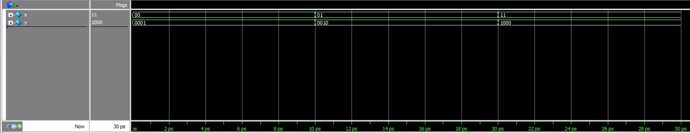

**Saved synthesis RTL schematic**

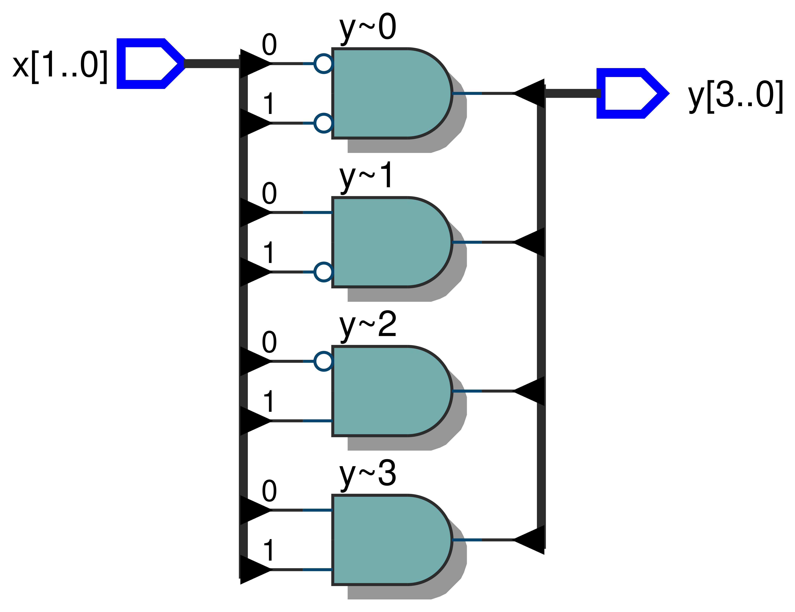

### RTL: decoderDataflow.v

[Editable source](rtl/decoderDataflow.v)

```verilog
// 2 to 4 decoder using dataflow abstraction
module decoder2to4(
    input wire [1:0] x ,
    output wire [3:0] y
);
assign y[0] = ~x[1] & ~x[0];
assign y[1] = ~x[1] & x[0];
assign y[2] = x[1] & ~x[0];
assign y[3] = x[1] & x[0];

 endmodule
```

### Testbench: decoderDataflow_tb.v

[Editable testbench](tb/decoderDataflow_tb.v) · Simulation top: `decoder2to4_tb`

```verilog
module decoder2to4_tb;
    reg [1:0] x ;
    wire [3:0] y ;
    decoder2to4 dut (
        .x(x),
        .y(y)
    );
    task decoderValues;
      input [1:0] inputs ;
      begin
        x= inputs ;
        #10 ;
      end
    endtask
    initial begin
        decoderValues(2'b00);
        decoderValues(2'b01);
        decoderValues(2'b11);
    end
endmodule
```
