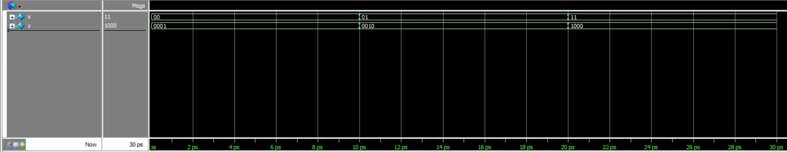
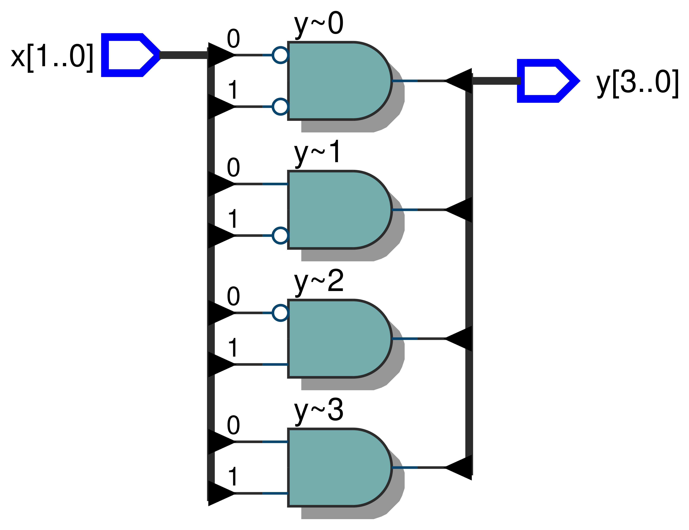

# 2-to-4 dataflow decoder

[Topic index](../README.md)

RTL compilation: **PASS**. Selected testbench: **PASS**. These are compile/elaboration checks, not functional simulation results.

Synthesis provenance: saved RTL/TB hashes match the imported source. Waveform provenance: saved RTL/TB hashes match the imported source.

**Saved simulation waveform**



**Saved synthesis RTL schematic**



## RTL: decoderDataflow.v

[Editable source](../rtl/decoderDataflow.v)

```verilog
// 2 to 4 decoder using dataflow abstraction
module decoder2to4(
    input wire [1:0] x ,
    output wire [3:0] y
);
assign y[0] = ~x[1] & ~x[0];
assign y[1] = ~x[1] & x[0];
assign y[2] = x[1] & ~x[0];
assign y[3] = x[1] & x[0];

 endmodule
```

## Testbench: decoderDataflow_tb.v

[Editable testbench](../tb/decoderDataflow_tb.v) · Simulation top: `decoder2to4_tb`

```verilog
module decoder2to4_tb;
    reg [1:0] x ;
    wire [3:0] y ;
    decoder2to4 dut (
        .x(x),
        .y(y)
    );
    task decoderValues;
      input [1:0] inputs ;
      begin
        x= inputs ;
        #10 ;
      end
    endtask
    initial begin
        decoderValues(2'b00);
        decoderValues(2'b01);
        decoderValues(2'b11);
    end
endmodule
```
