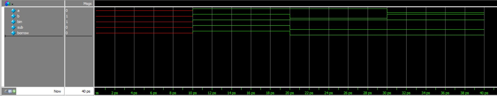
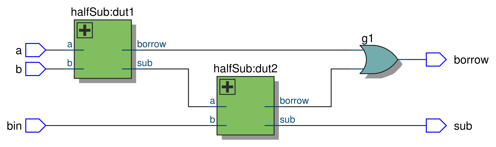
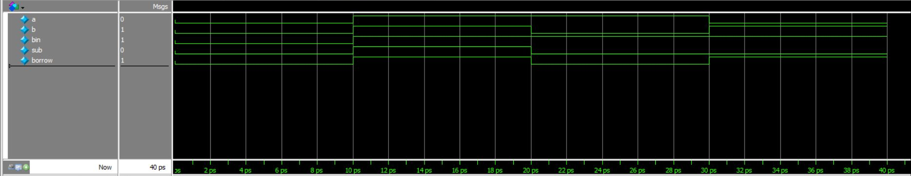

# Full subtractor using half subtractors

[Topic index](../README.md)

RTL compilation: **PASS**. Selected testbench: **PASS**. These are compile/elaboration checks, not functional simulation results.

Synthesis provenance: saved RTL/TB hashes match the imported source. Waveform provenance: historical source hashes differ from the current RTL or selected TB.

The original waveform record predates the current RTL/TB. The separate fixed-timing capture has no accompanying source-hash record. Both captures are preserved as earlier illustrations; the synthesis source hashes match the current code.

One or more saved exports use older source. The provenance notes above identify the affected kind. Re-run the current RTL and TB before using those exports as evidence of today's behavior.

**Saved simulation waveform**



**Saved synthesis RTL schematic**



**Saved alternate waveform - source provenance unrecorded**



## RTL: fullSubUsingHalf.v

[Editable source](../rtl/fullSubUsingHalf.v)

```verilog
module fullSubUsingHalf(
    input wire a , b, bin,
    output wire sub , borrow
);
  wire w1,w2,w3;
  halfSub dut1 (
    .a(a),
    .b(b),
    .sub(w1),
    .borrow(w2)
  );
  halfSub dut2 (
    .a(w1),
    .b(bin),
    .sub(sub),
    .borrow(w3)
  );
   or g1 (borrow , w2, w3) ;

endmodule

module halfSub(
    input wire a , b,
    output wire sub , borrow
);
assign sub = a ^ b ;
assign borrow = ~a & b ;
endmodule
```

## Testbench: fullSubUsingHalf_tb.v

[Editable testbench](../tb/fullSubUsingHalf_tb.v) · Simulation top: `fullSubUsingHalf_tb`

```verilog
module fullSubUsingHalf_tb;
  reg a , b, bin;
  wire sub, borrow ;
  fullSubUsingHalf dut (
    .a(a),
    .b(b),
    .bin(bin),
    .sub(sub),
    .borrow(borrow)
  );

  initial begin
    a = 0;
    b =0;
    bin= 0 ;
  end


task valuesForSub;
    input aVal , bVal, borrowIn ;
    begin
        a = aVal;
        b = bVal;
        bin = borrowIn ;
        #10 ;
        // this delay should be in the beginning or at the end
        $display("Values for a, b, bin, sub and borrow are %0d %0d %0d %0d %0d",a, b, bin, sub, borrow);

    end
endtask
initial begin
    #10 ; // this is creating those, red values, now i will try to fix it
    valuesForSub(1'b1 , 1'b1 , 1'b1);  // sub is : 1 borrow 1
    valuesForSub(1'b1 , 1'b0 , 1'b1);  // sub is 0 borrow 0
    valuesForSub(1'b0 , 1'b1 , 1'b1);  // sub is 0 borrow 1
    /*
    valuesForSub(1'b1 , 1'b1 , 1'b1);
    valuesForSub(1'b1 , 1'b1 , 1'b1);
    valuesForSub(1'b1 , 1'b1 , 1'b1);
    valuesForSub(1'b1 , 1'b1 , 1'b1);
    */
    // have given 3 values via task
end
endmodule
```
