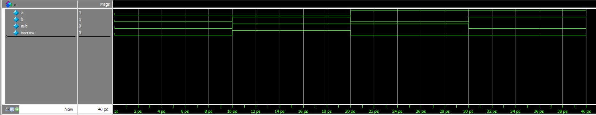
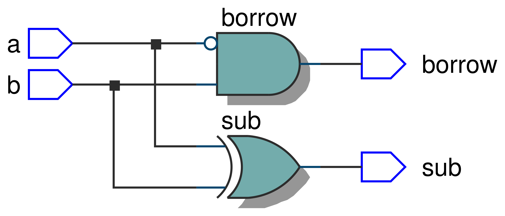

# Dataflow half subtractor

[Topic index](../README.md)

RTL compilation: **PASS**. Selected testbench: **PASS**. These are compile/elaboration checks, not functional simulation results.

Synthesis provenance: saved RTL/TB hashes match the imported source. Waveform provenance: saved RTL/TB hashes match the imported source.

**Saved simulation waveform**



**Saved synthesis RTL schematic**



## RTL: halfSubDataflow.v

[Editable source](../rtl/halfSubDataflow.v)

```verilog
module halfSubDataflow(
    input wire a , b,
    output wire sub, borrow
);
assign sub = a ^ b ;
assign borrow = ~ a & b ;
endmodule
```

## Testbench: halfSubDataflow_tb.v

[Editable testbench](../tb/halfSubDataflow_tb.v) · Simulation top: `halfSubDataflow_tb`

```verilog
module halfSubDataflow_tb;
 reg a , b ;
 wire sub ;
 wire borrow;
 halfSubDataflow dut (
    .a(a),
    .b(b),
    .sub(sub),
    .borrow(borrow)
 );

 integer i ;
 initial begin
   for(i=0;i<4;i=i+1)begin
    {a,b} = i;
    #10;
    $display("values of a : %0d and b is :%0d and the subtraction is : %0d with borrow of %0d" , a, b, sub, borrow) ;

   end
   $finish;


 end

endmodule
```
