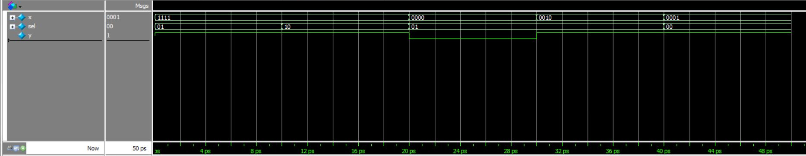
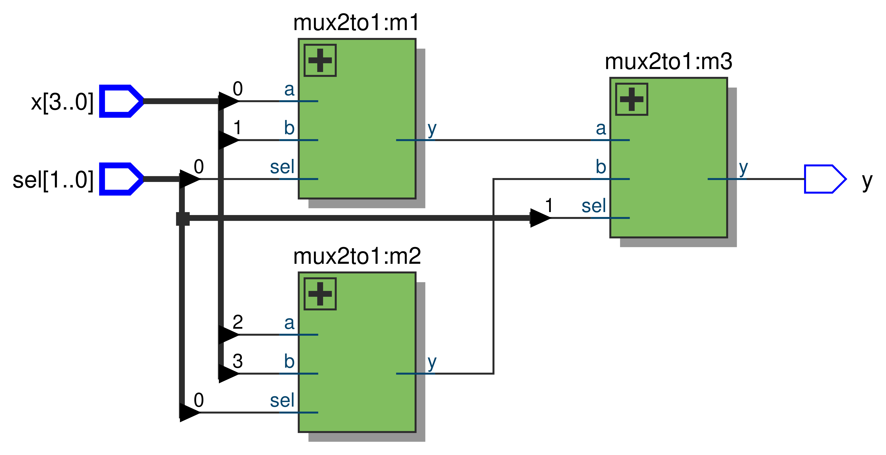
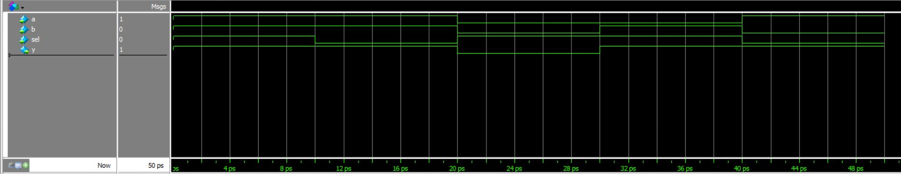
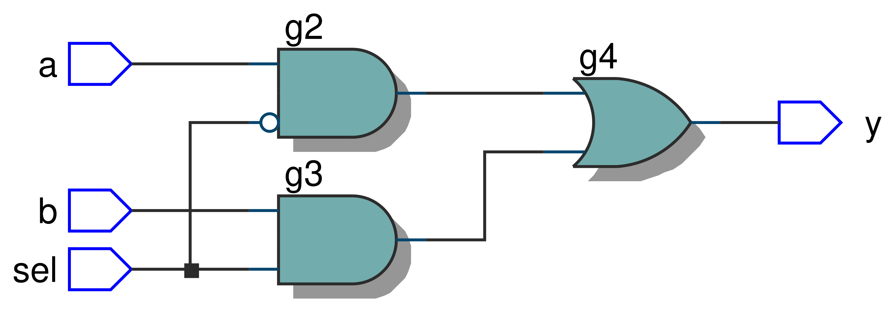

# 2-to-1 and hierarchical 4-to-1 muxes

[Topic index](../README.md)

RTL compilation: **PASS**. Selected testbench: **PASS**. These are compile/elaboration checks, not functional simulation results.

Synthesis provenance: saved RTL/TB hashes match the imported source. Waveform provenance: saved RTL/TB hashes match the imported source.

**Saved simulation waveform**



**Saved synthesis RTL schematic**



**Saved simulation waveform**



**Saved synthesis RTL schematic**



## RTL: muxQ3andQ4.v

[Editable source](../rtl/muxQ3andQ4.v)

```verilog
//q3 : Design a 2 to 1 mux gate level abstraction

module mux2to1(
    input a , b,
    input sel ,
    output y
);
wire w1 , w2 , w3 ;
not g1 (w1 , sel ) ; // ~sel
and g2 (w2 , w1, a ) ; // ~sel & a
and g3 (w3 , sel , b ) ; // sel & b
or g4 (y, w2, w3) ;
endmodule
// q4 : 4 to 1 mux using 2 to 1 mux
module mux4to1(
    input wire [3:0] x ,
    input wire [1:0] sel ,
    output wire y
);
wire w1,w2 ;
mux2to1 m1 (x[0],x[1],sel[0],w1); // lower values
mux2to1 m2 (x[2],x[3],sel[0],w2); // upper values towards the msb
mux2to1 m3 (w1,w2,sel[1],y);

endmodule
```

## Testbench: muxQ3andQ4_tb.v

[Editable testbench](../tb/muxQ3andQ4_tb.v) · Simulation top: `mux4to1_tb`

```verilog
module mux4to1_tb;
    reg [3:0] x ;
    reg [1:0] sel ;
    wire y ;
    mux4to1 dut (x,sel , y); // position based declaration
    /*
    integer i ;
    integer j ;
    initial begin
        for(i=0;i<4;i= i +1) begin
            for(j=0;j<16;j= j + 1)begin
                sel = i ;
                x =j ;

                #10 ;

            end
        end
    end
    */
    // make it task based ok
    task muxValues;
      input [3:0] xvals ;
      input [1:0] selvals;
      begin
        x = xvals;
        sel = selvals;
        #10 ;
        $display("the value of y based on sel (%0d) and input x %0d  is : %0d " , sel , x, y ) ;
      end
    endtask
    initial begin
        muxValues(4'b1111 , 2'b01);
        muxValues(4'b1111 , 2'b10);
        muxValues(4'b0000 , 2'b01); // output should be 0
        muxValues(4'b0010 , 2'b01); //should output 1
        muxValues(4'b0001 , 2'b00) ; // should output 1

    end
endmodule
```
