# Topic 1 - code and saved evidence

[Topic index](README.md)

[Bidirectional buffer](#bidirectionalbuffer) · [2-to-4 dataflow decoder](#decoderdataflow) · [Dataflow full adder](#fulladderdataflow) · [Full adder using half adders](#fulladderusinghalfadder) · [Half adder](#halfadder) · [4-to-1 mux using 2-to-1 muxes](#mux4to1) · [4-to-1 mux using a decoder](#muxusingdecoder) · [Priority encoder](#priorityencoder) · [4-bit ripple-carry adder](#ripplecarryadder) · [Gate-level ripple-carry adder](#ripplecarryadderstruct)

<a id="bidirectionalbuffer"></a>

## Bidirectional buffer

RTL compilation: **PASS**. Selected testbench: **PASS**. These are compile/elaboration checks, not functional simulation results.

Synthesis provenance: historical source hashes differ from the current RTL or selected TB. Waveform provenance: the saved waveform-export record has no RTL/TB hashes, so current-source equality is unverified.

One or more saved exports use older source. The provenance notes above identify the affected kind. Re-run the current RTL and TB before using those exports as evidence of today's behavior.

**Saved simulation waveform**

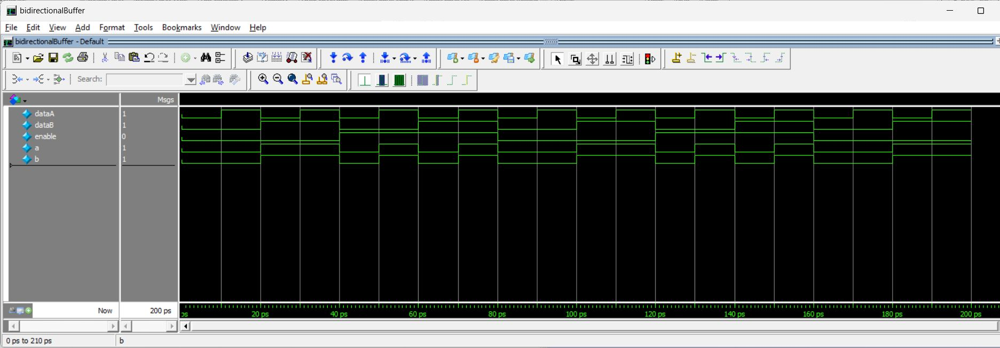

**Saved synthesis RTL schematic**

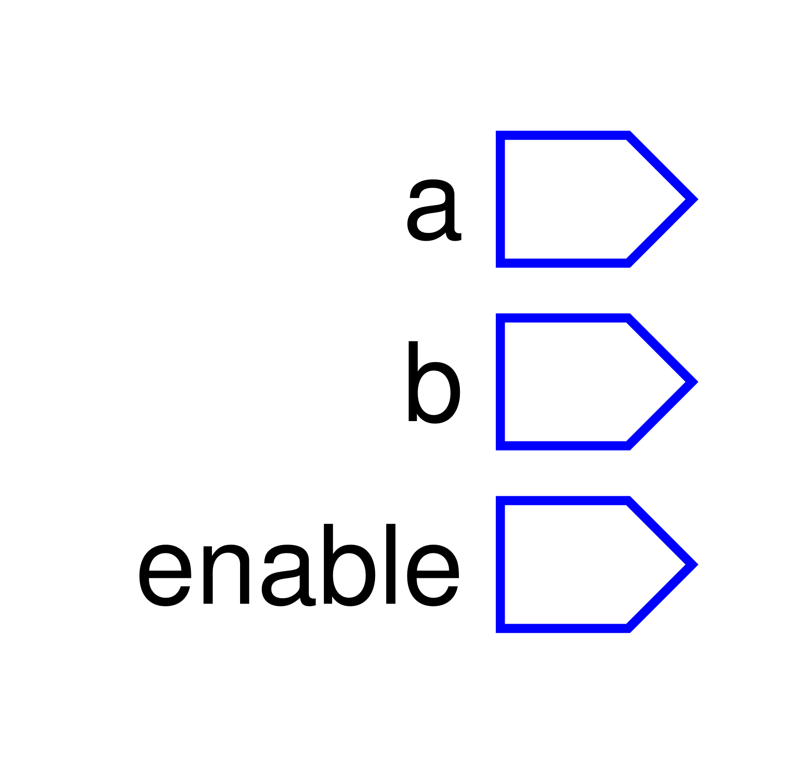

### RTL: bidirectionalBuffer.v

[Editable source](rtl/bidirectionalBuffer.v)

```verilog
// to create a RTL for bidirectional buffer
module bidirectionalBuffer(
    inout a , b ,
    input enable
);
// This is not correct , this is going to be synthesized like a mux .

bufif1(b,a,enable); // if enable is high b = a ; i.e a 10 ns pulse according to my tb
bufif0(a,b,enable) ;  // if enable is low , a = b ; i.e a 20 ns pulse according to my tb
// but this one will synthesize into a real bidirectional buffer
//tranif1(a ,b , enable) ;
endmodule
```

### Testbench: bidirectionalBuffer_tb.v

[Editable testbench](tb/bidirectionalBuffer_tb.v) · Simulation top: `bidirectionalBuffer_tb`

```verilog
module bidirectionalBuffer_tb ;
  wire a , b ;
  reg enable ;
  reg dataA ;
  reg dataB;
  bidirectionalBuffer dut (
    .a(a) ,
    .b(b) ,
    .enable(enable)
  ) ;
  // a and b are inout connections , and they require net type connections , to be resolved .
  // hence i will assign to wire's a and b
  initial begin
    dataA = 1'b0 ;
    dataB = 1'b0 ;
    enable = 1'b0 ;

  end
  always #10 dataA = ~dataA ;   // a is basically a pulse of time period 10
  always #20 dataB = ~dataB ;   // b is a pulse of time period 20
  always #40 enable = ~enable ;
  assign a = (enable) ? dataA : 1'bz ;
  assign b = (enable) ? 1'bz : dataB  ;

  initial begin
    #200 ;
    $finish;
  end

endmodule
```

<a id="decoderdataflow"></a>

## 2-to-4 dataflow decoder

RTL compilation: **PASS**. Selected testbench: **PASS**. These are compile/elaboration checks, not functional simulation results.

Synthesis provenance: saved RTL/TB hashes match the imported source. Waveform provenance: the saved waveform-export record has no RTL/TB hashes, so current-source equality is unverified.

**Saved simulation waveform**

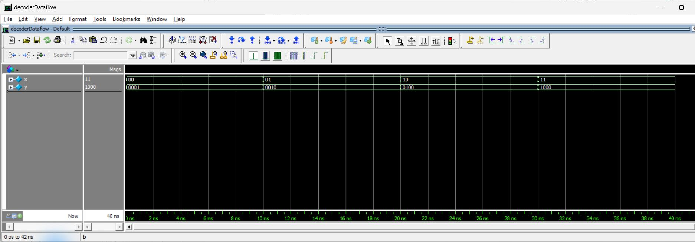

**Saved synthesis RTL schematic**

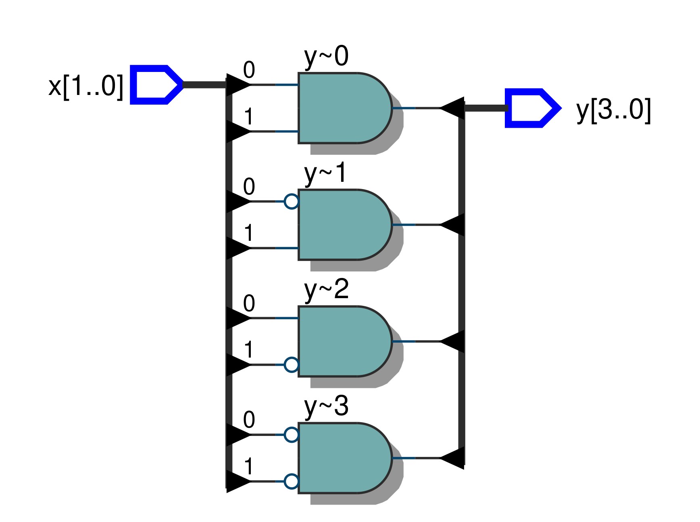

### RTL: decoderDataflow.v

[Editable source](rtl/decoderDataflow.v)

```verilog
module decoderDataflow(
    input [1:0] x,
    output [3:0] y
);
assign y[3] = x[1] & x[0] ;
assign y[2] = x[1] & ~x[0] ;
assign y[1] = ~x[1] & x[0] ;
assign y[0] = ~x[1] & ~x[0] ;
endmodule
```

### Testbench: decoderDataflow_tb.v

[Editable testbench](tb/decoderDataflow_tb.v) · Simulation top: `decoderDataflow_tb`

```verilog
`timescale 1ns/1ps
module decoderDataflow_tb ;
// it was a 2 to 4 decoder
reg [1:0] x ;
wire [3:0] y ;
initial begin
    x= 2'b00;
end
decoderDataflow dut (
    .x(x),
    .y(y)
);
integer i ;
initial begin
    for(i =0; i< 4 ; i= i+1)begin
        x = i ;
        #10;
        $display("For the value x = %0b , the value in the output is :%0b " , x, y );
    end
end
endmodule
```

<a id="fulladderdataflow"></a>

## Dataflow full adder

RTL compilation: **PASS**. Selected testbench: **PASS**. These are compile/elaboration checks, not functional simulation results.

Synthesis provenance: saved RTL/TB hashes match the imported source. Waveform provenance: the saved waveform-export record has no RTL/TB hashes, so current-source equality is unverified.

**Saved simulation waveform**

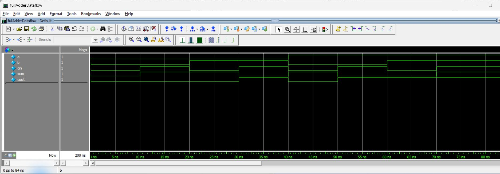

**Saved synthesis RTL schematic**

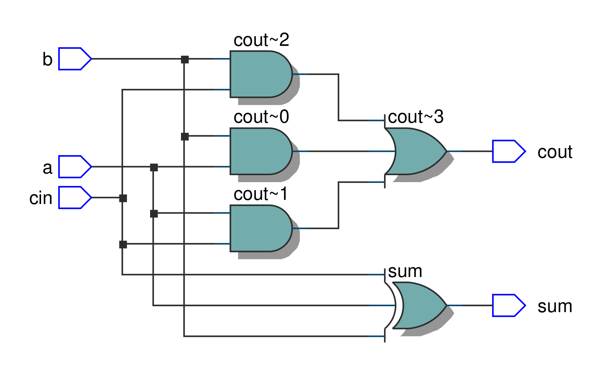

### RTL: fullAdderDataflow.v

[Editable source](rtl/fullAdderDataflow.v)

```verilog
module fullAdderDataflow (
    input wire a , b, cin ,
    output wire cout, sum
);
assign sum = a ^ b ^ cin;
assign cout = (a & b )  | (a & cin ) | (b & cin ) ;
endmodule
```

### Testbench: fullAdderDataflow_tb.v

[Editable testbench](tb/fullAdderDataflow_tb.v) · Simulation top: `fullAdderDataflow_tb`

```verilog
`timescale 1ns/1ps
module fullAdderDataflow_tb ;
  reg a , b, cin ;
  wire cout ;
  wire sum;
  initial begin
    a= 1'b0;
    b= 1'b0 ;
    cin = 1'b0 ;
  end
  // connecting the tb to the dut
  fullAdderDataflow dut (
    .a(a),
    .b(b),
    .cin(cin),
    .cout(cout),
    .sum(sum)
  );
  integer i ;
  initial begin
    for(i=0 ; i<8; i=i+1)begin
        {a,b,cin} = i ;
        #10;
        $display("The value of sum is : %0d for the value of a : %0d and b : %0d " , sum , a , b) ;
    end
   //$monitor("THe values for sum and carry are %0d , %0d  " , sum , cout );
  end
// why i cant use monitor here ?
    initial begin
      #200;
      $finish;

    end
endmodule
```

<a id="fulladderusinghalfadder"></a>

## Full adder using half adders

RTL compilation: **PASS**. Selected testbench: **PASS**. These are compile/elaboration checks, not functional simulation results.

Synthesis provenance: saved RTL/TB hashes match the imported source. Waveform provenance: the saved waveform-export record has no RTL/TB hashes, so current-source equality is unverified.

The task runner selects the TB under tbExtra. This RTL file includes its own halfAdder module. The other saved TB with the same module name is retained as a separate draft.

**Saved simulation waveform**

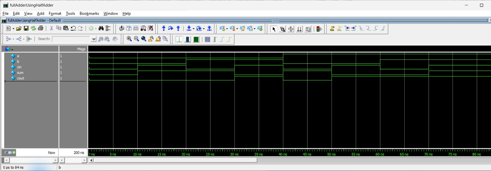

**Saved synthesis RTL schematic**

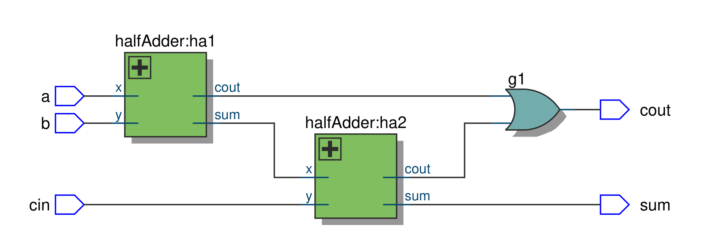

### RTL: fullAdderUsingHalfAdder.v

[Editable source](rtl/rtlExtra/fullAdderUsingHalfAdder.v)

```verilog
module fullAdderUsingHalfAdder (
    input wire a , b, cin ,
    output wire cout , sum
);
wire w1 , w2 ,w3;
halfAdder ha1 (a ,b,w1,w2 ) ;
halfAdder ha2 (w2,cin,w3,sum);
or g1 (cout , w1,w3) ;
endmodule
module halfAdder(
    input wire x, y ,
    output wire cout , sum
);
assign cout = x & y ;
assign sum = x ^ y ;
endmodule
```

### Testbench: fullAdderUsingHalfAdder_tb.v

[Editable testbench](tb/tbExtra/fullAdderUsingHalfAdder_tb.v) · Simulation top: `fullAdderUsingHalfAdder_tb`

```verilog
`timescale 1ns/1ps
module fullAdderUsingHalfAdder_tb ;
  reg a , b, cin ;
  wire cout ;
  wire sum;
  initial begin
    a= 1'b0;
    b= 1'b0 ;
    cin = 1'b0 ;
  end
  // connecting the tb to the dut
  fullAdderUsingHalfAdder dut (
    .a(a),
    .b(b),
    .cin(cin),
    .cout(cout),
    .sum(sum)
  );
  integer i ;
  initial begin
    for(i=0 ; i<8; i=i+1)begin
        {a,b,cin} = i ;
        #10;
        $display("The value of sum is : %0d for the value of a : %0d and b : %0d " , sum , a , b) ;
    end
   //$monitor("THe values for sum and carry are %0d , %0d  " , sum , cout );
  end
// why i cant use monitor here ?
    initial begin
      #200;
      $finish;

    end
endmodule
```

<a id="halfadder"></a>

## Half adder

RTL compilation: **PASS**. Selected testbench: **PASS**. These are compile/elaboration checks, not functional simulation results.

Synthesis provenance: saved RTL/TB hashes match the imported source. Waveform provenance: the saved waveform-export record has no RTL/TB hashes, so current-source equality is unverified.

The root TB is selected. The alternate tbExtra/halfAdder_tb.v is retained as an unfinished draft.

**Saved simulation waveform**

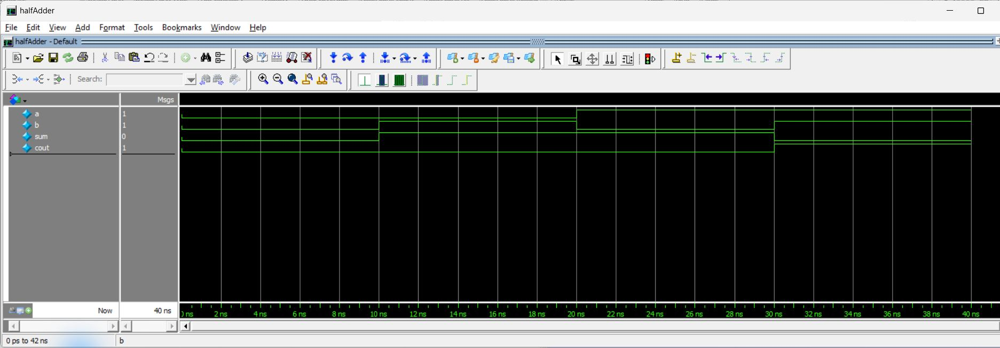

**Saved synthesis RTL schematic**

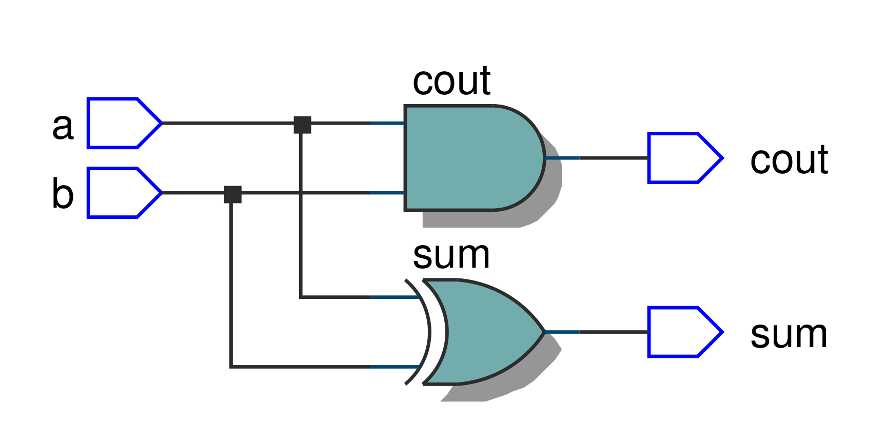

### RTL: halfAdder.v

[Editable source](rtl/rtlExtra/halfAdder.v)

```verilog
module halfAdder(
    input wire a , b,
    output wire cout, sum
);
assign sum = a ^b;
assign cout = a & b ;
endmodule
```

### Testbench: halfAdder_tb.v

[Editable testbench](tb/halfAdder_tb.v) · Simulation top: `halfAdder_tb`

```verilog
`timescale 1ns/1ps
module halfAdder_tb;
    reg a , b ;
    wire cout,sum;
    halfAdder dut (a , b,cout , sum);
    initial begin
        a=0 ;
        b =0;
    end
    integer i ;

    initial begin
        for(i =0;i<4;i=i+1)begin
            {a,b} = i;
            #10;
        end
    end

endmodule
```

<a id="mux4to1"></a>

## 4-to-1 mux using 2-to-1 muxes

RTL compilation: **PASS**. Selected testbench: **PASS**. These are compile/elaboration checks, not functional simulation results.

Synthesis provenance: saved RTL/TB hashes match the imported source. Waveform provenance: the saved waveform-export record has no RTL/TB hashes, so current-source equality is unverified.

**Saved simulation waveform**

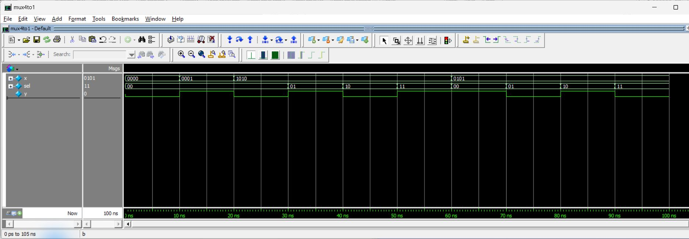

**Saved synthesis RTL schematic**

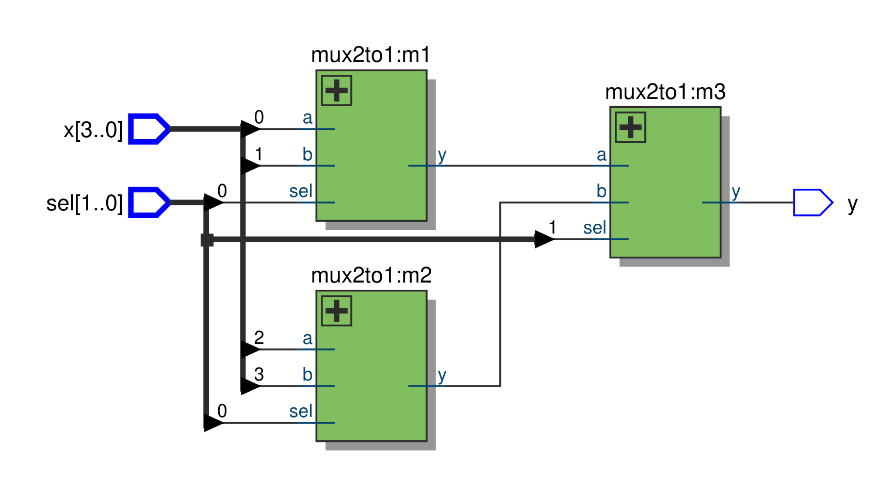

### RTL: mux4to1.v

[Editable source](rtl/mux4to1.v)

```verilog
// To create 4 to 1 mux using 2 to 1 muxes
module mux4to1(
    input wire [3:0] x ,
    input wire [1:0] sel ,
    output wire y
);
// i can use only 2 to 1 muxes
wire w1, w2;
mux2to1 m1 (
    .a(x[0]),
    .b(x[1]),
    .sel(sel[0]),
    .y(w1)
);
mux2to1 m2 (
    .a(x[2]),
    .b(x[3]),
    .sel(sel[0]),
    .y(w2)
);
mux2to1 m3 (
    .a(w1),
    .b(w2),
    .sel(sel[1]),
    .y(y)
);
endmodule
module mux2to1(
    input wire a , b ,
    input wire sel ,
    output wire y
);
assign y = (sel)? b : a ;

endmodule
```

### Testbench: mux4to1_tb.v

[Editable testbench](tb/mux4to1_tb.v) · Simulation top: `mux4to1_tb`

```verilog
`timescale 1ns/1ps
module mux4to1_tb ;
    reg [3:0] x ;
    reg [1:0] sel ;
    wire y ;
    mux4to1 dut (
        .x(x),
        .sel(sel),
        .y(y)
    );
    initial begin
        x = 4'b0000;
        sel = 2'b00;

    end
    task stimuli ;
      input [3:0] data ;
      input [1:0] select;
      begin
        x= data ;
        sel = select ;
        #10 ;

      end
    endtask
    initial begin
        #10;
        stimuli(4'b0001 , 2'b00);  // output 1
        stimuli(4'b1010, 2'b00);  // output 0
        stimuli(4'b1010, 2'b01);  // its gonna o/p a 1
        stimuli(4'b1010, 2'b10);  // 0
        stimuli(4'b1010, 2'b11);  // output a 1

        stimuli(4'b0101, 2'b00);  //1 output
        //last 3 should be 1's
        stimuli(4'b0101, 2'b01);
        stimuli(4'b0101, 2'b10);
        stimuli(4'b0101, 2'b11);

    end
endmodule
```

<a id="muxusingdecoder"></a>

## 4-to-1 mux using a decoder

RTL compilation: **PASS**. Selected testbench: **PASS**. These are compile/elaboration checks, not functional simulation results.

Synthesis provenance: historical source hashes differ from the current RTL or selected TB. Waveform provenance: the saved waveform-export record has no RTL/TB hashes, so current-source equality is unverified.

One or more saved exports use older source. The provenance notes above identify the affected kind. Re-run the current RTL and TB before using those exports as evidence of today's behavior.

**Saved simulation waveform**

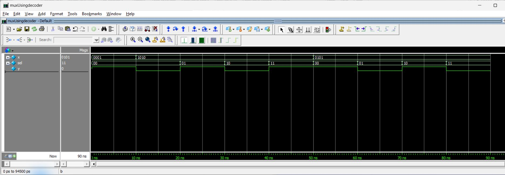

**Saved synthesis RTL schematic**

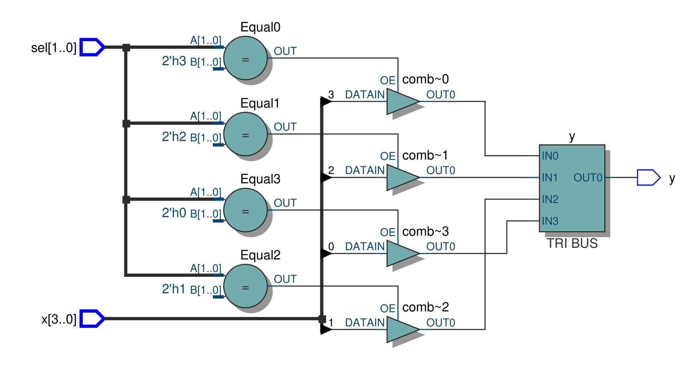

### RTL: muxUsingDecoder.v

[Editable source](rtl/muxUsingDecoder.v)

```verilog
// 4 to 1 mux using decoder and tri state buffer
module muxUsingdecoder(
    input wire [3:0] x ,
    input wire [1:0] sel ,
    output wire y
);
// i have a decoder and a tri state buffer
// 2 to 4 decoder
wire [3:0] dOut ;
assign dOut[3] = (sel== 2'b11 ) ;
assign dOut[2] = (sel == 2'b10 ) ;
assign dOut[1] = (sel == 2'b01) ;
assign dOut[0] = (sel == 2'b00) ;
//I need to make use of tri state buffers as well for the output logic
assign y = (x[3] & dOut[3] ) |x[2] & dOut[2] | x[1] & dOut[1] | x[0] & dOut[0];

/*
this is creating 4 buffers in the synthesis

bufif1(y,x[3],dOut[3] ) ;
bufif1(y,x[2],dOut[2] ) ;
bufif1(y,x[1],dOut[1] ) ;
bufif1(y,x[0],dOut[0] ) ;
*/


endmodule
```

### Testbench: muxUsingdecoder_tb.v

[Editable testbench](tb/muxUsingdecoder_tb.v) · Simulation top: `muxUsingdecoder_tb`

```verilog
`timescale 1ns/1ps

module muxUsingdecoder_tb ;
    reg [3:0] x ;
    reg [1:0] sel ;
    wire y ;
    initial begin
        x = 4'd0;
        sel = 2'd0 ;
        // i wont do anything to the o/p
    end
    // tb wont change cause its still functionally mux

    muxUsingdecoder dut(x , sel , y);
    // order based instantiation
    task stimuli ;
      input [3:0] data;
      input [1:0] sel_stimulus ;
      begin
        x = data;
        sel = sel_stimulus ;
        #10;
      end
    endtask
    initial begin
        stimuli(4'b0001 , 2'b00);  // output 1
        stimuli(4'b1010, 2'b00);  // output 0
        stimuli(4'b1010, 2'b01);
        stimuli(4'b1010, 2'b10);
        stimuli(4'b1010, 2'b11);

        stimuli(4'b0101, 2'b00);
        //last 3 should be 1's
        stimuli(4'b0101, 2'b01);
        stimuli(4'b0101, 2'b10);
        stimuli(4'b0101, 2'b11);

      end
 endmodule
```

<a id="priorityencoder"></a>

## Priority encoder

RTL compilation: **PASS**. Selected testbench: **PASS**. These are compile/elaboration checks, not functional simulation results.

Synthesis provenance: saved RTL/TB hashes match the imported source. Waveform provenance: the saved waveform-export record has no RTL/TB hashes, so current-source equality is unverified.

**Saved simulation waveform**

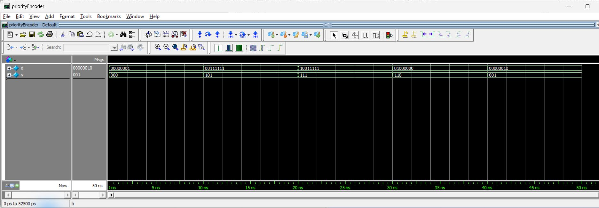

**Saved synthesis RTL schematic**

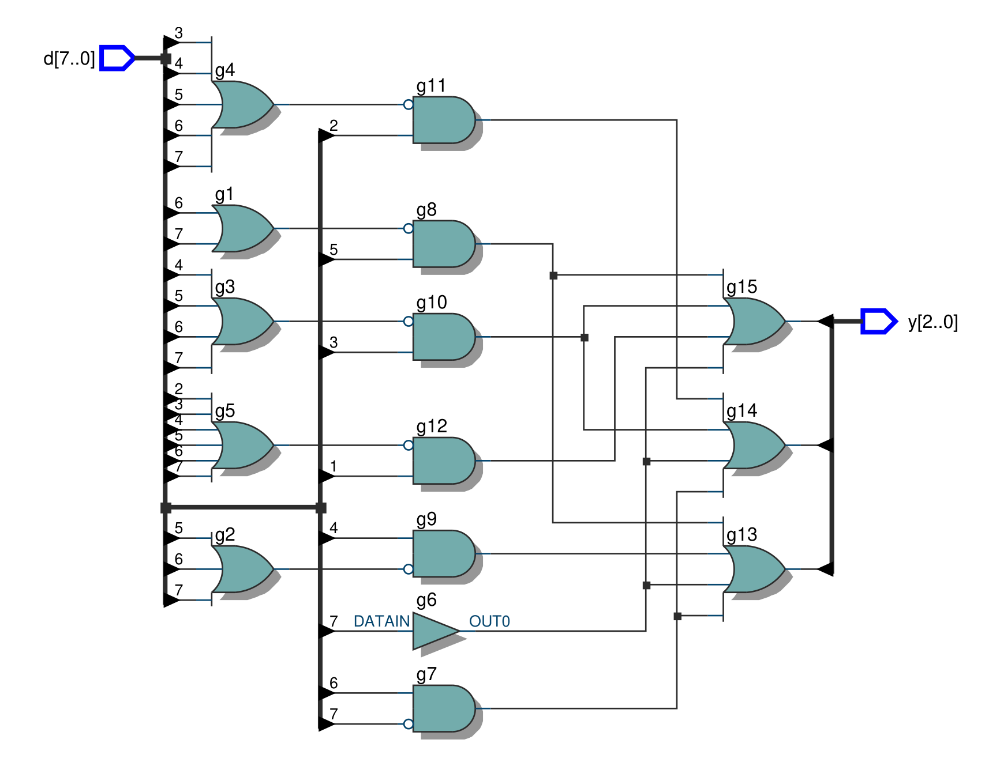

### RTL: priorityEncoder.v

[Editable source](rtl/rtlExtra/priorityEncoder.v)

```verilog
// 8 to 3 priority encoder using strutural modelling
// MSB priority
module priorityEncoder(
    input wire [7:0] d ,
    output wire [2:0] y
);
// structural modelling
wire w1,w2,w3,w4,w5,w6,w7 ;
wire n7 , n76 , n765, n7654 , n76543 , n765432 ;
not g0 (n7 , d[7]) ;
nor g1 (n76 ,d[7],d[6] );
nor g2 (n765 , d[7],d[6] , d[5]) ;
nor g3 (n7654 , d[7],d[6] , d[5] , d[4] );
nor g4 (n76543 ,d[7],d[6] , d[5] , d[4] ,d[3] );
nor g5 (n765432 , d[7],d[6] , d[5] , d[4] ,d[3] , d[2]) ;
// why not n7654321
//priority based signals

buf g6 (w7,d[7]);
and g7 (w6 , d[6] , n7);
and g8 (w5 , d[5],n76);
and g9 (w4 , d[4],n765);
and g10 (w3 , d[3],n7654);
and g11 (w2 , d[2],n76543);
and g12 (w1 , d[1],n765432);
// generate 3 bit output
or g13 (y[2] , w4,w5,w6,w7);
or g14 (y[1] , w2,w3,w6,w7);
or g15 (y[0] , w1,w3,w5,w7) ;

/*
This is not structural its, behavioural modelling
always @(*)begin
    casez (x)
        8'b00000001 : y= 3'b000;
        8'b0000001? : y= 3'b001;
        8'b000001?? : y= 3'b010;
        8'b00001??? : y= 3'b011;
        8'b0001???? : y= 3'b100;
        8'b001????? : y= 3'b101;
        8'b01?????? : y= 3'b110;
        8'b1??????? : y= 3'b111;
        default: y= 3'b000;
    endcase
end
*/
endmodule
```

### Testbench: priorityEncoder_tb.v

[Editable testbench](tb/tbExtra/priorityEncoder_tb.v) · Simulation top: `priorityEncoder_tb`

```verilog
`timescale 1ns/1ps
module priorityEncoder_tb;
//  8 bit d
//  3 bit y

  reg [7:0] d ;
  wire [2:0] y ;
  /*
  initial begin
    d= 8'd0;

  end
  */
  // connection i gave
  priorityEncoder dut (d,y);
  task stimulus ;
      input [7:0] data ;
      begin
        d = data;
        #10;
        // so i am waiting for data (correct data ok )
        $display("The value of data is : %0b at a time of %0t and the output is: %0d "  , data , $time , y);
      end
  endtask
  initial begin
    stimulus(8'b00000001); // it should o/p 0 since position 0 is having a 1
    stimulus(8'b00111111); // it should o/p 5 since bit at pos 5 is having a 1 its msb priority
    stimulus(8'b10011111); // o/p 7
    stimulus(8'b01000000); // o/p is 6
    stimulus(8'b00000010);
  end
endmodule
```

<a id="ripplecarryadder"></a>

## 4-bit ripple-carry adder

RTL compilation: **PASS**. Selected testbench: **PASS**. These are compile/elaboration checks, not functional simulation results.

Synthesis provenance: historical source hashes differ from the current RTL or selected TB. Waveform provenance: the saved waveform-export record has no RTL/TB hashes, so current-source equality is unverified.

One or more saved exports use older source. The provenance notes above identify the affected kind. Re-run the current RTL and TB before using those exports as evidence of today's behavior.

**Saved simulation waveform**

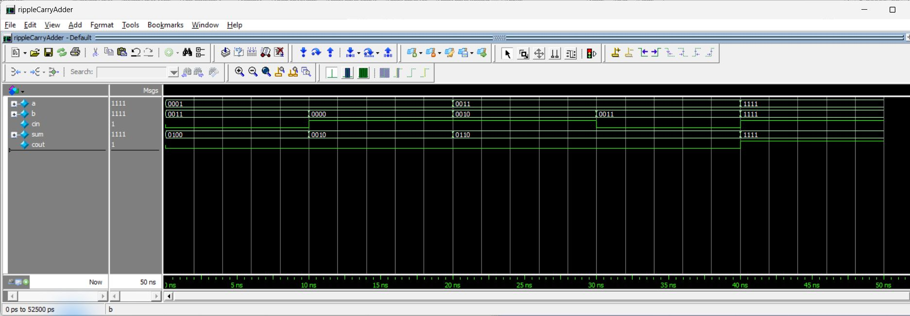

### RTL: rippleCarryAdder.v

[Editable source](rtl/rippleCarryAdder.v)

```verilog
// 4 bit ripple carry adder using 1 bit full adder
module rippleCarryAdder(
    input wire [3:0] a , b,
    input wire cin ,
    output wire [3:0] sum ,
    output wire cout
);
wire [4:0] carry ;  //why it wont be reg
assign carry[0] = cin;
assign cout = carry[4] ;

genvar i ;
generate
    for(i =0 ; i<4 ; i= i+ 1 )begin : generate4fa
        fullAdder dut (
            .a(a[i]),
            .b(b[i]),
            .cin(carry[i]),
            .sum(sum[i]),
            .cout(carry[i+1])
        );
    end
endgenerate
endmodule
module fullAdder(
    input wire a , b,  cin ,
    output wire cout , sum
);
assign sum = a ^ b ^ cin ;
assign cout = (a & b ) | (b & cin ) | (a & cin) ;
endmodule
```

### Testbench: rippleCarryAdder_tb.v

[Editable testbench](tb/rippleCarryAdder_tb.v) · Simulation top: `rippleCarryAdder_tb`

```verilog
`timescale 1ns/1ps
module rippleCarryAdder_tb ;
  reg [3:0] a , b;
  reg cin ;
  wire cout ;
  wire [3:0] sum;
  rippleCarryAdder dut (
    .a(a),
    .b(b),
    .cin(cin),
    .sum(sum),
    .cout(cout)
  );

  initial begin
    a= 4'd0 ;
    b= 4'd0 ;
    cin = 0 ;

  end
  task stimuli;
    input [3:0] num1 ;
    input [3:0] num2;
    input carryIn ;
    begin
      a = num1;
      b= num2 ;
      cin = carryIn ;
      #10 ;

    end
 endtask
 initial begin
    stimuli(4'b0001 ,4'b0011 , 0 ) ;
    stimuli(4'b0001 , 4'b0000, 1 ) ;
    stimuli(4'b0011 , 4'b0010 , 1 ) ;
    stimuli(4'b0011 , 4'b0011 , 0 ) ;
    stimuli(4'b1111,  4'b1111 , 1 ) ;
    // overflow case

 end
endmodule
```

<a id="ripplecarryadderstruct"></a>

## Gate-level ripple-carry adder

RTL compilation: **PASS**. Selected testbench: **PASS**. These are compile/elaboration checks, not functional simulation results.

Synthesis provenance: saved RTL/TB hashes match the imported source. Waveform provenance: the saved waveform-export record has no RTL/TB hashes, so current-source equality is unverified.

**Saved simulation waveform**


**Saved synthesis RTL schematic**

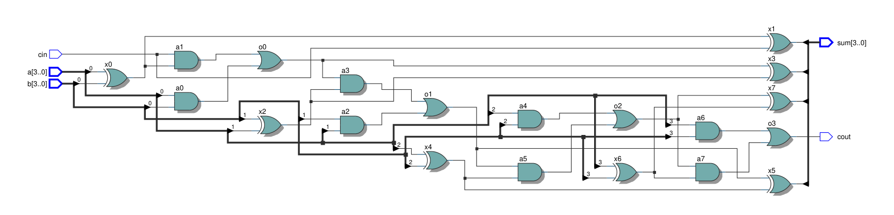

### RTL: rippleCarryAdderStruct.v

[Editable source](rtl/rtlExtra/rippleCarryAdderStruct.v)

```verilog
module rippleCarryAdderStruct(
    input wire [3:0] a, b,
    input wire cin ,
    output wire [3:0] sum ,
    output wire cout
);
wire c0,c1,c2; // carry signals
wire p0 , p1,p2,p3; // propagate so i will call xor terms using this
wire g0,g1,g2,g3 ; // generate , so i will call the and terms using this
wire t0, t1,t2,t3;
// starting from the lsb :  bit 0
xor x0 (p0 , a[0],b[0]);  // help in propagate term
xor x1 (sum[0] , p0,cin);  // till sum
and a0 (g0,a[0],b[0]); // a & b generate term
and a1 (t0 , p0 , cin); // (a ^b )cin
or o0 (c0 , g0,t0 ); // final carry expression , (a ^ b) cin + (a & b)
// this was the lsb
// starting from the lsb :  bit 1
xor x2 (p1 , a[1],b[1]);  // help in propagate term
xor x3 (sum[1] , p1,c0);  // till sum  , c1 generated final stage of prev
and a2 (g1,a[1],b[1]); // a & b generate term
and a3 (t1 , p1 , c0); // (a ^b )cin
or o1 (c1 , g1,t1 ); // final carry expression , (a ^ b) cin + (a & b)

// bit 2
// starting from the lsb :  bit 2
xor x4 (p2 , a[2],b[2]);  // help in propagate term
xor x5 (sum[2] , p2, c1);  // till sum
and a4 (g2,a[2],b[2]); // a & b generate term
and a5 (t2 , p2 , c1); // (a ^b )cin
or o2 (c2 , g2,t2 ); // final carry expression , (a ^ b) cin + (a & b)
// bit 3 : i.e the msb
// starting from the lsb :  bit 0
xor x6 (p3 , a[3],b[3]);  // help in propagate term
xor x7 (sum[3] , p3,c2);  // till sum
and a6 (g3,a[3],b[3]); // a & b generate term
and a7 (t3 , p3 , c2); // (a ^b )cin
or o3 (cout , g3,t3 ); // final carry expression , (a ^ b) cin + (a & b)
endmodule
// bit 0 will have the carry term c0 , bit 1 have carry term c1 , .. similarly bit 3 will generate a carry of c3
```

### Testbench: ripplyCarryAdderStruct_tb.v

[Editable testbench](tb/tbExtra/ripplyCarryAdderStruct_tb.v) · Simulation top: `rippleCarryAdderStruct_tb`

```verilog
`timescale 1ns/1ps
module rippleCarryAdderStruct_tb ;
  reg [3:0] a , b;
  reg cin ;
  wire cout ;
  wire [3:0] sum;
  rippleCarryAdderStruct dut (
    .a(a),
    .b(b),
    .cin(cin),
    .sum(sum),
    .cout(cout)
  );

  initial begin
    a= 4'd0 ;
    b= 4'd0 ;
    cin = 0 ;

  end
  task stimuli;
    input [3:0] num1 ;
    input [3:0] num2;
    input carryIn ;
    begin
      a = num1;
      b= num2 ;
      cin = carryIn ;
      #10 ;

    end
 endtask
 initial begin
    stimuli(4'b0001 ,4'b0011 , 0 ) ;
    stimuli(4'b0001 , 4'b0000, 1 ) ;
    stimuli(4'b0011 , 4'b0010 , 1 ) ;
    stimuli(4'b0011 , 4'b0011 , 0 ) ;
    stimuli(4'b1111,  4'b1111 , 1 ) ;
    // overflow case

 end
endmodule
```

## Other saved testbench drafts

These files are preserved as separate iterations. Compile one TB at a time because some declare the same module name.

### tb/fullAdderUsingHalfAdder_tb.v

Compile/elaboration: **FAIL**. [Editable draft](tb/fullAdderUsingHalfAdder_tb.v)

```verilog
`timescale 1ns/1ps
module fullAdderUsingHalfAdder_tb ;
  reg x,y,cin;
  wire cout , sum ;
  fullAdderUsingHalfAdder dut (x,y,cin,cout,sum);
  initial begin
    x = 0;
    y=0;
    cin=0;
  end
  initial begin
    for(i=0;i<8;i=i+1)begin
        {x,y,cin} = i;
        #10;

    end
  end

endmodule
```

### tb/tbExtra/halfAdder_tb.v

Compile/elaboration: **FAIL**. [Editable draft](tb/tbExtra/halfAdder_tb.v)

```verilog
module halfAdder_tb ;
   reg a ,b ,
   wire cout , sum ;
   initial begin
    a =0;
    b=0;
   end
   integer i ;
   initial begin
      for(i =0; i< 4 ; i= i +1 )begin
        {a,b} = i ;
        #10 ;
        $display("the values for a is %0d and b is %0d and the sum is : %0d " , a, b, sum );
      end
   end
endmodule
```

### tb/tbExtra/ripplyCarryAdderStruct.v

Compile/elaboration: **PASS**. [Editable draft](tb/tbExtra/ripplyCarryAdderStruct.v)

```verilog
`timescale 1ns/1ps
module rippleCarryAdder_tb ;
  reg [3:0] a , b;
  reg cin ;
  wire cout ;
  wire [3:0] sum;
  rippleCarryAdderStruct dut (
    .a(a),
    .b(b),
    .cin(cin),
    .sum(sum),
    .cout(cout)
  );

  initial begin
    a= 4'd0 ;
    b= 4'd0 ;
    cin = 0 ;

  end
  task stimuli;
    input [3:0] num1 ;
    input [3:0] num2;
    input carryIn ;
    begin
      a = num1;
      b= num2 ;
      cin = carryIn ;
      #10 ;

    end
 endtask
 initial begin
    stimuli(4'b0001 ,4'b0011 , 0 ) ;
    stimuli(4'b0001 , 4'b0000, 1 ) ;
    stimuli(4'b0011 , 4'b0010 , 1 ) ;
    stimuli(4'b0011 , 4'b0011 , 0 ) ;
    stimuli(4'b1111,  4'b1111 , 1 ) ;
    // overflow case

 end
endmodule
```
