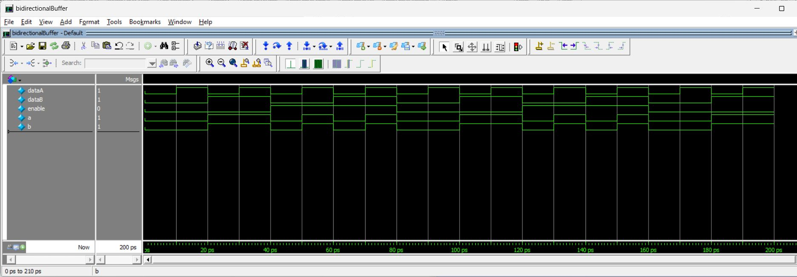
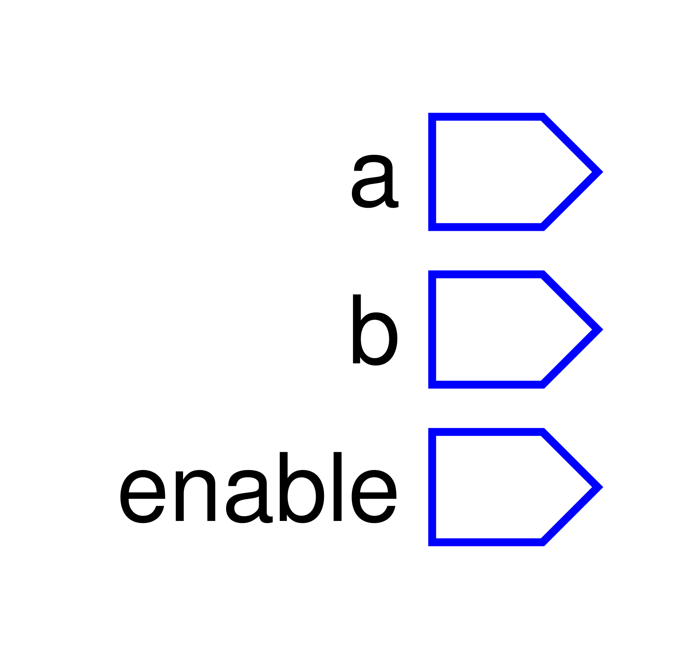

# Bidirectional buffer

[Topic index](../README.md)

RTL compilation: **PASS**. Selected testbench: **PASS**. These are compile/elaboration checks, not functional simulation results.

Synthesis provenance: historical source hashes differ from the current RTL or selected TB. Waveform provenance: the saved waveform-export record has no RTL/TB hashes, so current-source equality is unverified.

One or more saved exports use older source. The provenance notes above identify the affected kind. Re-run the current RTL and TB before using those exports as evidence of today's behavior.

**Saved simulation waveform**



**Saved synthesis RTL schematic**



## RTL: bidirectionalBuffer.v

[Editable source](../rtl/bidirectionalBuffer.v)

```verilog
// to create a RTL for bidirectional buffer
module bidirectionalBuffer(
    inout a , b ,
    input enable
);
// This is not correct , this is going to be synthesized like a mux .

bufif1(b,a,enable); // if enable is high b = a ; i.e a 10 ns pulse according to my tb
bufif0(a,b,enable) ;  // if enable is low , a = b ; i.e a 20 ns pulse according to my tb
// but this one will synthesize into a real bidirectional buffer
//tranif1(a ,b , enable) ;
endmodule
```

## Testbench: bidirectionalBuffer_tb.v

[Editable testbench](../tb/bidirectionalBuffer_tb.v) · Simulation top: `bidirectionalBuffer_tb`

```verilog
module bidirectionalBuffer_tb ;
  wire a , b ;
  reg enable ;
  reg dataA ;
  reg dataB;
  bidirectionalBuffer dut (
    .a(a) ,
    .b(b) ,
    .enable(enable)
  ) ;
  // a and b are inout connections , and they require net type connections , to be resolved .
  // hence i will assign to wire's a and b
  initial begin
    dataA = 1'b0 ;
    dataB = 1'b0 ;
    enable = 1'b0 ;

  end
  always #10 dataA = ~dataA ;   // a is basically a pulse of time period 10
  always #20 dataB = ~dataB ;   // b is a pulse of time period 20
  always #40 enable = ~enable ;
  assign a = (enable) ? dataA : 1'bz ;
  assign b = (enable) ? 1'bz : dataB  ;

  initial begin
    #200 ;
    $finish;
  end

endmodule
```
