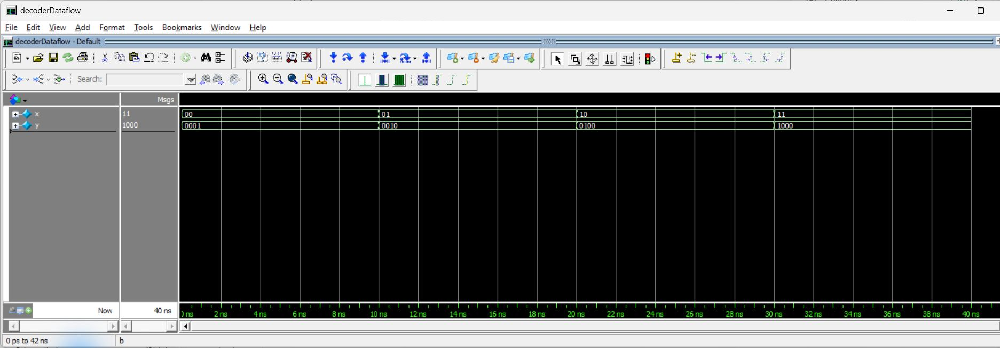
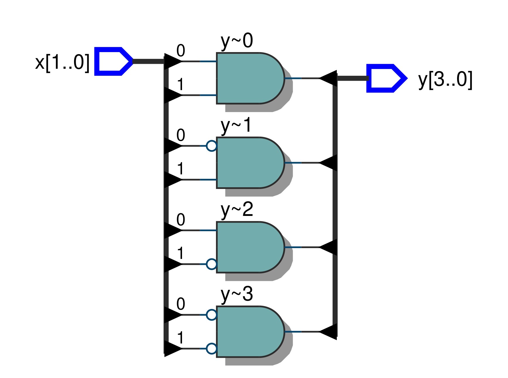

# 2-to-4 dataflow decoder

[Topic index](../README.md)

RTL compilation: **PASS**. Selected testbench: **PASS**. These are compile/elaboration checks, not functional simulation results.

Synthesis provenance: saved RTL/TB hashes match the imported source. Waveform provenance: the saved waveform-export record has no RTL/TB hashes, so current-source equality is unverified.

**Saved simulation waveform**



**Saved synthesis RTL schematic**



## RTL: decoderDataflow.v

[Editable source](../rtl/decoderDataflow.v)

```verilog
module decoderDataflow(
    input [1:0] x,
    output [3:0] y
);
assign y[3] = x[1] & x[0] ;
assign y[2] = x[1] & ~x[0] ;
assign y[1] = ~x[1] & x[0] ;
assign y[0] = ~x[1] & ~x[0] ;
endmodule
```

## Testbench: decoderDataflow_tb.v

[Editable testbench](../tb/decoderDataflow_tb.v) · Simulation top: `decoderDataflow_tb`

```verilog
`timescale 1ns/1ps
module decoderDataflow_tb ;
// it was a 2 to 4 decoder
reg [1:0] x ;
wire [3:0] y ;
initial begin
    x= 2'b00;
end
decoderDataflow dut (
    .x(x),
    .y(y)
);
integer i ;
initial begin
    for(i =0; i< 4 ; i= i+1)begin
        x = i ;
        #10;
        $display("For the value x = %0b , the value in the output is :%0b " , x, y );
    end
end
endmodule
```
