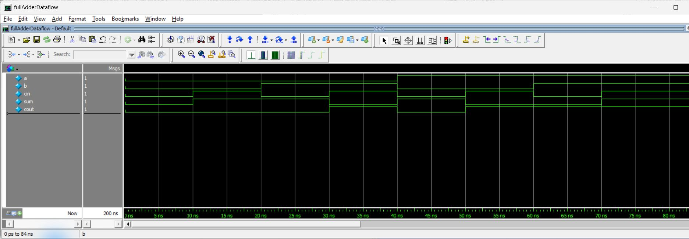
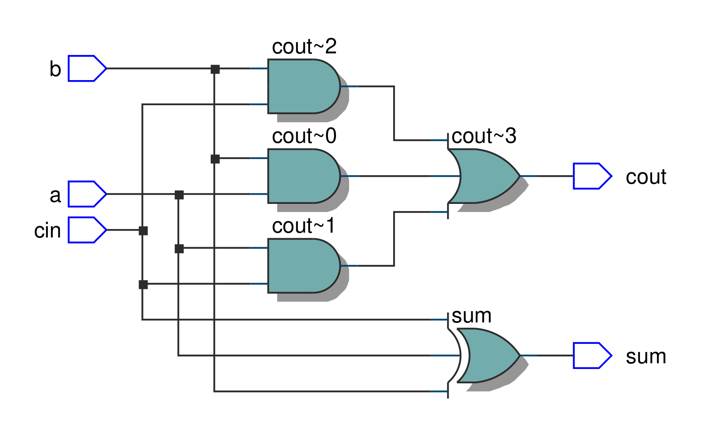

# Dataflow full adder

[Topic index](../README.md)

RTL compilation: **PASS**. Selected testbench: **PASS**. These are compile/elaboration checks, not functional simulation results.

Synthesis provenance: saved RTL/TB hashes match the imported source. Waveform provenance: the saved waveform-export record has no RTL/TB hashes, so current-source equality is unverified.

**Saved simulation waveform**



**Saved synthesis RTL schematic**



## RTL: fullAdderDataflow.v

[Editable source](../rtl/fullAdderDataflow.v)

```verilog
module fullAdderDataflow (
    input wire a , b, cin ,
    output wire cout, sum
);
assign sum = a ^ b ^ cin;
assign cout = (a & b )  | (a & cin ) | (b & cin ) ;
endmodule
```

## Testbench: fullAdderDataflow_tb.v

[Editable testbench](../tb/fullAdderDataflow_tb.v) · Simulation top: `fullAdderDataflow_tb`

```verilog
`timescale 1ns/1ps
module fullAdderDataflow_tb ;
  reg a , b, cin ;
  wire cout ;
  wire sum;
  initial begin
    a= 1'b0;
    b= 1'b0 ;
    cin = 1'b0 ;
  end
  // connecting the tb to the dut
  fullAdderDataflow dut (
    .a(a),
    .b(b),
    .cin(cin),
    .cout(cout),
    .sum(sum)
  );
  integer i ;
  initial begin
    for(i=0 ; i<8; i=i+1)begin
        {a,b,cin} = i ;
        #10;
        $display("The value of sum is : %0d for the value of a : %0d and b : %0d " , sum , a , b) ;
    end
   //$monitor("THe values for sum and carry are %0d , %0d  " , sum , cout );
  end
// why i cant use monitor here ?
    initial begin
      #200;
      $finish;

    end
endmodule
```
