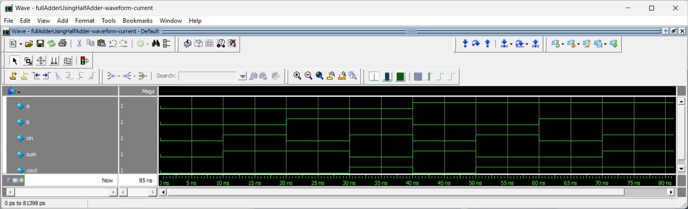
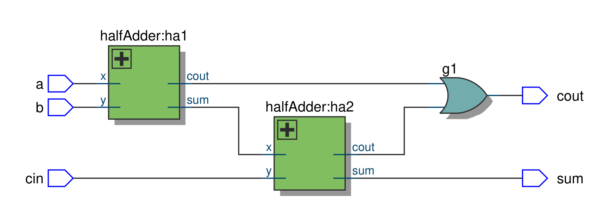

# Full adder using half adders

[Topic index](../README.md) · [Alternate testbench](#alternate-testbench)

Icarus Verilog compiles both testbenches. Each ModelSim trace matches the expected sum and carry for all eight input combinations. The selected testbench is in the tbExtra folder.



[Selected testbench VCD](../waveforms/data/fullAdderUsingHalfAdder-current.vcd) · [Earlier waveform](../waveforms/fullAdderUsingHalfAdder-waveform-original.png)

**Saved synthesis RTL schematic**



## RTL: fullAdderUsingHalfAdder.v

[Editable source](../rtl/rtlExtra/fullAdderUsingHalfAdder.v)

```verilog
module fullAdderUsingHalfAdder (
    input wire a , b, cin ,
    output wire cout , sum
);
wire w1 , w2 ,w3;
halfAdder ha1 (a ,b,w1,w2 ) ;
halfAdder ha2 (w2,cin,w3,sum);
or g1 (cout , w1,w3) ;
endmodule
module halfAdder(
    input wire x, y ,
    output wire cout , sum
);
assign cout = x & y ;
assign sum = x ^ y ;
endmodule
```

## Testbench: fullAdderUsingHalfAdder_tb.v

[Editable testbench](../tb/tbExtra/fullAdderUsingHalfAdder_tb.v) · Simulation top: `fullAdderUsingHalfAdder_tb`

```verilog
`timescale 1ns/1ps
module fullAdderUsingHalfAdder_tb ;
  reg a , b, cin ;
  wire cout ;
  wire sum;
  initial begin
    a= 1'b0;
    b= 1'b0 ;
    cin = 1'b0 ;
  end
  // connecting the tb to the dut
  fullAdderUsingHalfAdder dut (
    .a(a),
    .b(b),
    .cin(cin),
    .cout(cout),
    .sum(sum)
  );
  integer i ;
  initial begin
    for(i=0 ; i<8; i=i+1)begin
        {a,b,cin} = i ;
        #10;
        $display("The value of sum is : %0d for the value of a : %0d and b : %0d " , sum , a , b) ;
    end
   //$monitor("THe values for sum and carry are %0d , %0d  " , sum , cout );
  end
// why i cant use monitor here ?
    initial begin
      #200;
      $finish;

    end
endmodule
```

## Alternate testbench

### tb/fullAdderUsingHalfAdder_tb.v

The alternate testbench compiles and matches the expected sum and carry for all eight input combinations. [Editable draft](../tb/fullAdderUsingHalfAdder_tb.v)


[Alternate testbench VCD](../waveforms/data/fullAdderUsingHalfAdder-alternate.vcd)

```verilog
`timescale 1ns/1ps
module fullAdderUsingHalfAdder_tb ;
  reg x,y,cin;
  wire cout , sum ;
  integer i ;
  fullAdderUsingHalfAdder dut (x,y,cin,cout,sum);
  initial begin
    x = 0;
    y=0;
    cin=0;
  end
  initial begin
    for(i=0;i<8;i=i+1)begin
        {x,y,cin} = i;
        #10;

    end
  end

endmodule
```
