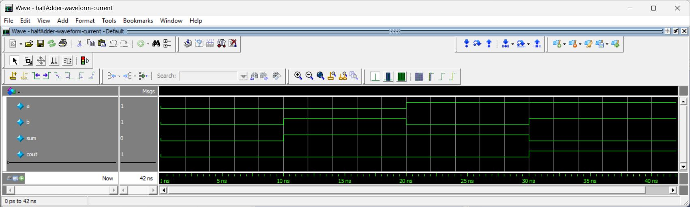
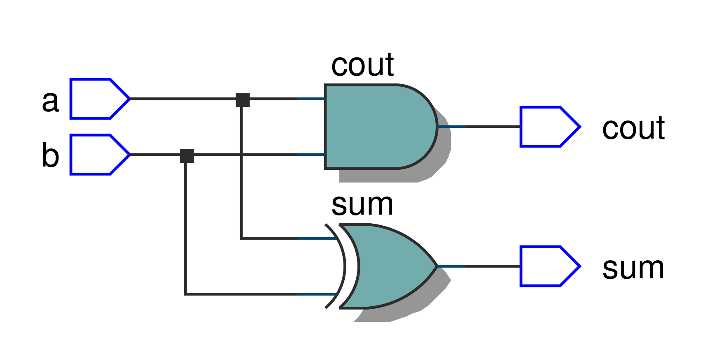
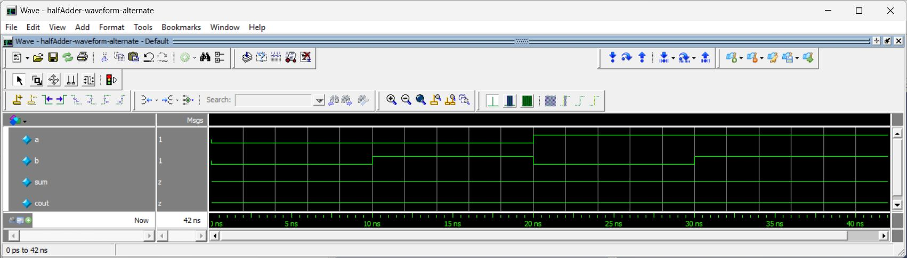

# Half adder

[Topic index](../README.md) · [Alternate testbench](#alternate-testbench)

The selected testbench compiles. The ModelSim trace matches the expected sum and carry for all four input combinations.



[Selected testbench VCD](../waveforms/data/halfAdder-current.vcd) · [Earlier waveform](../waveforms/halfAdder-waveform-original.png)

**Saved synthesis RTL schematic**



## RTL: halfAdder.v

[Editable source](../rtl/rtlExtra/halfAdder.v)

```verilog
module halfAdder(
    input wire a , b,
    output wire cout, sum
);
assign sum = a ^b;
assign cout = a & b ;
endmodule
```

## Testbench: halfAdder_tb.v

[Editable testbench](../tb/halfAdder_tb.v) · Simulation top: `halfAdder_tb`

```verilog
`timescale 1ns/1ps
module halfAdder_tb;
    reg a , b ;
    wire cout,sum;
    halfAdder dut (a , b,cout , sum);
    initial begin
        a= 0 ;
        b =0 ;
    end
    integer i ;

    initial begin
        for(i =0;i<4;i=i+1)begin
            {a,b} = i;
            #10;
        end
    end

endmodule
```

## Alternate testbench

### tb/tbExtra/halfAdder_tb.v

The alternate testbench compiles and applies all four input combinations. With no half-adder instance, both output nets stay at `Z`. [Editable draft](../tb/tbExtra/halfAdder_tb.v)



[Alternate testbench VCD](../waveforms/data/halfAdder-alternate.vcd)

```verilog
module halfAdder_tb ;
   reg a ,b ;
   wire cout , sum ;
   initial begin
    a =0;
    b=0;
   end
   integer i ;
   initial begin
      for(i =0; i< 4 ; i= i +1 )begin
        {a,b} = i ;
        #10 ;
        $display("the values for a is %0d and b is %0d and the sum is : %0d " , a, b, sum );
      end
   end
endmodule
```
