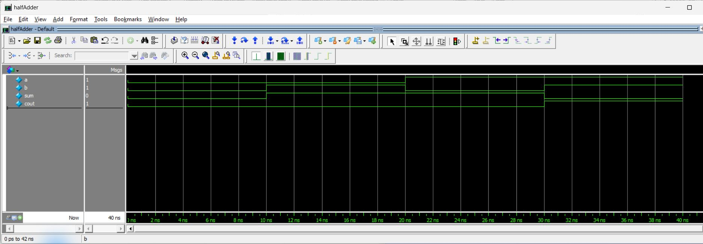

# Half adder

[Topic index](../README.md) · [Alternate testbench](#alternate-testbench)

RTL compilation: **PASS**. Selected testbench: **PASS**. These are compile/elaboration checks, not functional simulation results.

Synthesis provenance: saved RTL/TB hashes match the imported source. Waveform provenance: the saved waveform-export record has no RTL/TB hashes, so current-source equality is unverified.

The root TB is selected. The alternate tbExtra/halfAdder_tb.v is retained as an unfinished draft.

**Saved simulation waveform**



**Saved synthesis RTL schematic**


## RTL: halfAdder.v

[Editable source](../rtl/rtlExtra/halfAdder.v)

```verilog
module halfAdder(
    input wire a , b,
    output wire cout, sum
);
assign sum = a ^b;
assign cout = a & b ;
endmodule
```

## Testbench: halfAdder_tb.v

[Editable testbench](../tb/halfAdder_tb.v) · Simulation top: `halfAdder_tb`

```verilog
`timescale 1ns/1ps
module halfAdder_tb;
    reg a , b ;
    wire cout,sum;
    halfAdder dut (a , b,cout , sum);
    initial begin
        a=0 ;
        b =0;
    end
    integer i ;

    initial begin
        for(i =0;i<4;i=i+1)begin
            {a,b} = i;
            #10;
        end
    end

endmodule
```

## Alternate testbench

### tb/tbExtra/halfAdder_tb.v

Compile/elaboration: **FAIL**. [Editable draft](../tb/tbExtra/halfAdder_tb.v)

```verilog
module halfAdder_tb ;
   reg a ,b ,
   wire cout , sum ;
   initial begin
    a =0;
    b=0;
   end
   integer i ;
   initial begin
      for(i =0; i< 4 ; i= i +1 )begin
        {a,b} = i ;
        #10 ;
        $display("the values for a is %0d and b is %0d and the sum is : %0d " , a, b, sum );
      end
   end
endmodule
```
