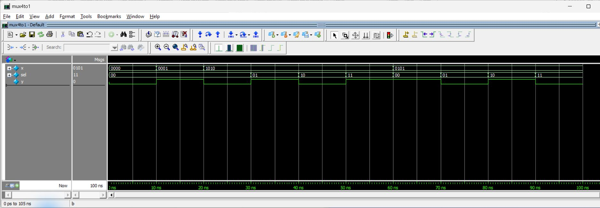
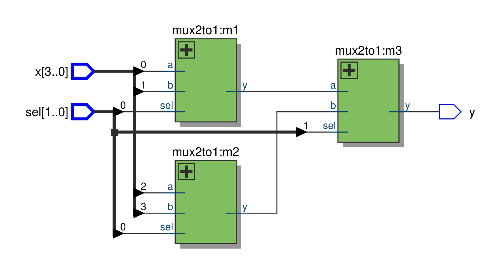

# 4-to-1 mux using 2-to-1 muxes

[Topic index](../README.md)

RTL compilation: **PASS**. Selected testbench: **PASS**. These are compile/elaboration checks, not functional simulation results.

Synthesis provenance: saved RTL/TB hashes match the imported source. Waveform provenance: the saved waveform-export record has no RTL/TB hashes, so current-source equality is unverified.

**Saved simulation waveform**



**Saved synthesis RTL schematic**



## RTL: mux4to1.v

[Editable source](../rtl/mux4to1.v)

```verilog
// To create 4 to 1 mux using 2 to 1 muxes
module mux4to1(
    input wire [3:0] x ,
    input wire [1:0] sel ,
    output wire y
);
// i can use only 2 to 1 muxes
wire w1, w2;
mux2to1 m1 (
    .a(x[0]),
    .b(x[1]),
    .sel(sel[0]),
    .y(w1)
);
mux2to1 m2 (
    .a(x[2]),
    .b(x[3]),
    .sel(sel[0]),
    .y(w2)
);
mux2to1 m3 (
    .a(w1),
    .b(w2),
    .sel(sel[1]),
    .y(y)
);
endmodule
module mux2to1(
    input wire a , b ,
    input wire sel ,
    output wire y
);
assign y = (sel)? b : a ;

endmodule
```

## Testbench: mux4to1_tb.v

[Editable testbench](../tb/mux4to1_tb.v) · Simulation top: `mux4to1_tb`

```verilog
`timescale 1ns/1ps
module mux4to1_tb ;
    reg [3:0] x ;
    reg [1:0] sel ;
    wire y ;
    mux4to1 dut (
        .x(x),
        .sel(sel),
        .y(y)
    );
    initial begin
        x = 4'b0000;
        sel = 2'b00;

    end
    task stimuli ;
      input [3:0] data ;
      input [1:0] select;
      begin
        x= data ;
        sel = select ;
        #10 ;

      end
    endtask
    initial begin
        #10;
        stimuli(4'b0001 , 2'b00);  // output 1
        stimuli(4'b1010, 2'b00);  // output 0
        stimuli(4'b1010, 2'b01);  // its gonna o/p a 1
        stimuli(4'b1010, 2'b10);  // 0
        stimuli(4'b1010, 2'b11);  // output a 1

        stimuli(4'b0101, 2'b00);  //1 output
        //last 3 should be 1's
        stimuli(4'b0101, 2'b01);
        stimuli(4'b0101, 2'b10);
        stimuli(4'b0101, 2'b11);

    end
endmodule
```
