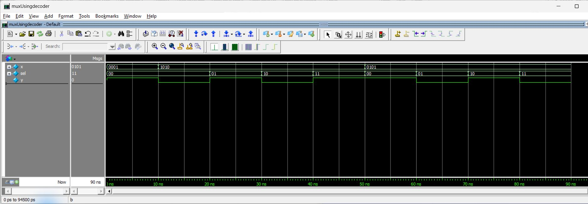
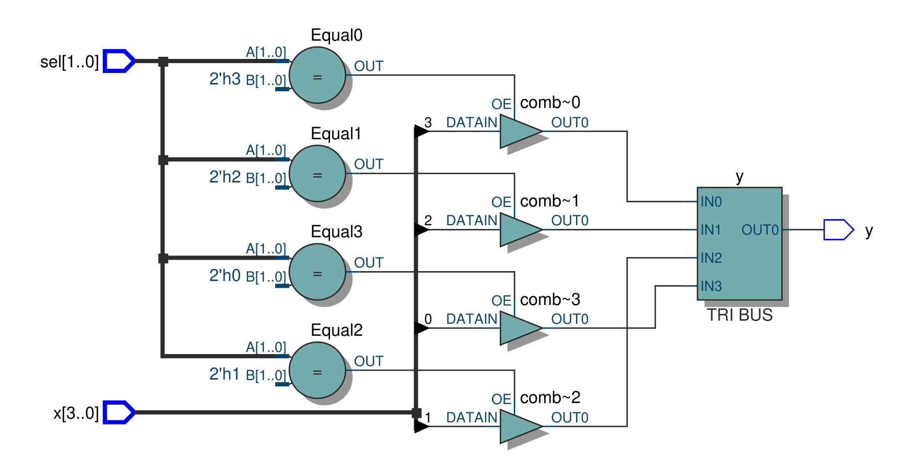

# 4-to-1 mux using a decoder

[Topic index](../README.md)

RTL compilation: **PASS**. Selected testbench: **PASS**. These are compile/elaboration checks, not functional simulation results.

Synthesis provenance: historical source hashes differ from the current RTL or selected TB. Waveform provenance: the saved waveform-export record has no RTL/TB hashes, so current-source equality is unverified.

One or more saved exports use older source. The provenance notes above identify the affected kind. Re-run the current RTL and TB before using those exports as evidence of today's behavior.

**Saved simulation waveform**



**Saved synthesis RTL schematic**



## RTL: muxUsingDecoder.v

[Editable source](../rtl/muxUsingDecoder.v)

```verilog
// 4 to 1 mux using decoder and tri state buffer
module muxUsingdecoder(
    input wire [3:0] x ,
    input wire [1:0] sel ,
    output wire y
);
// i have a decoder and a tri state buffer
// 2 to 4 decoder
wire [3:0] dOut ;
assign dOut[3] = (sel== 2'b11 ) ;
assign dOut[2] = (sel == 2'b10 ) ;
assign dOut[1] = (sel == 2'b01) ;
assign dOut[0] = (sel == 2'b00) ;
//I need to make use of tri state buffers as well for the output logic
assign y = (x[3] & dOut[3] ) |x[2] & dOut[2] | x[1] & dOut[1] | x[0] & dOut[0];

/*
this is creating 4 buffers in the synthesis

bufif1(y,x[3],dOut[3] ) ;
bufif1(y,x[2],dOut[2] ) ;
bufif1(y,x[1],dOut[1] ) ;
bufif1(y,x[0],dOut[0] ) ;
*/


endmodule
```

## Testbench: muxUsingdecoder_tb.v

[Editable testbench](../tb/muxUsingdecoder_tb.v) · Simulation top: `muxUsingdecoder_tb`

```verilog
`timescale 1ns/1ps

module muxUsingdecoder_tb ;
    reg [3:0] x ;
    reg [1:0] sel ;
    wire y ;
    initial begin
        x = 4'd0;
        sel = 2'd0 ;
        // i wont do anything to the o/p
    end
    // tb wont change cause its still functionally mux

    muxUsingdecoder dut(x , sel , y);
    // order based instantiation
    task stimuli ;
      input [3:0] data;
      input [1:0] sel_stimulus ;
      begin
        x = data;
        sel = sel_stimulus ;
        #10;
      end
    endtask
    initial begin
        stimuli(4'b0001 , 2'b00);  // output 1
        stimuli(4'b1010, 2'b00);  // output 0
        stimuli(4'b1010, 2'b01);
        stimuli(4'b1010, 2'b10);
        stimuli(4'b1010, 2'b11);

        stimuli(4'b0101, 2'b00);
        //last 3 should be 1's
        stimuli(4'b0101, 2'b01);
        stimuli(4'b0101, 2'b10);
        stimuli(4'b0101, 2'b11);

      end
 endmodule
```
