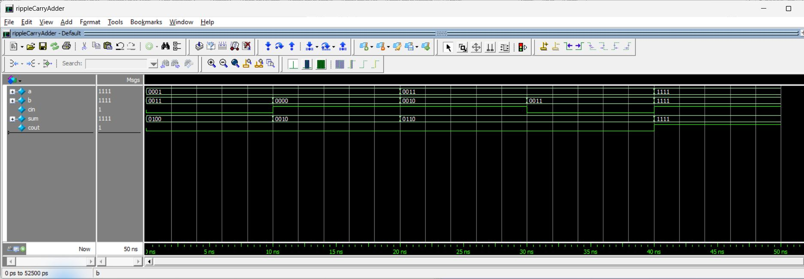

# 4-bit ripple-carry adder

[Topic index](../README.md)

RTL compilation: **PASS**. Selected testbench: **PASS**. These are compile/elaboration checks, not functional simulation results.

Synthesis provenance: historical source hashes differ from the current RTL or selected TB. Waveform provenance: the saved waveform-export record has no RTL/TB hashes, so current-source equality is unverified.

One or more saved exports use older source. The provenance notes above identify the affected kind. Re-run the current RTL and TB before using those exports as evidence of today's behavior.

**Saved simulation waveform**



## RTL: rippleCarryAdder.v

[Editable source](../rtl/rippleCarryAdder.v)

```verilog
// 4 bit ripple carry adder using 1 bit full adder
module rippleCarryAdder(
    input wire [3:0] a , b,
    input wire cin ,
    output wire [3:0] sum ,
    output wire cout
);
wire [4:0] carry ;  //why it wont be reg
assign carry[0] = cin;
assign cout = carry[4] ;

genvar i ;
generate
    for(i =0 ; i<4 ; i= i+ 1 )begin : generate4fa
        fullAdder dut (
            .a(a[i]),
            .b(b[i]),
            .cin(carry[i]),
            .sum(sum[i]),
            .cout(carry[i+1])
        );
    end
endgenerate
endmodule
module fullAdder(
    input wire a , b,  cin ,
    output wire cout , sum
);
assign sum = a ^ b ^ cin ;
assign cout = (a & b ) | (b & cin ) | (a & cin) ;
endmodule
```

## Testbench: rippleCarryAdder_tb.v

[Editable testbench](../tb/rippleCarryAdder_tb.v) · Simulation top: `rippleCarryAdder_tb`

```verilog
`timescale 1ns/1ps
module rippleCarryAdder_tb ;
  reg [3:0] a , b;
  reg cin ;
  wire cout ;
  wire [3:0] sum;
  rippleCarryAdder dut (
    .a(a),
    .b(b),
    .cin(cin),
    .sum(sum),
    .cout(cout)
  );

  initial begin
    a= 4'd0 ;
    b= 4'd0 ;
    cin = 0 ;

  end
  task stimuli;
    input [3:0] num1 ;
    input [3:0] num2;
    input carryIn ;
    begin
      a = num1;
      b= num2 ;
      cin = carryIn ;
      #10 ;

    end
 endtask
 initial begin
    stimuli(4'b0001 ,4'b0011 , 0 ) ;
    stimuli(4'b0001 , 4'b0000, 1 ) ;
    stimuli(4'b0011 , 4'b0010 , 1 ) ;
    stimuli(4'b0011 , 4'b0011 , 0 ) ;
    stimuli(4'b1111,  4'b1111 , 1 ) ;
    // overflow case

 end
endmodule
```
