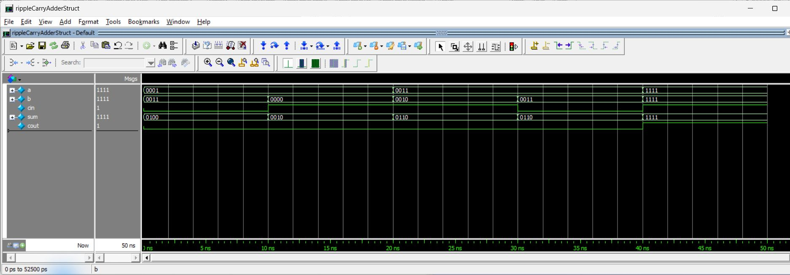
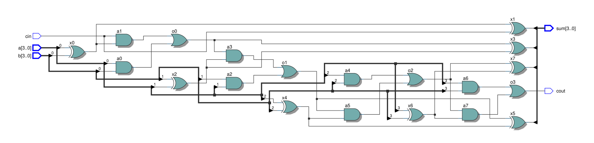

# Gate-level ripple-carry adder

[Topic index](../README.md) · [Alternate testbench](#alternate-testbench)

RTL compilation: **PASS**. Selected testbench: **PASS**. These are compile/elaboration checks, not functional simulation results.

Synthesis provenance: saved RTL/TB hashes match the imported source. Waveform provenance: the saved waveform-export record has no RTL/TB hashes, so current-source equality is unverified.

**Saved simulation waveform**



**Saved synthesis RTL schematic**



## RTL: rippleCarryAdderStruct.v

[Editable source](../rtl/rtlExtra/rippleCarryAdderStruct.v)

```verilog
module rippleCarryAdderStruct(
    input wire [3:0] a, b,
    input wire cin ,
    output wire [3:0] sum ,
    output wire cout
);
wire c0,c1,c2; // carry signals
wire p0 , p1,p2,p3; // propagate so i will call xor terms using this
wire g0,g1,g2,g3 ; // generate , so i will call the and terms using this
wire t0, t1,t2,t3;
// starting from the lsb :  bit 0
xor x0 (p0 , a[0],b[0]);  // help in propagate term
xor x1 (sum[0] , p0,cin);  // till sum
and a0 (g0,a[0],b[0]); // a & b generate term
and a1 (t0 , p0 , cin); // (a ^b )cin
or o0 (c0 , g0,t0 ); // final carry expression , (a ^ b) cin + (a & b)
// this was the lsb
// starting from the lsb :  bit 1
xor x2 (p1 , a[1],b[1]);  // help in propagate term
xor x3 (sum[1] , p1,c0);  // till sum  , c1 generated final stage of prev
and a2 (g1,a[1],b[1]); // a & b generate term
and a3 (t1 , p1 , c0); // (a ^b )cin
or o1 (c1 , g1,t1 ); // final carry expression , (a ^ b) cin + (a & b)

// bit 2
// starting from the lsb :  bit 2
xor x4 (p2 , a[2],b[2]);  // help in propagate term
xor x5 (sum[2] , p2, c1);  // till sum
and a4 (g2,a[2],b[2]); // a & b generate term
and a5 (t2 , p2 , c1); // (a ^b )cin
or o2 (c2 , g2,t2 ); // final carry expression , (a ^ b) cin + (a & b)
// bit 3 : i.e the msb
// starting from the lsb :  bit 0
xor x6 (p3 , a[3],b[3]);  // help in propagate term
xor x7 (sum[3] , p3,c2);  // till sum
and a6 (g3,a[3],b[3]); // a & b generate term
and a7 (t3 , p3 , c2); // (a ^b )cin
or o3 (cout , g3,t3 ); // final carry expression , (a ^ b) cin + (a & b)
endmodule
// bit 0 will have the carry term c0 , bit 1 have carry term c1 , .. similarly bit 3 will generate a carry of c3
```

## Testbench: ripplyCarryAdderStruct_tb.v

[Editable testbench](../tb/tbExtra/ripplyCarryAdderStruct_tb.v) · Simulation top: `rippleCarryAdderStruct_tb`

```verilog
`timescale 1ns/1ps
module rippleCarryAdderStruct_tb ;
  reg [3:0] a , b;
  reg cin ;
  wire cout ;
  wire [3:0] sum;
  rippleCarryAdderStruct dut (
    .a(a),
    .b(b),
    .cin(cin),
    .sum(sum),
    .cout(cout)
  );

  initial begin
    a= 4'd0 ;
    b= 4'd0 ;
    cin = 0 ;

  end
  task stimuli;
    input [3:0] num1 ;
    input [3:0] num2;
    input carryIn ;
    begin
      a = num1;
      b= num2 ;
      cin = carryIn ;
      #10 ;

    end
 endtask
 initial begin
    stimuli(4'b0001 ,4'b0011 , 0 ) ;
    stimuli(4'b0001 , 4'b0000, 1 ) ;
    stimuli(4'b0011 , 4'b0010 , 1 ) ;
    stimuli(4'b0011 , 4'b0011 , 0 ) ;
    stimuli(4'b1111,  4'b1111 , 1 ) ;
    // overflow case

 end
endmodule
```

## Alternate testbench

### tb/tbExtra/ripplyCarryAdderStruct.v

Compile/elaboration: **PASS**. [Editable draft](../tb/tbExtra/ripplyCarryAdderStruct.v)

```verilog
`timescale 1ns/1ps
module rippleCarryAdder_tb ;
  reg [3:0] a , b;
  reg cin ;
  wire cout ;
  wire [3:0] sum;
  rippleCarryAdderStruct dut (
    .a(a),
    .b(b),
    .cin(cin),
    .sum(sum),
    .cout(cout)
  );

  initial begin
    a= 4'd0 ;
    b= 4'd0 ;
    cin = 0 ;

  end
  task stimuli;
    input [3:0] num1 ;
    input [3:0] num2;
    input carryIn ;
    begin
      a = num1;
      b= num2 ;
      cin = carryIn ;
      #10 ;

    end
 endtask
 initial begin
    stimuli(4'b0001 ,4'b0011 , 0 ) ;
    stimuli(4'b0001 , 4'b0000, 1 ) ;
    stimuli(4'b0011 , 4'b0010 , 1 ) ;
    stimuli(4'b0011 , 4'b0011 , 0 ) ;
    stimuli(4'b1111,  4'b1111 , 1 ) ;
    // overflow case

 end
endmodule
```
