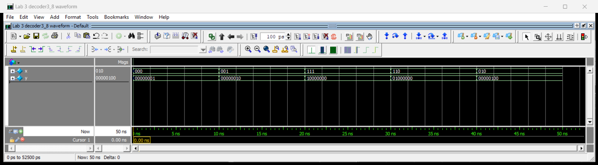
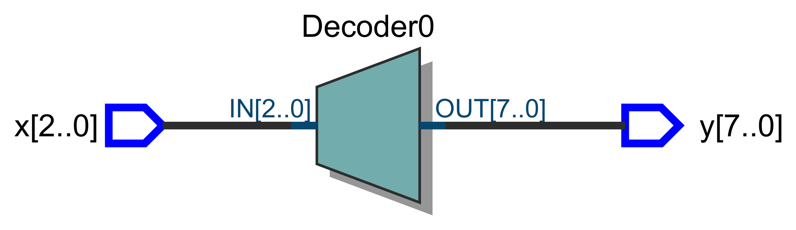

# 3-to-8 decoder

[Topic index](../README.md)

RTL compilation: **PASS**. Selected testbench: **PASS**. These are compile/elaboration checks, not functional simulation results.

Synthesis provenance: saved RTL/TB hashes match the imported source. Waveform provenance: saved RTL/TB hashes match the imported source.

**Saved simulation waveform**



**Saved synthesis RTL schematic**



## RTL: decoder3_8.v

[Editable source](../rtl/decoder3_8.v)

```verilog
module decoder3_8(
    input wire [2:0] x,
    output reg [7:0] y
);
always @(*) begin
    case (x)
      3'b000: y = 8'b00000001;
      3'b001: y = 8'b00000010;
      3'b010: y = 8'b00000100;
      3'b011: y = 8'b00001000;
      3'b100: y = 8'b00010000;
      3'b101: y = 8'b00100000;
      3'b110: y = 8'b01000000;
      3'b111: y = 8'b10000000;
      default: y = 8'b00000000;
      // CASE will create a mux ?

    endcase
end
endmodule
```

## Testbench: decoder3_8_tb.v

[Editable testbench](../tb/decoder3_8_tb.v) · Simulation top: `decoder3_8_tb`

```verilog
`timescale 1ns/1ps
module decoder3_8_tb;
  reg [2:0] x ;
  wire [7:0] y ;
  decoder3_8 dut(
    .x(x),
    .y(y)
  );
  initial begin
    x = 3'b000;
  end
  task stimuli;
    input [2:0] x_values ;
    begin
      x = x_values;
      #10 ;
    end
  endtask
  initial begin
    stimuli(3'b000);
    stimuli(3'b001);
    stimuli(3'b111) ;
    stimuli(3'b110) ;
    stimuli(3'b010) ;
    $finish ;
  end
  initial begin
    $monitor("The input given is %0d and the o/p is %0d " , x , y ) ;

  end
endmodule
```
