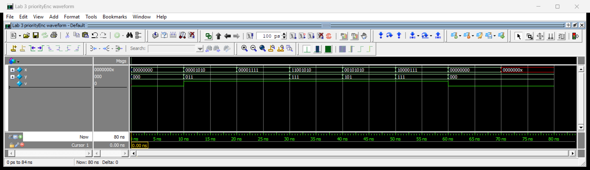
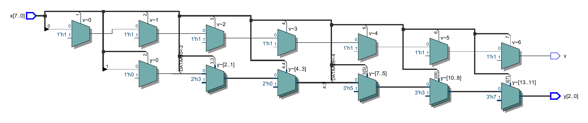

# 8-to-3 priority encoder

[Topic index](../README.md)

RTL compilation: **PASS**. Selected testbench: **PASS**. These are compile/elaboration checks, not functional simulation results.

Synthesis provenance: saved RTL/TB hashes match the imported source. Waveform provenance: saved RTL/TB hashes match the imported source.

**Saved simulation waveform**



**Saved synthesis RTL schematic**



## RTL: encoderPriority.v

[Editable source](../rtl/encoderPriority.v)

```verilog
// 8 to 3 priority encoder
module priorityEnc(
    input wire [7:0] x,
    output reg v ,
    output reg [2:0] y
);
always @(*)begin
    v = 1'b1;
    if(x[7]) begin
        y = 3'b111 ;
    end
     else if (x[6])begin
        y= 3'b110 ;

     end else if(x[5]) begin
        y= 3'b101;
     end else if (x[4])begin
        y=3'b100;

     end else if (x[3]) begin
        y=3'b011;
     end else if (x[2]) begin
        y=3'b010;
     end else if (x[1]) begin
        y=3'b001;
     end else if (x[0]) begin
        y=3'b000;
end else begin
    {y,v} = 4'b0000;
end
end
/*
always @(*)begin
    casez (x)
        8'b00000001: y= 3'b000;
        8'b0000001?: y= 3'b001;
        8'b000001??: y= 3'b010;
        8'b00001???: y= 3'b011;
        8'b0001????: y= 3'b100;
        8'b001?????: y= 3'b101;
        8'b01??????: y= 3'b110;
        8'b1???????: y= 3'b111;
        default: y= 3'b000;

    endcase
end
*/
endmodule
```

## Testbench: encoderPriority_tb.v

[Editable testbench](../tb/encoderPriority_tb.v) · Simulation top: `priorityEnc_tb`

```verilog
`timescale 1ns/1ps
module priorityEnc_tb;
  reg [7:0] x ;
  wire [2:0] y ;
  wire v ;
  priorityEnc dut (
    .x(x),
    .y(y) ,
    .v(v)
  );
  initial begin
    x= 8'd0;
  end
  task stimuli;
    input [7:0] x_values ;
    begin
        x = x_values;
        #10 ;
    end
  endtask
  initial begin
    $monitor("The input given to the encoder is %0d , and the output is %0d at the time %0t  " , x , y , $time  ) ;
    stimuli(8'b00000000);
    stimuli(8'b00001010) ;
    stimuli(8'b00001111);
    stimuli(8'b11001010) ;
    stimuli(8'b00101010);
    stimuli(8'b10000111) ;
    stimuli(8'b00000000) ; // this will give me , the output v = 0 no input is active
    stimuli(8'b0000000x) ; // this will give me v =0
    $finish;

  end
endmodule
```
