# Topic 4 - code and saved evidence

[Topic index](README.md)

[Gate-level SR latch](#srlatch) · [JK flip-flop with named operations](#jkfilpflopparameter) · [T flip-flop using a D flip-flop](#tffusingdff) · [Loadable binary up counter](#loadableupcounter) · [Loadable MOD-12 up counter](#mod12upcounter) · [Loadable binary up-down counter](#binaryupdowncounter) · [Four-bit SISO right-shift register](#siso4bits)

<a id="srlatch"></a>

## Gate-level SR latch

RTL compilation: **PASS**. Selected testbench: **PASS**. These are compile/elaboration checks, not functional simulation results.

Synthesis provenance: saved RTL/TB hashes match the imported source. Waveform provenance: saved RTL/TB hashes match the imported source.

**Saved simulation waveform**

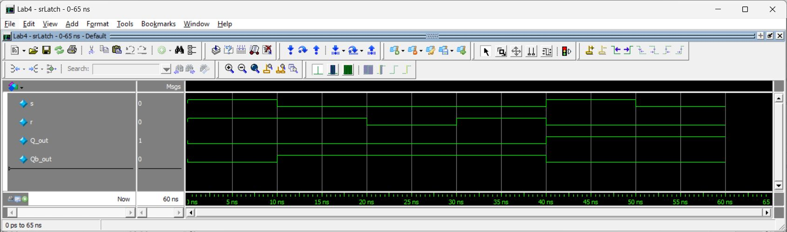

**Saved synthesis RTL schematic**

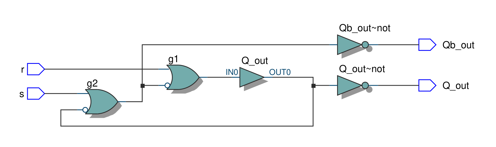

### RTL: latchSR.v

[Editable source](rtl/latchSR.v)

```verilog
// gate level modelling sr latch
module srLatch(
    input wire s,r ,
    output wire Q_out, Qb_out  // i can also make them inout port as well
);
wire w1,w2 ;
nor g1 (w1 , Qb_out , r ) ;
nor g2 (w2 , s, Q_out) ;
assign Q_out = w1;
assign Qb_out = w2;

endmodule
```

### Testbench: srLatch_tb.v

[Editable testbench](tb/srLatch_tb.v) · Simulation top: `srLatch_tb`

```verilog
`timescale 1ns/1ps

module srLatch_tb ;
  reg s , r ;
  wire Q_out , Qb_out  ;
  // to check if , both the o/p will be wires, here, or not
  srLatch dut (s , r, Q_out , Qb_out ) ;
  // diff combinations of s and r
  task srValues;
    input sval;
    input rval ;
    begin
      s= sval ;
      r = rval ;
      #10 ;

    end
  endtask
  initial begin
     srValues (1, 1 ) ;
     srValues(0 ,1 ) ;
     srValues(0,0) ;
     srValues(0,1) ;
     srValues(1,0) ;
     srValues(0, 0 ) ;

  end
endmodule
```

<a id="jkfilpflopparameter"></a>

## JK flip-flop with named operations

RTL compilation: **PASS**. Selected testbench: **PASS**. These are compile/elaboration checks, not functional simulation results.

Synthesis provenance: saved RTL/TB hashes match the imported source. Waveform provenance: saved RTL/TB hashes match the imported source.

**Saved simulation waveform**

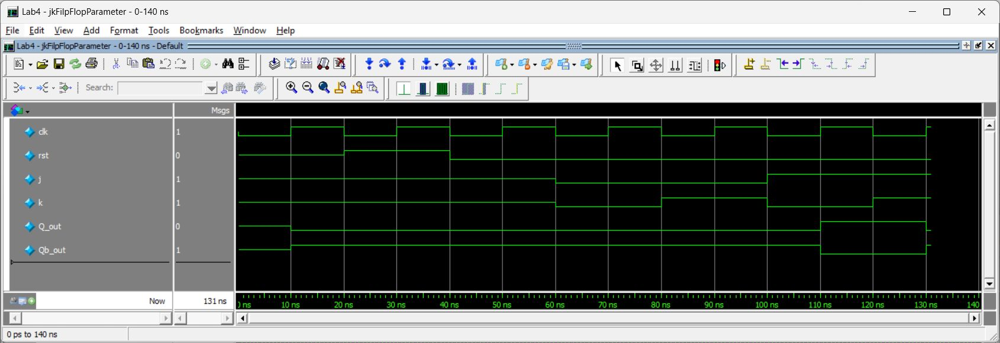

**Saved synthesis RTL schematic**

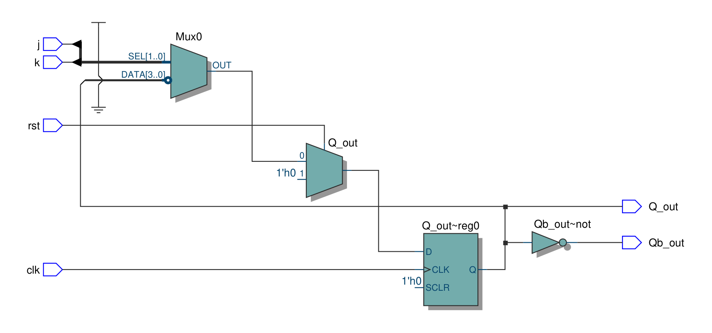

### RTL: jkFlipFlopParameter.v

[Editable source](rtl/jkFlipFlopParameter.v)

```verilog
module jkFilpFlopParameter(
    input wire j , k , rst , clk ,
    output reg Q_out,
    output wire Qb_out
);
// only for readability

parameter MEMORY= 2'b00;
parameter SET = 2'b10 ;
parameter RESET = 2'b01;
parameter TOGGLE = 2'b11 ;
always @(posedge clk )begin
    if(rst)begin
        Q_out <=1'b0;
end else begin
    case ({j,k})
      MEMORY : Q_out <= Q_out ;
      SET : Q_out <= 1'b1 ;
      RESET : Q_out <= 1'b0 ;
      TOGGLE : Q_out <=~Q_out ;
      default: Q_out <= 1'b0 ;
    endcase
end
end
assign Qb_out = ~Q_out;
endmodule
```

### Testbench: jkFilpFlopParameter_tb.v

[Editable testbench](tb/jkFilpFlopParameter_tb.v) · Simulation top: `jkFilpFlopParameter_tb`

```verilog
// TO check if the reset is working
`timescale 1ns/1ps

module jkFilpFlopParameter_tb;
    reg j , k , rst , clk ;
    wire Q_out , Qb_out ;
    jkFilpFlopParameter dut (j,k,rst,clk,Q_out , Qb_out) ;
    initial begin
        clk= 1'b0 ;

    end
    always begin
        #10 ;
        clk = ~clk ;
    end
    // to check is reset is working
    task resetWorking;
    begin
      @(negedge clk );
      rst = 1'b1 ;
      @(negedge clk ) ;
      rst = 1'b0 ;
    end
    endtask
    task inputsForJK;
      input Jinput;
      input Kinput ;
      begin
        @(negedge clk) ;  // event delay
        j= Jinput ;
        k = Kinput;
        #11;  // this fixes the timing issue , after the last toggle input

      end
    endtask
    initial begin
        resetWorking ;
        inputsForJK(1'b0 , 1'b0);
        inputsForJK(1'b0 , 1'b1) ;
        inputsForJK(1'b1, 1'b0) ;
        inputsForJK(1'b1 , 1'b1 ) ;
        $finish ;

    end
endmodule
```

<a id="tffusingdff"></a>

## T flip-flop using a D flip-flop

RTL compilation: **PASS**. Selected testbench: **PASS**. These are compile/elaboration checks, not functional simulation results.

Synthesis provenance: saved RTL/TB hashes match the imported source. Waveform provenance: saved RTL/TB hashes match the imported source.

**Saved simulation waveform**

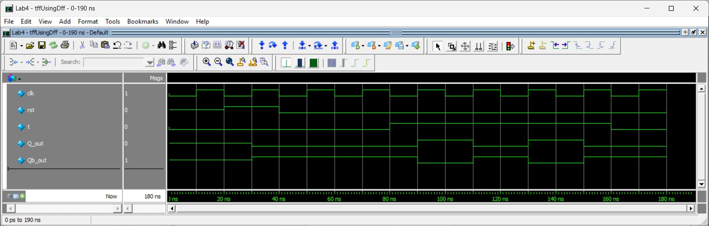

**Saved synthesis RTL schematic**

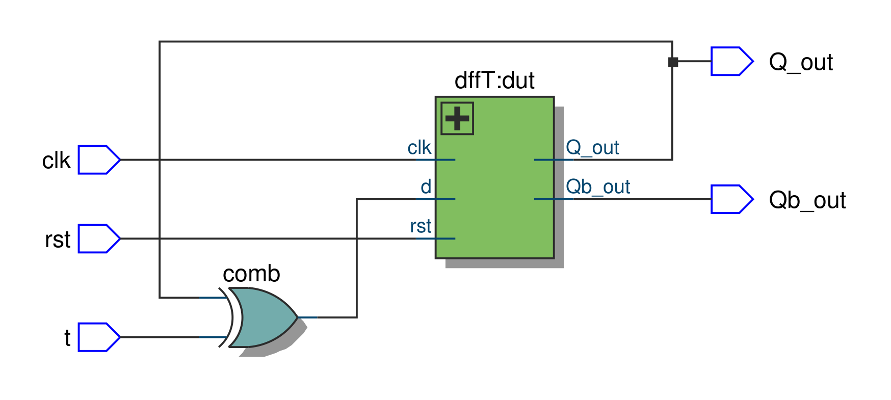

### RTL: tUsingDff.v

[Editable source](rtl/tUsingDff.v)

```verilog
`timescale 1ns/1ps
module tffUsingDff(
    input wire clk , rst, t,
    output wire  Q_out ,
    output wire Qb_out
);
// Q_out as input port , hence input to xor gate as well
// Merits vs demerits of that inout port
wire w1;
xor (w1,Q_out , t) ;
dffT dut (clk , rst,w1 ,Q_out , Qb_out);
endmodule

module dffT(
    input wire clk , rst , d ,
    output reg Q_out ,
    output wire Qb_out
);
always @(posedge clk)begin
    if(rst)begin
        Q_out<= 1'b0 ;
end else begin
    Q_out <= d ;
end
end
assign Qb_out = ~Q_out ;
endmodule
```

### Testbench: tffUsingDff_tb.v

[Editable testbench](tb/tffUsingDff_tb.v) · Simulation top: `tffUsingDff_tb`

```verilog
`timescale 1ns/1ps

module tffUsingDff_tb;
//dff dut (clk , rst,w1 ,Q_out , Qb_out);
reg clk , rst , t ;
wire Q_out , Qb_out ;
tffUsingDff dut (clk , rst , t, Q_out , Qb_out);
initial begin
    clk = 0 ;
    t=0; // how it fixes the things.
    forever #10 clk = ~clk ;
end
task rst_dut;  // can i also define task by rst_dut()
   begin
    @(negedge clk) ; // at negedge i gave rst
    rst = 1'b1 ;
    @(negedge clk) ; // then at next negedge , i made rst = 0
    rst = 1'b0 ;

   end
endtask
task din;
  input i ;
  begin
    @(negedge clk );
    t=i ;
  end
endtask
initial begin
    rst_dut ;
    din(0);
    din(1);
    din(1);
    din(1);
    din(1);
    din(0);
    #20 ;
    $finish ;
    end
endmodule
```

<a id="loadableupcounter"></a>

## Loadable binary up counter

RTL compilation: **PASS**. Selected testbench: **PASS**. These are compile/elaboration checks, not functional simulation results.

Synthesis provenance: historical source hashes differ from the current RTL or selected TB. Waveform provenance: historical source hashes differ from the current RTL or selected TB.

One or more saved exports use older source. The provenance notes above identify the affected kind. Re-run the current RTL and TB before using those exports as evidence of today's behavior.

**Saved simulation waveform**

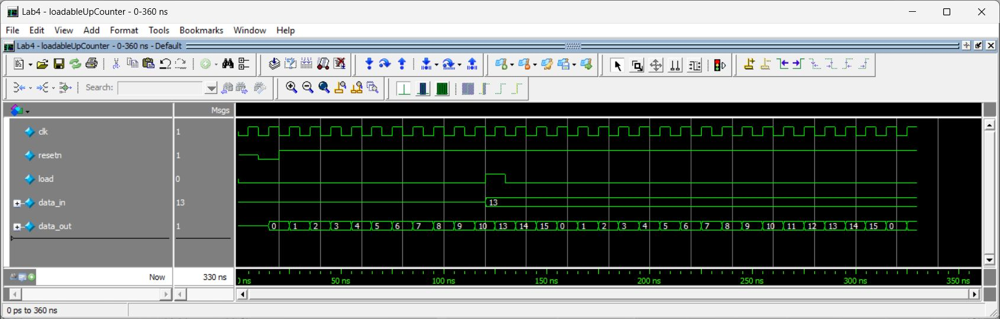

**Saved synthesis RTL schematic**

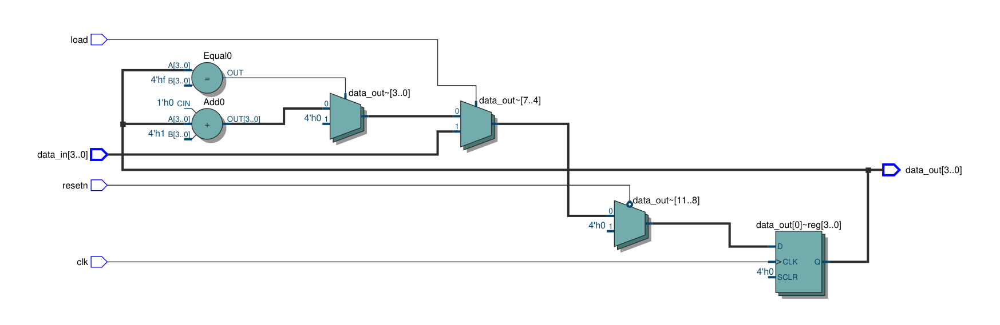

### RTL: loadableUpCounter.v

[Editable source](rtl/loadableUpCounter.v)

```verilog
// q no : 4 ) 4 bit synchronous and loadable binary  up counter

module loadableUpCounter    (
    input wire [3:0] data_in ,
    output reg [3:0] data_out ,
    input wire rst , clk ,
    input wire load
);

always @(posedge clk ) begin
    if(rst)begin
        data_out <= 4'd0 ;

    end else if(load)begin
        data_out <= data_in  ;
end else begin
    data_out<= data_out + 1'b1;
    // here i dont need to match the data_out width ?

end
end
endmodule
```

### Testbench: loadableUpCounter_tb.v

[Editable testbench](tb/loadableUpCounter_tb.v) · Simulation top: `loadableUpCounter_tb`

```verilog
`timescale 1ns/1ps

// reset , load and if its incrementing
module loadableUpCounter_tb;
/*
    input clk ,
    input wire resetn, load ,
    input wire [3:0] data_in ,
    output reg [3:0] data_out
*/
reg clk , resetn , load ;
reg [3:0] data_in ;
wire [3:0] data_out ;

loadableUpCounter dut (data_in , data_out , resetn , clk , load );
parameter CYCLE = 10 ;
// initializing the load
initial begin
  load <= 4'd0 ;

end
initial begin
    clk = 1'b0;
    forever #(CYCLE / 2) clk = ~clk ;
end
// this will also generate clock

// operation 1
task resetdut;
begin
   @(negedge clk ) ;
   resetn = 1'b1 ;
   @(negedge clk );
   resetn = 1'b0 ;
   #100 ;
end
endtask
// operation load
task loadDut;
  input loadEn ;
  input [3:0] loadData ;
  begin
    @(negedge clk) ;
    load = loadEn;
    data_in = loadData;

  end
endtask
initial begin
    resetdut ;
    //#100; // load value is ? false , count will be incremented till 10
    loadDut(1'b1, 4'd13) ;
    loadDut(1'b0 , 4'd13) ; // count value is 14 , and it will increment
    #200 ; // for next 20 clock pulse it will increment
    $finish ;

end
endmodule
```

<a id="mod12upcounter"></a>

## Loadable MOD-12 up counter

RTL compilation: **PASS**. Selected testbench: **PASS**. These are compile/elaboration checks, not functional simulation results.

Synthesis provenance: saved RTL/TB hashes match the imported source. Waveform provenance: saved RTL/TB hashes match the imported source.

**Saved simulation waveform**

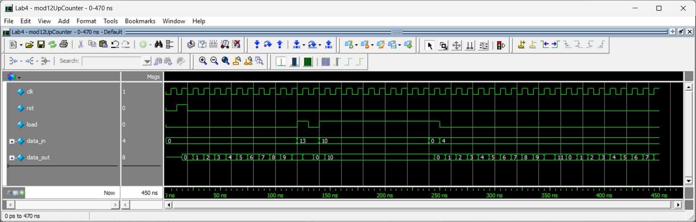

**Saved synthesis RTL schematic**

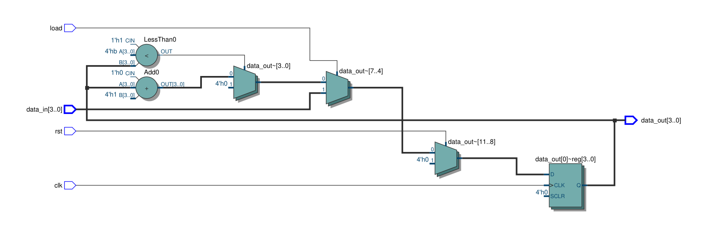

**Saved simulation waveform**

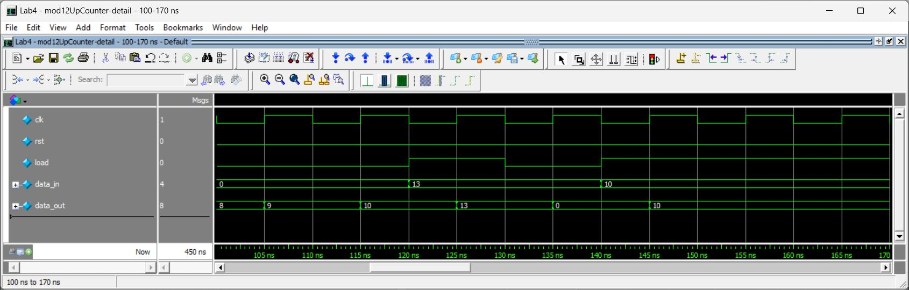

**Saved simulation waveform**


### RTL: mod12UpCounter.v

[Editable source](rtl/mod12UpCounter.v)

```verilog
module mod12UpCounter(
    // loadable , binary mod 12 up counter
    // mod is 12 hence 4 bit counting is needed
    // lodable up counter : parallel in parallel out kind of behaviour
    // rst , then load , then data_out >= 4'd11 , else i need to increment the up counter
    input wire clk, rst , load ,
    input wire [3:0] data_in,
    output reg [3:0] data_out
);

always @(posedge clk)begin
    if(rst)begin                          // 1 st priority
        data_out <= 4'b0000 ;
end else begin
    if(load)begin
        data_out<= data_in ;

    end else if(data_out >= 4'd11)begin    // if not load it will count .
        data_out  <= 4'd0 ;
end else begin
    data_out <= data_out+ 4'd1 ;

end

end
end
endmodule
```

### Testbench: mod12UpCounter_tb.v

[Editable testbench](tb/mod12UpCounter_tb.v) · Simulation top: `mod12UpCounter_tb`

```verilog
/*
    input wire clk, rst , load ,
    input wire [3:0] data_in,
    output reg [3:0] data_out

*/
`timescale 1ns/1ps

module mod12UpCounter_tb ;
reg clk , rst , load ;
reg [3:0] data_in ;
wire [3:0] data_out  ;
mod12UpCounter dut (clk , rst , load , data_in , data_out) ;
// to generate a clock
parameter cycle =10 ;
/*
always begin

    #(cycle / 2) ;  // clk = 0 ? this need clarification this will give unknowns
    clk = 1'b0   ;
    #(cycle/2 ) ;
    clk = 1'b1 ;
end
To fix this
*/
always begin
    clk = 1'b0 ;
    #(cycle / 2) ;
    clk = 1'b1 ;
    #(cycle/2 ) ;

end
initial begin
    clk = 1'b0 ;
    rst = 1'b0 ;
    load = 1'b0 ;
    data_in = 4'd0 ;
end

// reset behaviour .
 task reset_counter;
     begin
        @(negedge clk) ;
        rst = 1'b1 ;
        @(negedge clk ) ;
        rst = 1'b0 ;
     end
 endtask

 task load_check;
     input [3:0] dataInput ;
     input loadInput ;
     begin
        @(negedge clk ) ; // at first negative edge after calling this task im loading the data
        load = loadInput ;  //
        data_in = dataInput ;
     end
 endtask

  // I need to check the behaviour meeting the waveforms

 initial begin
    reset_counter ;
    #100;
    load_check(4'd13,  1'b1)  ;
    load_check(4'd13 , 1'b0 ) ;
    load_check(4'd10 , 1'b1 ) ;
    #100;
    load_check(4'd0 , 1'b1 ) ;
    load_check(4'd4 , 1'b0) ;
    #200 ;
    $finish ;

 end
endmodule
```

<a id="binaryupdowncounter"></a>

## Loadable binary up-down counter

RTL compilation: **PASS**. Selected testbench: **PASS**. These are compile/elaboration checks, not functional simulation results.

Synthesis provenance: historical source hashes differ from the current RTL or selected TB. Waveform provenance: historical source hashes differ from the current RTL or selected TB.

One or more saved exports use older source. The provenance notes above identify the affected kind. Re-run the current RTL and TB before using those exports as evidence of today's behavior.

**Saved simulation waveform**

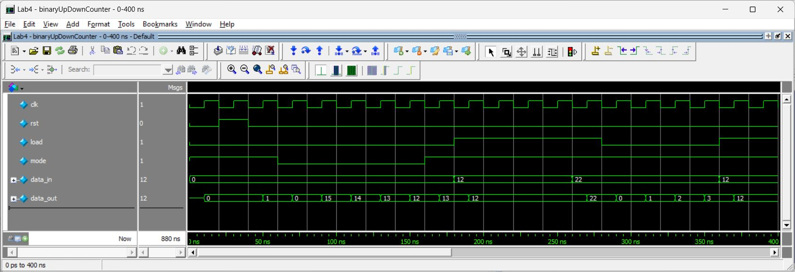

**Saved synthesis RTL schematic**

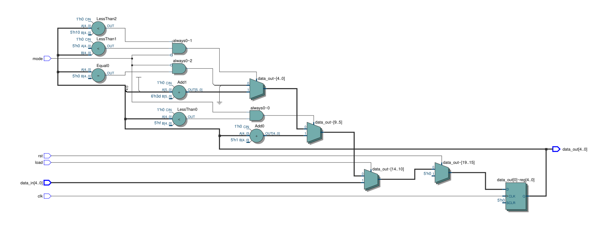

### RTL: binaryUpDownCounter.v

[Editable source](rtl/binaryUpDownCounter.v)

```verilog
// q no : 4 ) 4 bit synchronous and loadable binary  up counter

module binaryUpDownCounter(
    input wire [3:0] data_in ,
    output reg [3:0] data_out ,
    input wire rst , clk ,
    input wire load ,
    input wire direction

);

always @(posedge clk ) begin
    if(rst)begin
        data_out <= 4'd0 ;

    end else if(load)begin
        data_out <= data_in  ;
end else begin
    if(direction)begin
        //4 bit and up counting
        if(data_out>= 4'd15)
            data_out <= 4'd0 ;
        else
            data_out <= data_out + 1'b1 ;
end else begin
    // if not up its a down counter
    // hence i will count down
    if(data_out<=4'd0)
        data_out <= 4'd15;
    else
        data_out <= data_out - 1'b1 ;
end
end
end
endmodule
```

### Testbench: binaryUpDownCounter_tb.v

[Editable testbench](tb/binaryUpDownCounter_tb.v) · Simulation top: `binaryUpDownCounter_tb`

```verilog
`timescale 1ns/1ps
// 4 bit binary and loadable up down counter
// i dont think i need to take care of the rollover by default its taken care in a 4 bit
// only if the count is not 0 to 15 i.e mod 16 i need to take care of that
/*
module binaryUpDownCounter(
    input clk ,rst , mode ,
    input load ,
    input wire [3:0] data_in,
    output wire [3:0] data_out
);
*/
module binaryUpDownCounter_tb ;
  reg clk  , rst , mode ;
  wire [3:0] data_out ;
  reg [3:0] data_in;
  reg load ;
  binaryUpDownCounter dut (
    .clk(clk ) ,
    .rst(rst),
    .data_out(data_out),
    .data_in(data_in),
    .load(load) ,
    .direction(mode)
  );
  parameter count = 20 ;

  initial begin
    clk= 1'b0 ;
    rst = 1'b0;
    mode = 1'b1 ; // up counter by default
    load = 1'b0;
    data_in = 4'd0 ;
  end
  //should i use always @(*) or like this
  always #(count/2) clk = ~clk ;

  task resetUpDown;
  begin
     @(negedge clk) ;
     rst = 1'b1;
     @(negedge clk );
     rst = 1'b0 ;
  end
  endtask
  // can i mix # and a @(negedge clk ) or not
  task load_check;
      input [3:0] data_in_val ;
      input loadVal;
      begin
          data_in = data_in_val ;
          load  = loadVal ;
          #(count) ;
      end
  endtask
  task modeCheck;
  begin
    #(count);
    mode = 1'b0; // a down count
    #(count*5);
    mode = 1'b1 ;
    #(count);
  end
  endtask
  initial begin
    resetUpDown ;
    modeCheck;
    load_check(4'd12 , 1'b1 ) ;
    #(count*3);
    load_check(4'd22, 1'b1) ;
    load_check(4'd22, 1'b0 ) ;
    #(count*3);
    load_check(4'd12 , 1'b1 );
    #500;
    $finish;
  end
endmodule
```

<a id="siso4bits"></a>

## Four-bit SISO right-shift register

RTL compilation: **PASS**. Selected testbench: **PASS**. These are compile/elaboration checks, not functional simulation results.

Synthesis provenance: saved RTL/TB hashes match the imported source. Waveform provenance: saved RTL/TB hashes match the imported source.

**Saved simulation waveform**

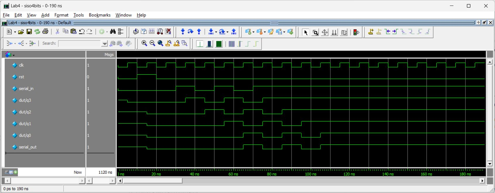

**Saved synthesis RTL schematic**

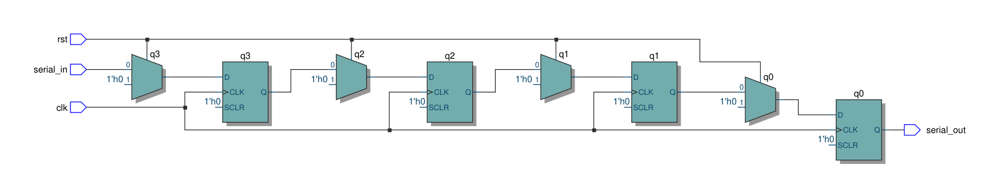

### RTL: siso.v

[Editable source](rtl/siso.v)

```verilog
module siso4bits(
    // 4 bit cause i can store internally 4 bits
    input wire clk , rst ,
    input wire serial_in,
    output wire serial_out
);
reg q3,q2,q1,q0 ; // 4 bits of data will be stored
// q3, q2,q1,q0
// serial_in goes to q3 (msb) , serial_out receives q0 , this happens at every clock edge

always @(posedge clk)begin
    if(rst)begin
        {q3,q2,q1,q0}<=4'b0000;
end else begin

    q3<= serial_in ;
    q2<= q3;
    q1<= q2;
    q0<= q1;
    //serial_out<= q0; // this willmake a 5th flip flop so
    // this is a right shift operation for higher no of bits
    // i can do something like this
    // reg [3:0] data
    // data<= {serial_in,data[MSB:LSB+1]} ;  for right shift
    // data<= {data[MSB-1:0] , serial_in} ;  for left shift
 end
end
assign serial_out= q0 ;
endmodule
```

### Testbench: siso_tb.v

[Editable testbench](tb/siso_tb.v) · Simulation top: `siso4bits_tb`

```verilog
`timescale 1ns/1ps
module siso4bits_tb;
    reg clk , rst ;
    reg serial_in ;
    wire serial_out ;
    siso4bits dut (
        .clk(clk),
        .rst(rst),
        .serial_in(serial_in),
        .serial_out(serial_out)
    );
    parameter t=10;
    initial begin
        clk=1'b0;
        rst=1'b0;
        serial_in=1'b0;
    end
    always #(t/2) clk = ~clk ; // clock period is 5

    // to verify if reset is working or serial output is working
    task resetSISO;
      begin
        @(negedge clk);
        rst =1'b1;
        @(negedge clk);
        rst=1'b0 ;

      end
    endtask
    task dataShift;
      input data;
      begin
        @(negedge clk);
        serial_in = data;
      end
    endtask
    initial begin
        resetSISO ;
        dataShift(1);
        dataShift(0);
        dataShift(1);
        dataShift(0);
        dataShift(1);
        dataShift(1);
        dataShift(1);
        dataShift(1);
        dataShift(1);
        dataShift(1);
        #1000;
        $finish ;

    end
endmodule
```
