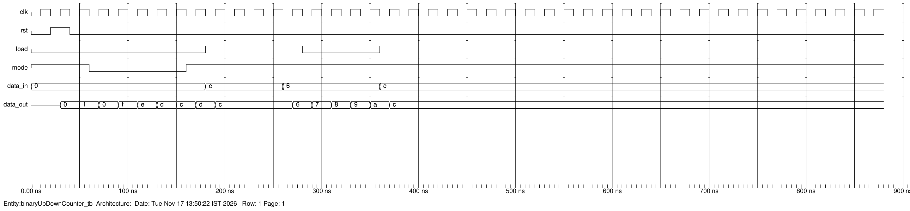
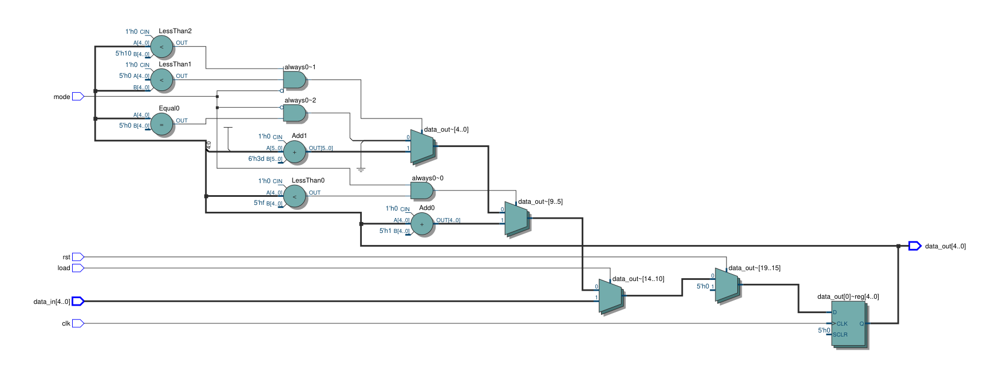

# Loadable binary up-down counter

[Topic index](../README.md)

Icarus Verilog compiles the RTL and the saved testbench.

The testbench loads a value and exercises both count directions. Its four-bit literal `4'd22` truncates to 6. The final load stays asserted and holds decimal 12.

**ModelSim waveform (saved testbench)**



**Quartus RTL schematic**



[Saved testbench VCD](../waveforms/data/binaryUpDownCounter-verification.vcd) · [Saved testbench WLF](../waveforms/data/binaryUpDownCounter-verification.wlf)

## RTL: binaryUpDownCounter.v

[Editable source](../rtl/binaryUpDownCounter.v)

```verilog
// q no : 4 ) 4 bit synchronous and loadable binary  up counter

module binaryUpDownCounter(
    input wire [3:0] data_in ,
    output reg [3:0] data_out ,
    input wire rst , clk ,
    input wire load ,
    input wire direction

);

always @(posedge clk ) begin
    if(rst)begin
        data_out <= 4'd0 ;

    end else if(load)begin
        data_out <= data_in  ;
end else begin
    if(direction)begin
        //4 bit and up counting
        if(data_out>= 4'd15)
            data_out <= 4'd0 ;
        else
            data_out <= data_out + 1'b1 ;
end else begin
    // if not up its a down counter
    // hence i will count down
    if(data_out<=4'd0)
        data_out <= 4'd15;
    else
        data_out <= data_out - 1'b1 ;
end
end
end
endmodule
```

## Testbench: binaryUpDownCounter_tb.v

[Editable testbench](../tb/binaryUpDownCounter_tb.v) · Simulation top: `binaryUpDownCounter_tb`

```verilog
`timescale 1ns/1ps
// 4 bit binary and loadable up down counter
// i dont think i need to take care of the rollover by default its taken care in a 4 bit
// only if the count is not 0 to 15 i.e mod 16 i need to take care of that
/*
module binaryUpDownCounter(
    input clk ,rst , mode ,
    input load ,
    input wire [3:0] data_in,
    output wire [3:0] data_out
);
*/
module binaryUpDownCounter_tb ;
  reg clk  , rst , mode ;
  wire [3:0] data_out ;
  reg [3:0] data_in;
  reg load ;
  binaryUpDownCounter dut (
    .clk(clk ) ,
    .rst(rst),
    .data_out(data_out),
    .data_in(data_in),
    .load(load) ,
    .direction(mode)
  );
  parameter count = 20 ;

  initial begin
    clk= 1'b0 ;
    rst = 1'b0;
    mode = 1'b1 ; // up counter by default
    load = 1'b0;
    data_in = 4'd0 ;
  end
  //should i use always @(*) or like this
  always #(count/2) clk = ~clk ;

  task resetUpDown;
  begin
     @(negedge clk) ;
     rst = 1'b1;
     @(negedge clk );
     rst = 1'b0 ;
  end
  endtask
  // can i mix # and a @(negedge clk ) or not
  task load_check;
      input [3:0] data_in_val ;
      input loadVal;
      begin
          data_in = data_in_val ;
          load  = loadVal ;
          #(count) ;
      end
  endtask
  task modeCheck;
  begin
    #(count);
    mode = 1'b0; // a down count
    #(count*5);
    mode = 1'b1 ;
    #(count);
  end
  endtask
  initial begin
    resetUpDown ;
    modeCheck;
    load_check(4'd12 , 1'b1 ) ;
    #(count*3);
    load_check(4'd22, 1'b1) ;
    load_check(4'd22, 1'b0 ) ;
    #(count*3);
    load_check(4'd12 , 1'b1 );
    #500;
    $finish;
  end
endmodule
```
