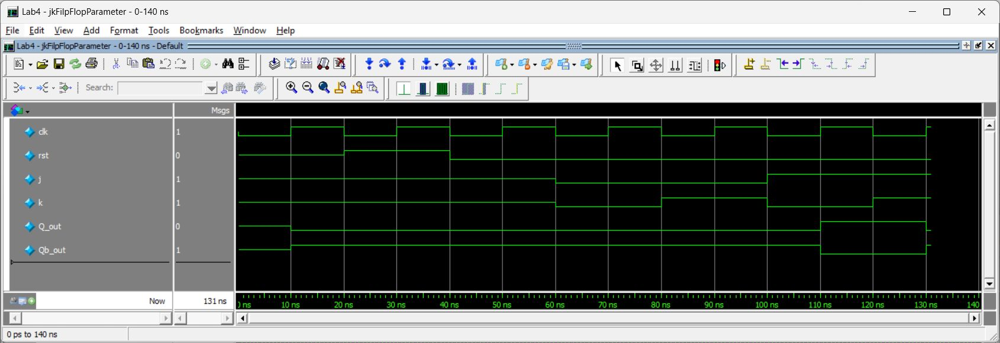
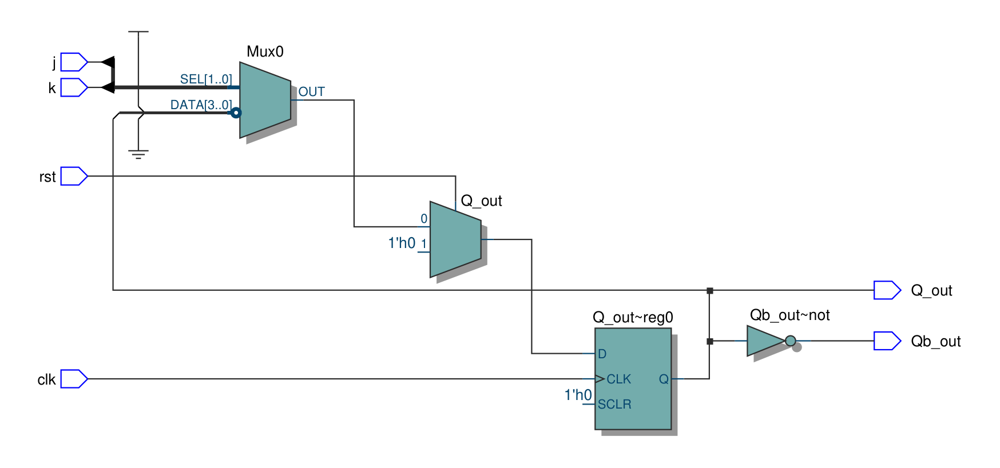

# JK flip-flop with named operations

[Topic index](../README.md)

RTL compilation: **PASS**. Selected testbench: **PASS**. These are compile/elaboration checks, not functional simulation results.

Synthesis provenance: saved RTL/TB hashes match the imported source. Waveform provenance: saved RTL/TB hashes match the imported source.

**Saved simulation waveform**



**Saved synthesis RTL schematic**



## RTL: jkFlipFlopParameter.v

[Editable source](../rtl/jkFlipFlopParameter.v)

```verilog
module jkFilpFlopParameter(
    input wire j , k , rst , clk ,
    output reg Q_out,
    output wire Qb_out
);
// only for readability

parameter MEMORY= 2'b00;
parameter SET = 2'b10 ;
parameter RESET = 2'b01;
parameter TOGGLE = 2'b11 ;
always @(posedge clk )begin
    if(rst)begin
        Q_out <=1'b0;
end else begin
    case ({j,k})
      MEMORY : Q_out <= Q_out ;
      SET : Q_out <= 1'b1 ;
      RESET : Q_out <= 1'b0 ;
      TOGGLE : Q_out <=~Q_out ;
      default: Q_out <= 1'b0 ;
    endcase
end
end
assign Qb_out = ~Q_out;
endmodule
```

## Testbench: jkFilpFlopParameter_tb.v

[Editable testbench](../tb/jkFilpFlopParameter_tb.v) · Simulation top: `jkFilpFlopParameter_tb`

```verilog
// TO check if the reset is working
`timescale 1ns/1ps

module jkFilpFlopParameter_tb;
    reg j , k , rst , clk ;
    wire Q_out , Qb_out ;
    jkFilpFlopParameter dut (j,k,rst,clk,Q_out , Qb_out) ;
    initial begin
        clk= 1'b0 ;

    end
    always begin
        #10 ;
        clk = ~clk ;
    end
    // to check is reset is working
    task resetWorking;
    begin
      @(negedge clk );
      rst = 1'b1 ;
      @(negedge clk ) ;
      rst = 1'b0 ;
    end
    endtask
    task inputsForJK;
      input Jinput;
      input Kinput ;
      begin
        @(negedge clk) ;  // event delay
        j= Jinput ;
        k = Kinput;
        #11;  // this fixes the timing issue , after the last toggle input

      end
    endtask
    initial begin
        resetWorking ;
        inputsForJK(1'b0 , 1'b0);
        inputsForJK(1'b0 , 1'b1) ;
        inputsForJK(1'b1, 1'b0) ;
        inputsForJK(1'b1 , 1'b1 ) ;
        $finish ;

    end
endmodule
```
