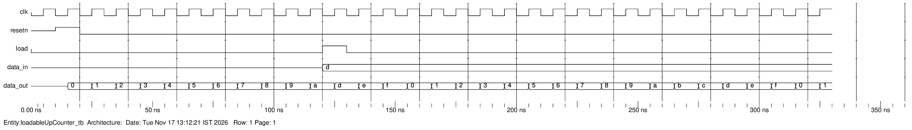
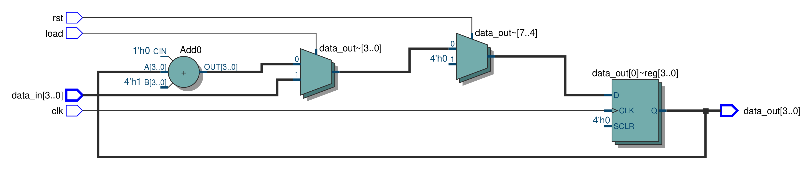

# Loadable binary up counter

[Topic index](../README.md)

Icarus Verilog compiles the RTL and the saved testbench.

The testbench asserts synchronous reset high, loads decimal 13 and runs through four-bit wraparound. Its local reset signal is named `resetn`.

**ModelSim waveform (saved testbench)**



**Quartus RTL schematic**



[Saved testbench VCD](../waveforms/data/loadableUpCounter-verification.vcd) · [Saved testbench WLF](../waveforms/data/loadableUpCounter-verification.wlf)

## RTL: loadableUpCounter.v

[Editable source](../rtl/loadableUpCounter.v)

```verilog
// q no : 4 ) 4 bit synchronous and loadable binary  up counter

module loadableUpCounter    (
    input wire [3:0] data_in ,
    output reg [3:0] data_out ,
    input wire rst , clk ,
    input wire load
);

always @(posedge clk ) begin
    if(rst)begin
        data_out <= 4'd0 ;

    end else if(load)begin
        data_out <= data_in  ;
end else begin
    data_out<= data_out + 1'b1;
    // here i dont need to match the data_out width ?

end
end
endmodule
```

## Testbench: loadableUpCounter_tb.v

[Editable testbench](../tb/loadableUpCounter_tb.v) · Simulation top: `loadableUpCounter_tb`

```verilog
`timescale 1ns/1ps

// reset , load and if its incrementing
module loadableUpCounter_tb;
/*
    input clk ,
    input wire resetn, load ,
    input wire [3:0] data_in ,
    output reg [3:0] data_out
*/
reg clk , resetn , load ;
reg [3:0] data_in ;
wire [3:0] data_out ;

loadableUpCounter dut (data_in , data_out , resetn , clk , load );
parameter CYCLE = 10 ;
// initializing the load
initial begin
  load <= 4'd0 ;

end
initial begin
    clk = 1'b0;
    forever #(CYCLE / 2) clk = ~clk ;
end
// this will also generate clock

// operation 1
task resetdut;
begin
   @(negedge clk ) ;
   resetn = 1'b1 ;
   @(negedge clk );
   resetn = 1'b0 ;
   #100 ;
end
endtask
// operation load
task loadDut;
  input loadEn ;
  input [3:0] loadData ;
  begin
    @(negedge clk) ;
    load = loadEn;
    data_in = loadData;

  end
endtask
initial begin
    resetdut ;
    //#100; // load value is ? false , count will be incremented till 10
    loadDut(1'b1, 4'd13) ;
    loadDut(1'b0 , 4'd13) ; // count value is 14 , and it will increment
    #200 ; // for next 20 clock pulse it will increment
    $finish ;

end
endmodule
```
