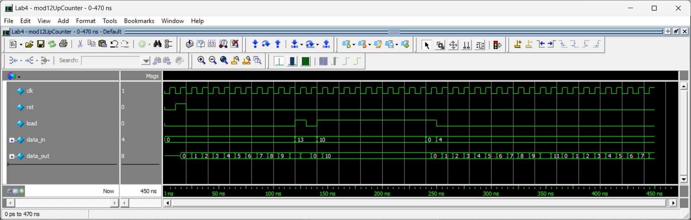
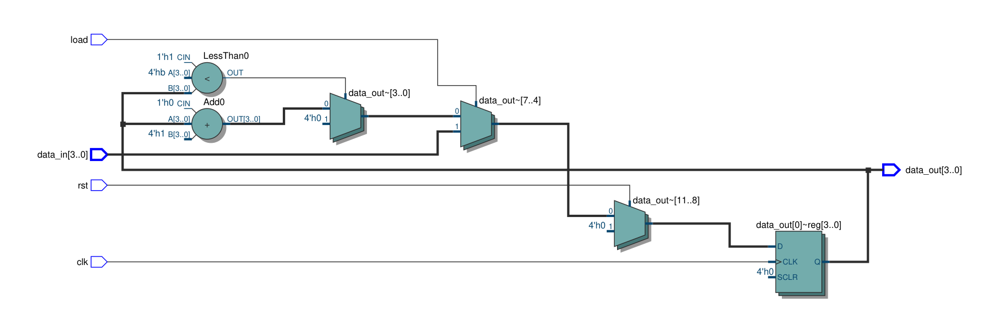
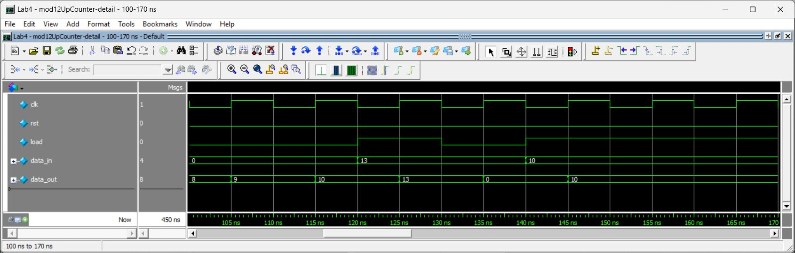

# Loadable MOD-12 up counter

[Topic index](../README.md)

RTL compilation: **PASS**. Selected testbench: **PASS**. These are compile/elaboration checks, not functional simulation results.

Synthesis provenance: saved RTL/TB hashes match the imported source. Waveform provenance: saved RTL/TB hashes match the imported source.

**Saved simulation waveform**



**Saved synthesis RTL schematic**



**Saved simulation waveform**



**Saved simulation waveform**


## RTL: mod12UpCounter.v

[Editable source](../rtl/mod12UpCounter.v)

```verilog
module mod12UpCounter(
    // loadable , binary mod 12 up counter
    // mod is 12 hence 4 bit counting is needed
    // lodable up counter : parallel in parallel out kind of behaviour
    // rst , then load , then data_out >= 4'd11 , else i need to increment the up counter
    input wire clk, rst , load ,
    input wire [3:0] data_in,
    output reg [3:0] data_out
);

always @(posedge clk)begin
    if(rst)begin                          // 1 st priority
        data_out <= 4'b0000 ;
end else begin
    if(load)begin
        data_out<= data_in ;

    end else if(data_out >= 4'd11)begin    // if not load it will count .
        data_out  <= 4'd0 ;
end else begin
    data_out <= data_out+ 4'd1 ;

end

end
end
endmodule
```

## Testbench: mod12UpCounter_tb.v

[Editable testbench](../tb/mod12UpCounter_tb.v) · Simulation top: `mod12UpCounter_tb`

```verilog
/*
    input wire clk, rst , load ,
    input wire [3:0] data_in,
    output reg [3:0] data_out

*/
`timescale 1ns/1ps

module mod12UpCounter_tb ;
reg clk , rst , load ;
reg [3:0] data_in ;
wire [3:0] data_out  ;
mod12UpCounter dut (clk , rst , load , data_in , data_out) ;
// to generate a clock
parameter cycle =10 ;
/*
always begin

    #(cycle / 2) ;  // clk = 0 ? this need clarification this will give unknowns
    clk = 1'b0   ;
    #(cycle/2 ) ;
    clk = 1'b1 ;
end
To fix this
*/
always begin
    clk = 1'b0 ;
    #(cycle / 2) ;
    clk = 1'b1 ;
    #(cycle/2 ) ;

end
initial begin
    clk = 1'b0 ;
    rst = 1'b0 ;
    load = 1'b0 ;
    data_in = 4'd0 ;
end

// reset behaviour .
 task reset_counter;
     begin
        @(negedge clk) ;
        rst = 1'b1 ;
        @(negedge clk ) ;
        rst = 1'b0 ;
     end
 endtask

 task load_check;
     input [3:0] dataInput ;
     input loadInput ;
     begin
        @(negedge clk ) ; // at first negative edge after calling this task im loading the data
        load = loadInput ;  //
        data_in = dataInput ;
     end
 endtask

  // I need to check the behaviour meeting the waveforms

 initial begin
    reset_counter ;
    #100;
    load_check(4'd13,  1'b1)  ;
    load_check(4'd13 , 1'b0 ) ;
    load_check(4'd10 , 1'b1 ) ;
    #100;
    load_check(4'd0 , 1'b1 ) ;
    load_check(4'd4 , 1'b0) ;
    #200 ;
    $finish ;

 end
endmodule
```
