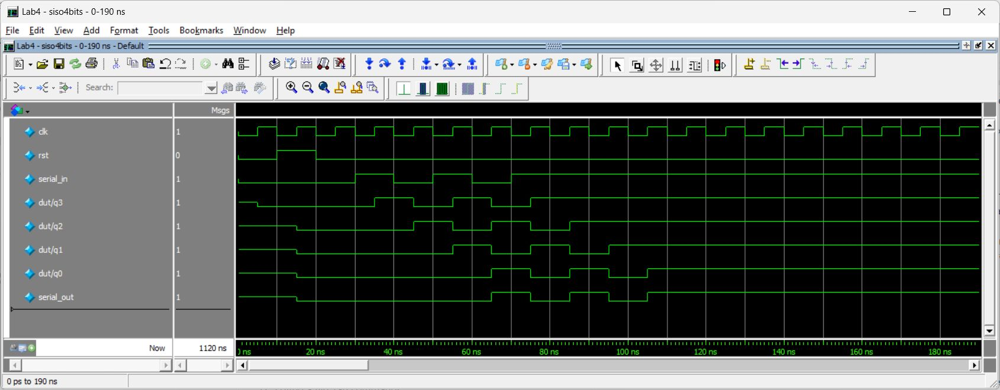
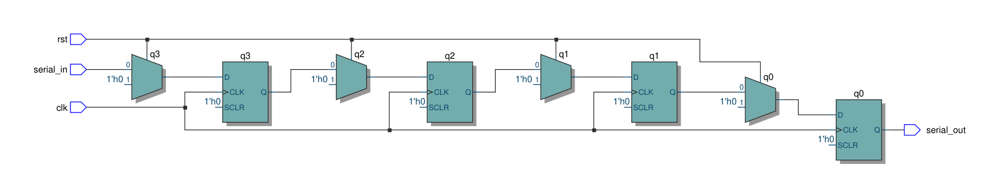

# Four-bit SISO right-shift register

[Topic index](../README.md)

RTL compilation: **PASS**. Selected testbench: **PASS**. These are compile/elaboration checks, not functional simulation results.

Synthesis provenance: saved RTL/TB hashes match the imported source. Waveform provenance: saved RTL/TB hashes match the imported source.

**Saved simulation waveform**



**Saved synthesis RTL schematic**



## RTL: siso.v

[Editable source](../rtl/siso.v)

```verilog
module siso4bits(
    // 4 bit cause i can store internally 4 bits
    input wire clk , rst ,
    input wire serial_in,
    output wire serial_out
);
reg q3,q2,q1,q0 ; // 4 bits of data will be stored
// q3, q2,q1,q0
// serial_in goes to q3 (msb) , serial_out receives q0 , this happens at every clock edge

always @(posedge clk)begin
    if(rst)begin
        {q3,q2,q1,q0}<=4'b0000;
end else begin

    q3<= serial_in ;
    q2<= q3;
    q1<= q2;
    q0<= q1;
    //serial_out<= q0; // this willmake a 5th flip flop so
    // this is a right shift operation for higher no of bits
    // i can do something like this
    // reg [3:0] data
    // data<= {serial_in,data[MSB:LSB+1]} ;  for right shift
    // data<= {data[MSB-1:0] , serial_in} ;  for left shift
 end
end
assign serial_out= q0 ;
endmodule
```

## Testbench: siso_tb.v

[Editable testbench](../tb/siso_tb.v) · Simulation top: `siso4bits_tb`

```verilog
`timescale 1ns/1ps
module siso4bits_tb;
    reg clk , rst ;
    reg serial_in ;
    wire serial_out ;
    siso4bits dut (
        .clk(clk),
        .rst(rst),
        .serial_in(serial_in),
        .serial_out(serial_out)
    );
    parameter t=10;
    initial begin
        clk=1'b0;
        rst=1'b0;
        serial_in=1'b0;
    end
    always #(t/2) clk = ~clk ; // clock period is 5

    // to verify if reset is working or serial output is working
    task resetSISO;
      begin
        @(negedge clk);
        rst =1'b1;
        @(negedge clk);
        rst=1'b0 ;

      end
    endtask
    task dataShift;
      input data;
      begin
        @(negedge clk);
        serial_in = data;
      end
    endtask
    initial begin
        resetSISO ;
        dataShift(1);
        dataShift(0);
        dataShift(1);
        dataShift(0);
        dataShift(1);
        dataShift(1);
        dataShift(1);
        dataShift(1);
        dataShift(1);
        dataShift(1);
        #1000;
        $finish ;

    end
endmodule
```
