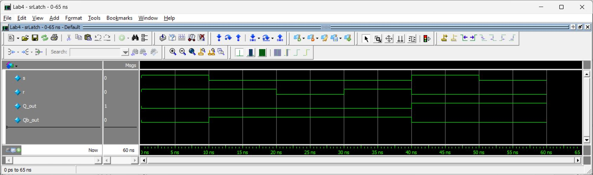
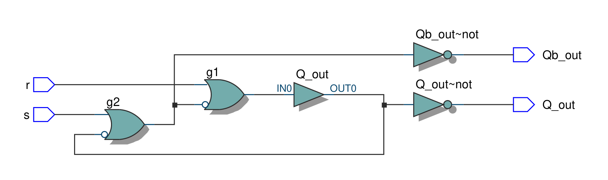

# Gate-level SR latch

[Topic index](../README.md)

RTL compilation: **PASS**. Selected testbench: **PASS**. These are compile/elaboration checks, not functional simulation results.

Synthesis provenance: saved RTL/TB hashes match the imported source. Waveform provenance: saved RTL/TB hashes match the imported source.

**Saved simulation waveform**



**Saved synthesis RTL schematic**



## RTL: latchSR.v

[Editable source](../rtl/latchSR.v)

```verilog
// gate level modelling sr latch
module srLatch(
    input wire s,r ,
    output wire Q_out, Qb_out  // i can also make them inout port as well
);
wire w1,w2 ;
nor g1 (w1 , Qb_out , r ) ;
nor g2 (w2 , s, Q_out) ;
assign Q_out = w1;
assign Qb_out = w2;

endmodule
```

## Testbench: srLatch_tb.v

[Editable testbench](../tb/srLatch_tb.v) · Simulation top: `srLatch_tb`

```verilog
`timescale 1ns/1ps

module srLatch_tb ;
  reg s , r ;
  wire Q_out , Qb_out  ;
  // to check if , both the o/p will be wires, here, or not
  srLatch dut (s , r, Q_out , Qb_out ) ;
  // diff combinations of s and r
  task srValues;
    input sval;
    input rval ;
    begin
      s= sval ;
      r = rval ;
      #10 ;

    end
  endtask
  initial begin
     srValues (1, 1 ) ;
     srValues(0 ,1 ) ;
     srValues(0,0) ;
     srValues(0,1) ;
     srValues(1,0) ;
     srValues(0, 0 ) ;

  end
endmodule
```
