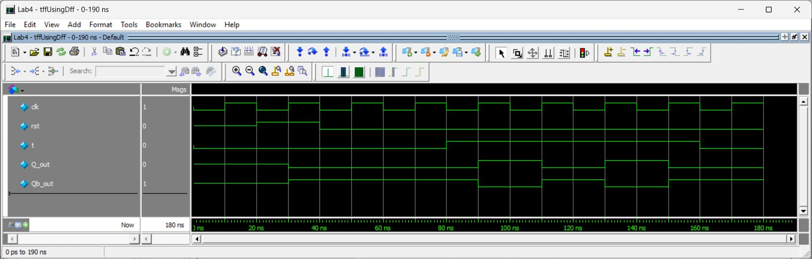
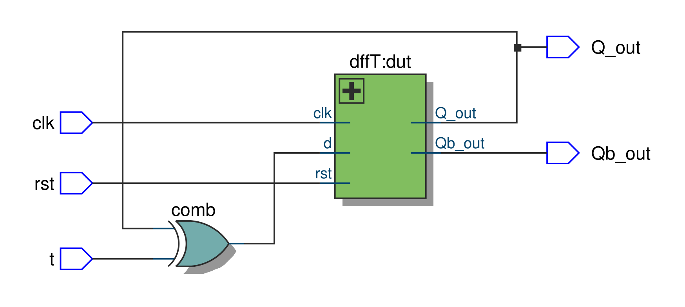

# T flip-flop using a D flip-flop

[Topic index](../README.md)

RTL compilation: **PASS**. Selected testbench: **PASS**. These are compile/elaboration checks, not functional simulation results.

Synthesis provenance: saved RTL/TB hashes match the imported source. Waveform provenance: saved RTL/TB hashes match the imported source.

**Saved simulation waveform**



**Saved synthesis RTL schematic**



## RTL: tUsingDff.v

[Editable source](../rtl/tUsingDff.v)

```verilog
`timescale 1ns/1ps
module tffUsingDff(
    input wire clk , rst, t,
    output wire  Q_out ,
    output wire Qb_out
);
// Q_out as input port , hence input to xor gate as well
// Merits vs demerits of that inout port
wire w1;
xor (w1,Q_out , t) ;
dffT dut (clk , rst,w1 ,Q_out , Qb_out);
endmodule

module dffT(
    input wire clk , rst , d ,
    output reg Q_out ,
    output wire Qb_out
);
always @(posedge clk)begin
    if(rst)begin
        Q_out<= 1'b0 ;
end else begin
    Q_out <= d ;
end
end
assign Qb_out = ~Q_out ;
endmodule
```

## Testbench: tffUsingDff_tb.v

[Editable testbench](../tb/tffUsingDff_tb.v) · Simulation top: `tffUsingDff_tb`

```verilog
`timescale 1ns/1ps

module tffUsingDff_tb;
//dff dut (clk , rst,w1 ,Q_out , Qb_out);
reg clk , rst , t ;
wire Q_out , Qb_out ;
tffUsingDff dut (clk , rst , t, Q_out , Qb_out);
initial begin
    clk = 0 ;
    t=0; // how it fixes the things.
    forever #10 clk = ~clk ;
end
task rst_dut;  // can i also define task by rst_dut()
   begin
    @(negedge clk) ; // at negedge i gave rst
    rst = 1'b1 ;
    @(negedge clk) ; // then at next negedge , i made rst = 0
    rst = 1'b0 ;

   end
endtask
task din;
  input i ;
  begin
    @(negedge clk );
    t=i ;
  end
endtask
initial begin
    rst_dut ;
    din(0);
    din(1);
    din(1);
    din(1);
    din(1);
    din(0);
    #20 ;
    $finish ;
    end
endmodule
```
