# Topic 5 - code and saved evidence

[Topic index](README.md)

[Parameterized asynchronous single-port RAM](#asynchronoussingleport) · [Synchronous dual-port RAM](#dualportram) · [Dual-clock RAM](#asynchronousdualportram) · [Clock buffer](#clockbuffer) · [FIFO using an occupancy counter](#fifo16x8_m1) · [FIFO using extended pointers](#fifo16x8_m2)

<a id="asynchronoussingleport"></a>

## Parameterized asynchronous single-port RAM

Icarus Verilog compiles the RTL. The saved testbench fails to elaborate.

ModelSim drove the RTL ports directly. The trace shows eight words written and read back at the default configuration, eight entries of 16 bits. The bus releases in idle and when both enables are high. The course exercise calls for 16 entries of 8 bits.

**ModelSim waveform (direct port stimulus)**

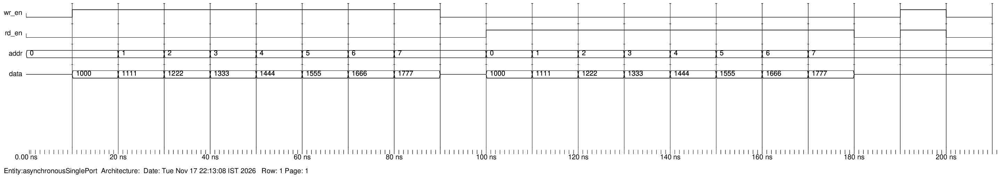

**Quartus RTL schematic**

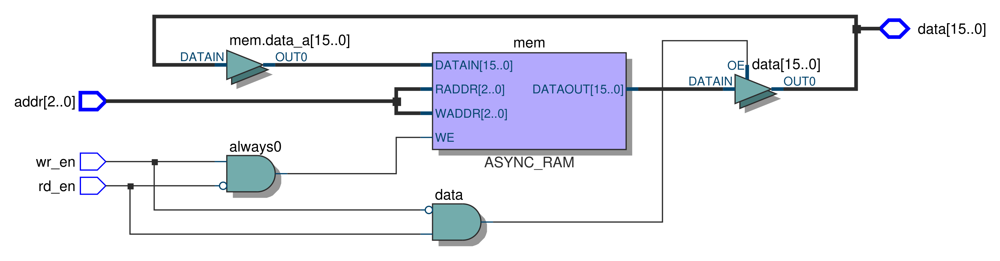

[Direct port stimulus VCD](waveforms/data/asynchronousSinglePort-direct.vcd) · [Direct port stimulus WLF](waveforms/data/asynchronousSinglePort-direct.wlf)

### RTL: asynchronousSinglePort.v

[Editable source](rtl/asynchronousSinglePort.v)

```verilog
module asynchronousSinglePort #(
    parameter aw = 3,
    parameter dw = 16
) (
    inout [dw-1:0] data,
    input wire wr_en , rd_en ,
    input wire [aw-1:0] addr
);
// no clock since asynchronous ,

localparam depth = (1<< aw) ;
reg [dw-1:0] mem [0:depth-1] ;

always @(data, wr_en , rd_en ,addr  )begin
    if(wr_en && ~rd_en )begin
        mem[addr] = data ;

    end

end
assign data = (rd_en && !wr_en )? mem[addr] : {dw{1'bz}};
endmodule
```

### Testbench: asynchronousSinglePort_tb.v

[Editable testbench](tb/asynchronousSinglePort_tb.v) · Simulation top: `asynchronousSinglePort_tb`

```verilog
`timescale 1ns/1ps
// the timeprecision cant be greater then timeunits
// NOV 11 : 12:00 pm to 1:00 pm

module asynchronousSinglePort_tb ;

parameter aw = 3 ;
parameter dw = 16;
wire data ; // since its a inout port , and we need to connect matching data type


integer i ;
reg [dw-1:0] temporary_storage ;

reg wr_en , rd_en ;
reg [aw-1:0] addr ;
asynchronousSinglePort dut (aw,dw,data,wr_en,rd_en,addr );
//40.20
// to test if reading is working
//rd_en = 1 wr_en =0 ; and address to read form
// to inpout port form the tb i need to connect a wire
task initialize();
  wr_en = 1'b0 ;
  rd_en = 1'b0;
  addr = 3'b000;
  data = 16'd0 ;

endtask
task write_memory();
  begin
    wr_en = 1'b1 ;
    rd_en = 1'b0 ;
  end
endtask
task read_memory();
  begin
    wr_en = 1'b0 ;
    rd_en = 1'b1 ;

  end
endtask

task write_data(input [2:0] address , input [15:0] dataVal );
  begin
    addr= address ;
    temporary_storage = dataVal ;
    // its writing on a temporary variable
  end
endtask


task read_data(input [2:0] address) ;
  begin
    addr = address ;

  end
endtask

initial begin
    initialize;
    #10 ;
    write_memory;
    for(i=0 ; i< 8 ; i = i+1 )begin
        write_data(i,{$random} % 65536);
        // Q why are we doing % 65536
        //2 power 16 ok comment on that

        #10 ;
    end
    read_memory;
    for(i=0; i<8; i=i+1)begin
        read_data(i);
        #10 ;

    end
    #1000;
    $finish;
end
assign data = (wr_en && !rd_en ) ? temporary_storage : 16'bz;

// this is the data going out of the tb ;
// so its basically data_out

// i will drive the data line when wr_en is active
endmodule
```

### Current compiler diagnostic

```text
Topic05/tb/asynchronousSinglePort_tb.v:26: error: data is not a valid l-value in asynchronousSinglePort_tb.initialize.
Topic05/tb/asynchronousSinglePort_tb.v:9:      : data is declared here as wire.
Topic05/tb/asynchronousSinglePort_tb.v:17: error: Wrong number of ports. Expecting 4, got 6.
2 error(s) during elaboration.
```

<a id="dualportram"></a>

## Synchronous dual-port RAM

Icarus Verilog compiles the RTL and the saved testbench.

The saved testbench resets the memory and uses separate random addresses for writes and reads. A read can return the reset value of an unwritten address.

**ModelSim waveform (saved testbench)**

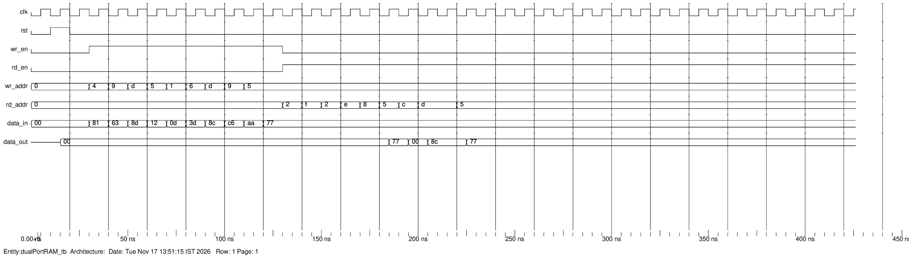

**Quartus RTL schematic**

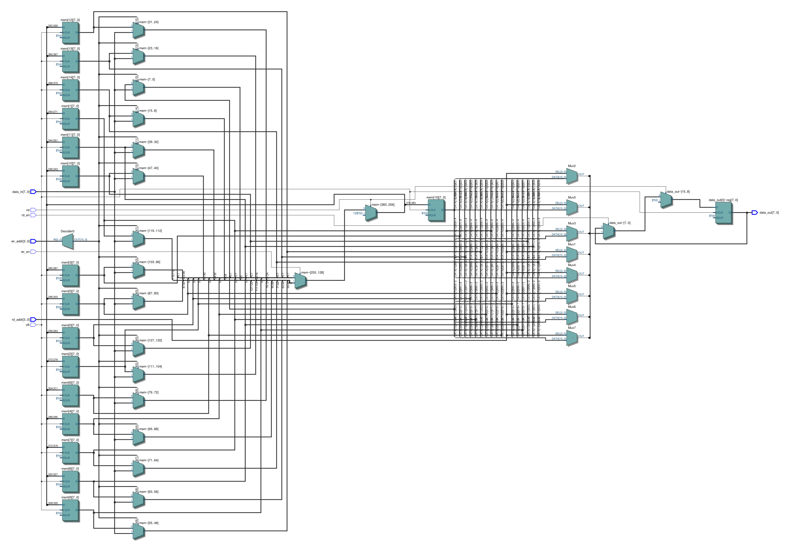

[Saved testbench VCD](waveforms/data/dualPortRAM-original.vcd) · [Saved testbench WLF](waveforms/data/dualPortRAM-original.wlf)

### RTL: dualPortRam.v

[Editable source](rtl/dualPortRam.v)

```verilog
// 16 * 8 dual port ram
// depth is 16 and width is 8
//reg  [7:0] mem [0:15]
// wr_addr and rd_addr are both 4 bits : since aw = 4 to address a depth of 16
// signals are , clk , rst , wr_addr ,rd_addr , wr_en , rd_en , data_in , data_out 8 signals
module dualPortRAM #(
    parameter aw= 4 ,
    parameter dw =8
) (
    input wire clk , rst ,
    input wire [aw-1:0] wr_addr , rd_addr ,
    input wire [dw-1:0] data_in ,
    input wire wr_en , rd_en ,
    output reg [dw-1:0] data_out
);
integer i ;
localparam depth= (1<< aw ) ;
reg [dw-1:0] mem [0: depth-1] ; // 2 to the power aw
always @(posedge clk) begin
    if(rst)begin
        data_out <= 8'd0 ;
        for(i=0; i<depth ; i = i +1 )begin
            mem[i] <= 8'd0 ;
        end
end else begin
    if(wr_en)begin
        mem[wr_addr] <= data_in ;  // if case will not create any latch cause we want that, behaviour
    end
    if(rd_en) begin
        data_out <= mem[rd_addr] ;

    end
end
end
endmodule
```

### Testbench: dualPortRAM_tb.v

[Editable testbench](tb/dualPortRAM_tb.v) · Simulation top: `dualPortRAM_tb`

```verilog
`timescale 1ns/1ps
module dualPortRAM_tb;
parameter aw = 4 ;
parameter dw = 8 ;
reg clk , rst ;
reg [aw-1:0] wr_addr , rd_addr;
reg wr_en , rd_en ;
reg [dw-1:0] data_in ;
wire [dw-1:0] data_out ;


dualPortRAM  #(
    .aw(aw),
    .dw(dw)
) dut (
    .clk(clk) ,
    .rst(rst) ,
    .wr_addr(wr_addr) ,
    .rd_addr(rd_addr) ,
    .wr_en(wr_en),
    .rd_en(rd_en),
    .data_in(data_in),
    .data_out(data_out)
);
// to verify
/*
1) reset working -> active for 1 clock pulse
2) write working -> activate wr_en , then wr_addr , and then the data .
3) read working ->           rd_en , then rd_addr , then i can read the data .
read working
to give input at the negative edge ,
*/
parameter period = 10 ;
initial begin
    clk= 1'b0 ;
    rst= 1'b0 ;
    wr_addr= 1'b0;
    rd_addr= 1'b0 ;
    wr_en= 1'b0 ;
    rd_en = 1'b0 ;
    data_in= 8'd0 ;

end


always begin
     #(period/2) ;
     clk = 1'b1 ;
     #(period/2) ;
     clk = 1'b0 ;
end
task applyReset ;
begin
    @(negedge clk);
    rst = 1'b1 ;
    @(negedge clk );
    rst = 1'b0 ;
end
endtask

task writeInput;
  input write_enable ;
  input [aw-1:0] write_address;
  input [dw-1:0] write_data;
  input read_enable;
  begin
    @(negedge clk);
    wr_en = write_enable ;
    wr_addr = write_address ; // why am i not assigning , using <= non blocking in task
    data_in = write_data ;
    rd_en = read_enable ;
    $display("Data written at an address : %0d , is %0d " , wr_addr , data_in);
  end
endtask

reg [dw-1:0] captured_data;
task readInput;
  input read_enable ;
  input [aw-1:0] read_address ;
  output [dw-1:0] read_data;
  input write_enable ;
  begin
    @(negedge clk);
    rd_en = read_enable ;
    rd_addr = read_address ;
        wr_en = write_enable ;
    // Data will be read , and its ready for the assignment , but in a non blocking assignment .
    @(posedge clk);
    #1;
    read_data = data_out ;
    // captured data received the read_data argument when it returns
    $display("Data read from location %0d ,is %0d " , read_address , read_data) ;

  end
endtask
initial begin
    applyReset;
    repeat (10)
      writeInput(1'b1 , {$random} % 16 , {$random}% 256 , 1'b0 ) ; // wr_en, wr_addr , wr_data(8 bits wide )
    repeat (10)
      readInput(1'b1 , {$random} % 16 , captured_data , 1'b0 ) ;
    #200;
    $finish ;

end
endmodule
```

<a id="asynchronousdualportram"></a>

## Dual-clock RAM

Icarus Verilog compiles the RTL and the saved testbench.

The saved testbench uses a 20 ns write clock and a 40 ns read clock. The read port samples on the rising edge of its own clock.

**ModelSim waveform (saved testbench)**

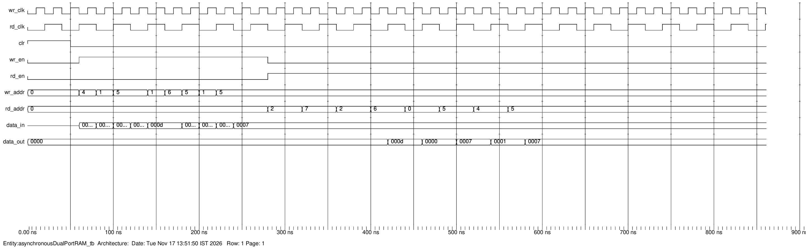

**Quartus RTL schematic**

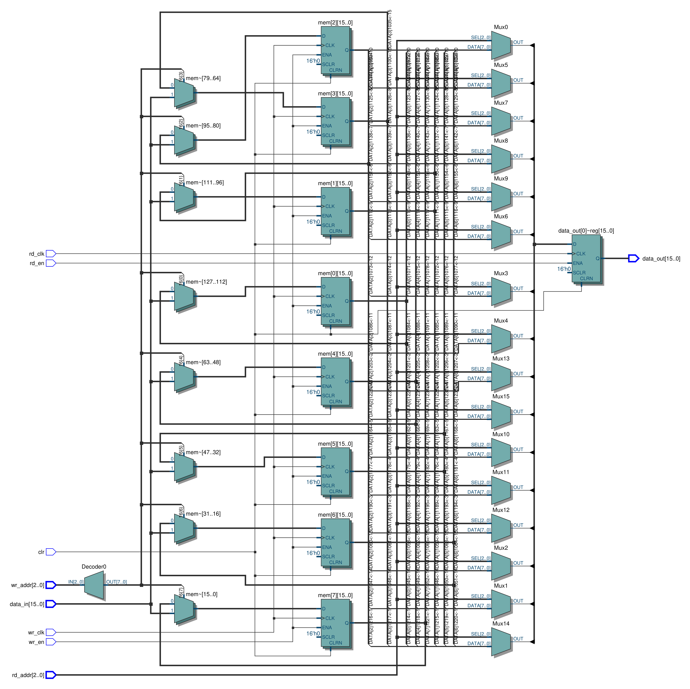

[Saved testbench VCD](waveforms/data/asynchronousDualPortRAM-original.vcd) · [Saved testbench WLF](waveforms/data/asynchronousDualPortRAM-original.wlf)

### RTL: asynchronousDualPortRAM.v

[Editable source](rtl/asynchronousDualPortRAM.v)

```verilog
// 8 * 16 RAM
// depth is 8 and width is 16

module asynchronousDualPortRAM #(
    parameter aw= 3 ,
    parameter dw =16
) (
    input wire wr_clk , rd_clk  ,
    //input wire rst ,
    input wire [aw-1:0] wr_addr , rd_addr ,
    input wire [dw-1:0] data_in ,
    input wire wr_en , rd_en ,
    input wire clr , // asynchronous clear
    output reg [dw-1:0] data_out
);   // 9 signals and 2 parameters
integer i ;
localparam depth = (1<< aw) ;
reg [dw-1:0] mem [0:depth -1] ;

always @(posedge wr_clk or posedge clr ) begin
    if(clr)begin
        for(i=0 ; i<depth ; i=i+1 ) begin
            mem[i]<= 16'b0; // this will also pad 0's then why we prefer using 16'd0

        end
end else begin
    if(wr_en)begin
        mem[wr_addr] <= data_in ;

    end
end
end

// read operation
always @(posedge rd_clk or posedge clr )begin
    if(clr)begin
        data_out <= 16'd0 ;
end else begin
    if(rd_en) begin
        data_out <= mem[rd_addr] ;
    end
end
end
endmodule
```

### Testbench: asynchronousDualPortRAM_tb.v

[Editable testbench](tb/asynchronousDualPortRAM_tb.v) · Simulation top: `asynchronousDualPortRAM_tb`

```verilog
`timescale 1ns/1ps
module asynchronousDualPortRAM_tb ;
parameter aw =3 ;
parameter dw = 16 ;
reg wr_clk , rd_clk , clr ;
reg [aw-1:0] rd_addr , wr_addr ;
reg [dw-1:0] data_in ;
reg wr_en , rd_en ;
wire [dw-1:0] data_out ;


reg [dw-1:0] output_value ;


asynchronousDualPortRAM #(
    .aw(aw),
    .dw(dw)
) dut (
    .wr_clk(wr_clk),
    .rd_clk(rd_clk),
    .clr(clr),
    .rd_addr(rd_addr),
    .wr_addr(wr_addr),
    .data_in(data_in),
    .wr_en(wr_en),
    .rd_en(rd_en),
    .data_out(data_out)
);
integer i , j ;
// Verification
//1) to activate the clear asynchronous
// 2) write task , wrt neg edge of write clock
//3) read task wrt neg edge of read clock
task initialize();
  begin
    wr_clk =1'b0 ;
    rd_clk= 1'b0 ;
    clr = 1'b0 ;
    wr_en = 1'b0 ;
    rd_en = 1'b0 ;
    wr_addr = {aw{1'b0}} ;
    rd_addr = {aw{1'b0}} ;

  end
endtask
always #10 wr_clk= ~ wr_clk ;
always #20 rd_clk = ~rd_clk ;

task clear_dut;
  begin
    clr = 1'b1;
    #50;  // 1 for first 50 ns
    clr = 1'b0 ;
  end
endtask
// task to write into memory
task write_memory;
// to give stimulus wrt write clock
  input [aw-1:0] write_address ;
  input write_enable ;
  input read_enable ;
  input [dw-1:0] data_input ;
  begin
    @(negedge wr_clk ) ;
    wr_addr = write_address ;
    wr_en = write_enable ;
    rd_en = read_enable;
    data_in = data_input ;
     @(posedge wr_clk);
    #1;

  end
endtask
task read_memory;
  input [aw-1:0] read_address;
  input read_enable ;
  input write_enable ;
  output [dw-1:0] read_value ;

  begin
    @(negedge rd_clk );
    rd_addr = read_address ;
    rd_en = read_enable ;
    wr_en = write_enable ;
    @(posedge rd_clk);
    #1;
    read_value = data_out ;
  end
endtask
// To check it further .
initial begin
    initialize;
    clear_dut ;
    repeat (10)
      write_memory({$random}% 8 ,1'b1, 1'b0 ,{$random}% 16  ) ;
    repeat (10)
      read_memory({$random}% 8 , 1'b1, 1'b0 , output_value) ;
    #200;
    $finish;
end
endmodule
```

<a id="clockbuffer"></a>

## Clock buffer

Icarus Verilog compiles the RTL and the saved testbench.

The free-running testbench reports matching phase and period. ModelSim captures the first 100 ns using a 1 ns time unit.

**ModelSim waveform (saved testbench)**

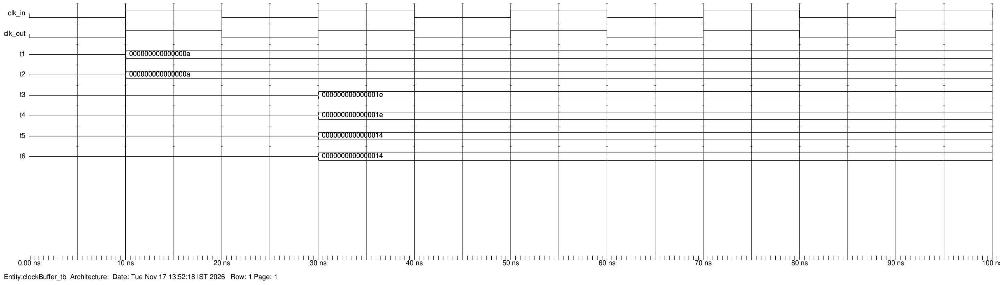

**Quartus RTL schematic**


[Saved testbench VCD](waveforms/data/clockBuffer-original.vcd) · [Saved testbench WLF](waveforms/data/clockBuffer-original.wlf)

### RTL: clockBuffer.v

[Editable source](rtl/clockBuffer.v)

```verilog
module clockBuffer(
    input wire clk_in ,
    output wire clk_out
);
  buf g1 (clk_out , clk_in );
endmodule
```

### Testbench: clockBuffer_tb.v

[Editable testbench](tb/clockBuffer_tb.v) · Simulation top: `clockBuffer_tb`

```verilog
module clockBuffer_tb ;
reg clk_in ;  // master clock
wire clk_out ;  // buffered clock
clockBuffer dut (clk_in , clk_out );
// To check if phase adn frequency is matching
// fork join works in parallel
reg p , f ;
time t1,t2,t3,t4,t5,t6;
initial begin
    clk_in = 1'b0 ;
end
always #10 clk_in = ~clk_in ;
task measure_clk_in ;
  begin
    @(posedge clk_in);
    t1 = $time ; // positive edge of the first edge
    @(posedge clk_in );
    t3= $time;  // next positive edge time
  end
endtask
// what it means for phase to be same in this respect

task measure_clk_out ;
begin
    @(posedge clk_out);
    t2= $time;
    @(posedge clk_out);
    t4= $time;
end
endtask
initial begin
    fork
        measure_clk_in ;
        measure_clk_out ;

    join
    if((t1==t2) && (t3==t4 )) // same phase
      $display("Phase is same ") ;
    else
      $display("Phase is not same ") ;
    t5 = t3-t1 ; // time period for the input
    t6= t4-t2;    // time period for the output clock
    if(t5 == t6 )begin
        $display("Frequency is same ") ;

end else begin
    $display("Frequency is different ") ;
end

end
endmodule
```

<a id="fifo16x8_m1"></a>

## FIFO using an occupancy counter

Icarus Verilog compiles the RTL and the saved testbench.

M1 uses a copy of the M2 testbench with the testbench and DUT module names changed. The saved testbench selects eight entries of 16 bits and holds active-low reset during the transfer attempts.

The direct port run uses the default 16 entries of 8 bits. It records 27 accepted writes, 23 accepted reads and 5 simultaneous transfers. With both requests high, the design accepts only the read at full and only the write at empty.

**ModelSim waveform (direct port stimulus)**

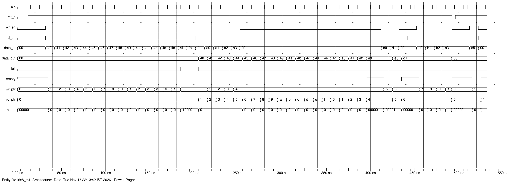

**Quartus RTL schematic**

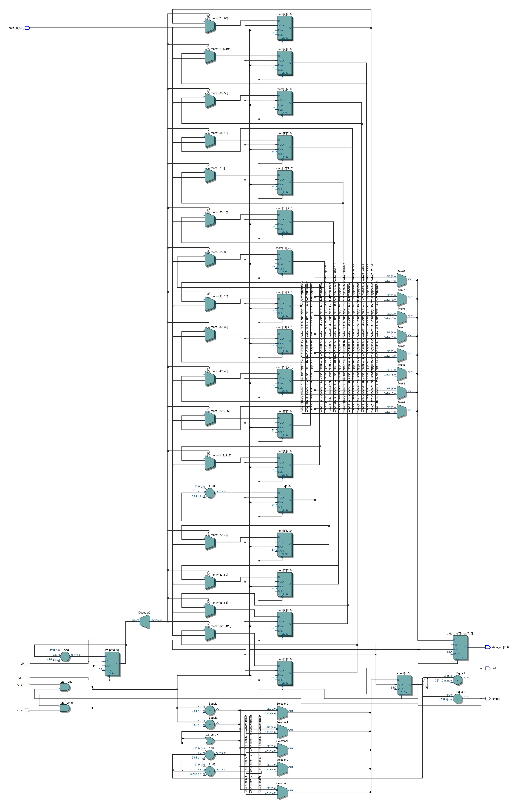

[Direct port stimulus VCD](waveforms/data/fifo16x8_m1-direct.vcd) · [Direct port stimulus WLF](waveforms/data/fifo16x8_m1-direct.wlf)

<details>
<summary>Full boundary, asynchronous reset and saved testbench views</summary>

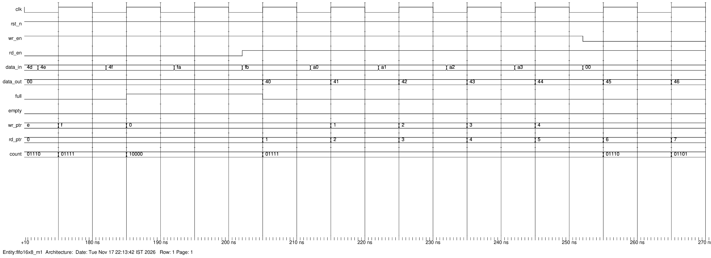

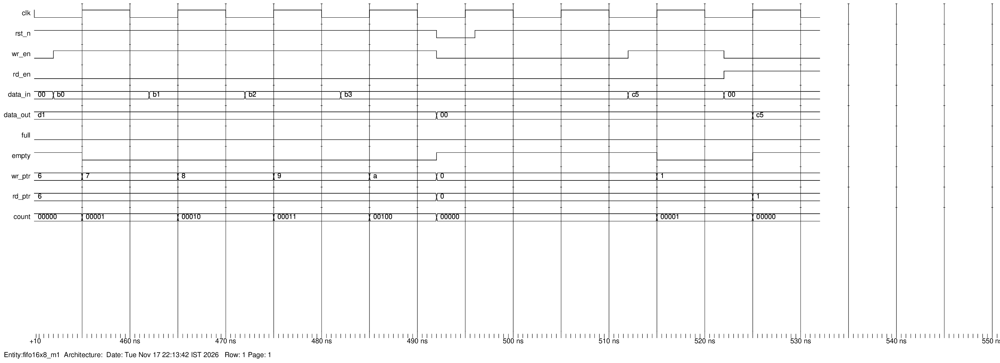

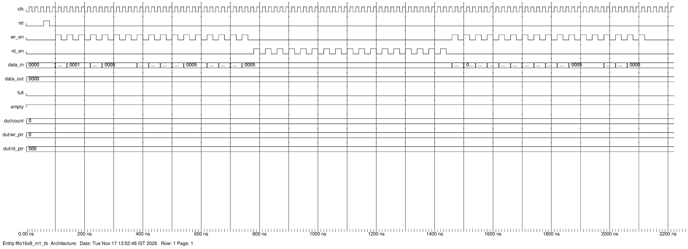

[Saved testbench VCD](waveforms/data/fifo16x8_m1-original.vcd) · [Saved testbench WLF](waveforms/data/fifo16x8_m1-original.wlf)

</details>

### RTL: fifo16x8_m1.v

[Editable source](rtl/fifo16x8_m1.v)

```verilog
//12 th november
// 16 * 8 fifo
// 16 wide and 8 deep
// [15:0] mem [0:7] ;

module fifo16x8_m1 #(
    parameter aw= 4,
    parameter dw= 8
)(
    input wire clk ,rst_n,
    input wr_en , rd_en ,
    input wire [dw-1:0] data_in ,
    output reg [dw-1:0] data_out ,
    output wire full, empty
);
localparam depth = (1<< aw) ;
reg [aw:0] count ;
reg [aw-1:0] wr_ptr , rd_ptr ;
reg [dw-1:0] mem [0:depth-1] ;
wire can_read ;
wire can_write;
assign can_read = (rd_en && !empty ) ;
assign can_write = (wr_en && !full) ;
assign empty = (count == 5'd0) ;
assign full = (count == depth ) ;
integer i  ;
// write operation
always @(posedge clk or negedge rst_n )begin
    if(!rst_n)begin
      for(i=0;i<depth ; i = i +1 )begin
        mem[i] <= {dw{1'b0}};
        wr_ptr<= {(aw){1'b0}} ;

    end
    end  else if(can_write)begin
        mem[wr_ptr] <= data_in; // although it wont matter if i write it first or second
        wr_ptr<= wr_ptr+ 1'b1 ;
end else begin
    wr_ptr<= wr_ptr ;
end
end
// read operation
always @(posedge clk or negedge rst_n )begin
    if(!rst_n)begin
        rd_ptr <= {(aw){1'b0}};
        data_out <= {dw{1'b0}} ;

    end else if(can_read)begin
        data_out <= mem[rd_ptr] ;
        rd_ptr <= rd_ptr+1'b1;
end else begin
    rd_ptr<= rd_ptr;
end
end
always @(posedge clk or negedge rst_n) begin
    if (!rst_n) begin
        count <= {aw+1{1'b0}};
end else begin
    case ({can_read , can_write})
        2'b01: count <= count + 1'b1;
        //  what should i do here , 1'b1 or i need specific bits like {aw+1{1'd1}}
        2'b10: count <= count - 1'b1 ;
        default : count <= count ;
    endcase
end
end
// read operation
// When reset is active , the empty will be high .
// externally we dont know where, we are writing .
// I cant give the address, its managed internally named wr_ptr and rd_ptr
// if wr_en and fifo is full
// 1) can use a counter when i write , then when its, = depth i.e count == 16
// 2) when i should read , rd_en
// 3) when reading i have to decrement the counter .
// 4) generate the empty signal when count ==0 ;
// 5) count ==0 , i.e fifo empty , and read pointer and write pointer are not at 0 , rather lets say both are at location 5
// not necessarily read_ptr and wr_ptr will be at location 0 for being empty
// count may have to increment and decrement
// nope we cant do that increment and decrement , i.e we cant do parallel read and write operation
endmodule
// read pointer msb bit and right pointer msb bit are not same , and lsb bits are same
// method 2
// wr_ptr [4:0] == rd_ptr[4:0] then its empty
// no restriction of doing parallel read and write operation
//
```

### Testbench: fifo16x8_m1_tb.v

[Editable testbench](tb/fifo16x8_m1_tb.v) · Simulation top: `fifo16x8_m1_tb`

```verilog
`timescale 1ns / 1ps
module fifo16x8_m1_tb;
  parameter aw = 3;
  parameter dw= 16;
  reg clk , rst ;
  reg [dw-1:0] data_in ;
  reg wr_en , rd_en ;
  wire [dw-1:0] data_out ;
  wire full , empty ;
fifo16x8_m1 #(aw,dw) dut (clk,rst,wr_en,rd_en,data_in,data_out , full, empty) ;
// generate a clock pulse
// activate the reset
parameter cycle = 20 ;
task initializeDut();  // will be called at time 0
  begin
    clk = 1'b0 ;
    rst = 1'b0 ;
    wr_en = 1'b0 ;
    rd_en = 1'b0 ;
    data_in = {dw{1'b0}} ;

  end
endtask
always #(cycle/2) clk= ~clk ;
task reset_dut();
  begin
    @(negedge clk );
    rst= 1'b1 ;
    @(negedge clk );
    rst = 1'b0 ;

  end
endtask
// task for writing in the memory location
task write_inFifo(input [dw-1:0] dataInput ) ;
  begin
    @(negedge clk );
    wr_en = 1'b1  ;
    data_in =dataInput;
    @(negedge clk );
    wr_en = 1'b0 ;
  end
endtask
// task to read from memory
task read_FromFifo();
  begin
    @(negedge clk );
    rd_en = 1'b1  ;
    @(negedge clk );
    rd_en = 1'b0 ;
  end
endtask
initial begin
    initializeDut ;
    #50;
    reset_dut;
    repeat (17) begin
        write_inFifo({$random} % 8 ) ; // mod 8 cause i want to write 8 bits of data , i.e 0 to 7

    end
    repeat (17) // will read 16 time depth is 16 not 17 time , ite gonna be empty
      read_FromFifo() ;
    repeat (17)
     write_inFifo({$random} % 8 ) ;
    #100;
    $finish;

end
endmodule
```

<a id="fifo16x8_m2"></a>

## FIFO using extended pointers

Icarus Verilog compiles the RTL and the saved testbench.

The saved testbench selects eight entries of 16 bits and holds active-low reset during the transfer attempts. The design uses an extra pointer bit to distinguish equal addresses at full and empty.

The direct port run uses the default 16 entries of 8 bits. It records 27 accepted writes, 23 accepted reads and 5 simultaneous transfers. With both requests high, the design accepts only the read at full and only the write at empty.

**ModelSim waveform (direct port stimulus)**

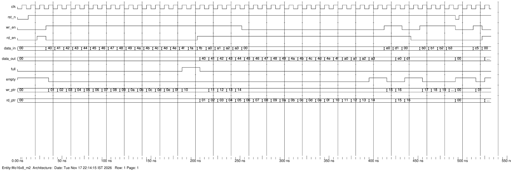

**Quartus RTL schematic**

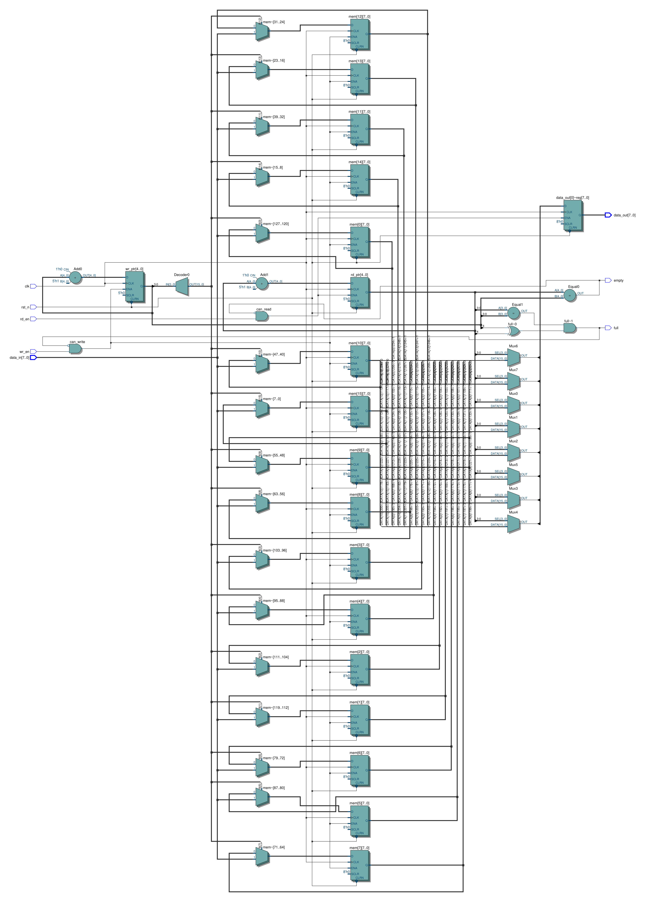

[Direct port stimulus VCD](waveforms/data/fifo16x8_m2-direct.vcd) · [Direct port stimulus WLF](waveforms/data/fifo16x8_m2-direct.wlf)

<details>
<summary>Full boundary, asynchronous reset and saved testbench views</summary>

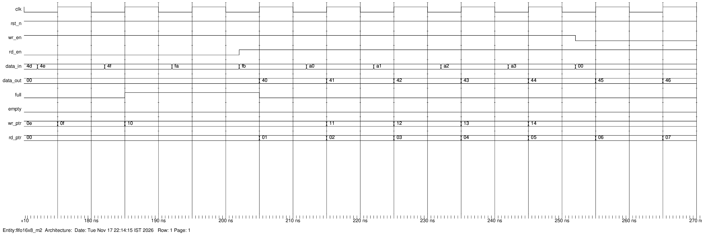

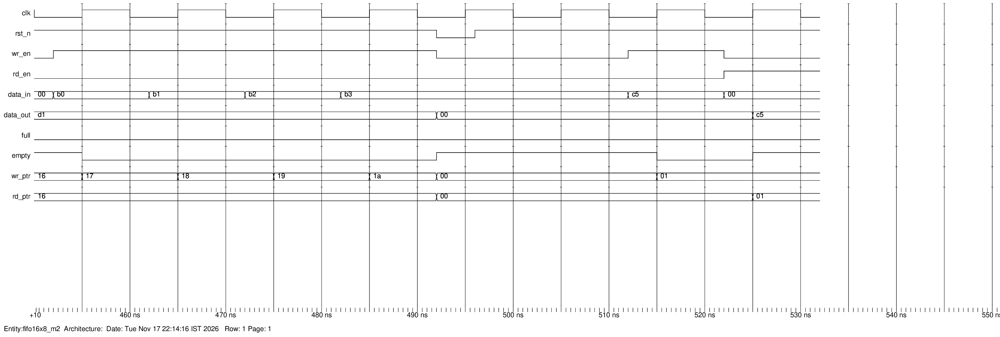

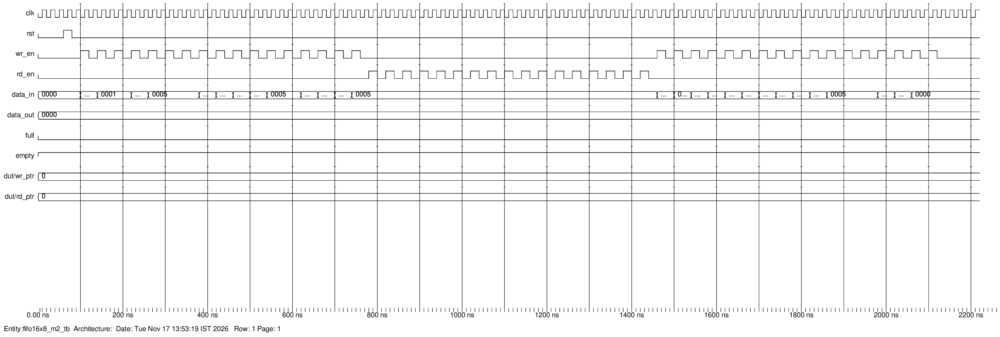

[Saved testbench VCD](waveforms/data/fifo16x8_m2-original.vcd) · [Saved testbench WLF](waveforms/data/fifo16x8_m2-original.wlf)

</details>

### RTL: fifo16x8_m2.v

[Editable source](rtl/fifo16x8_m2.v)

```verilog
module fifo16x8_m2 #(
    parameter aw= 4,
    parameter dw= 8
)(
    input wire clk ,rst_n,
    input wr_en , rd_en ,
    input wire [dw-1:0] data_in ,
    output reg [dw-1:0] data_out ,
    output wire full, empty
);
localparam depth = (1<< aw) ;

//reg [depth:0] count ;
reg [aw:0] wr_ptr , rd_ptr ;
reg [dw-1:0] mem [0:depth-1] ;

// this is method 2 .
// the pointers are of aw+1 in size , aw was needed to cover all the location equal to depth , now ne need a additional bit for wrap conditions

wire can_read ;
wire can_write;
assign can_read = (rd_en && !empty ) ;
assign can_write = (wr_en && !full) ;
// in this method the empty and full will change
assign empty = (wr_ptr == rd_ptr ) ;
assign full = (wr_ptr[aw-1:0] == rd_ptr[aw-1:0] && wr_ptr[aw]!= rd_ptr[aw]) ;

integer i  ;
// write operation
always @(posedge clk or negedge rst_n )begin
    if(!rst_n)begin
      for(i=0;i<depth ; i = i +1 )begin
        mem[i] <= {dw{1'b0}};
        wr_ptr<= {(aw+1){1'b0}} ;

    end
    end  else if(can_write)begin
        mem[wr_ptr[aw-1:0]] <= data_in; // although it wont matter if i write it first or second
        wr_ptr<= wr_ptr+ 1'b1 ;
end else begin
    wr_ptr<= wr_ptr ;
end
end
// read operation
always @(posedge clk or negedge rst_n )begin
    if(!rst_n)begin
        rd_ptr <= {(aw+1){1'b0}};
        data_out <= {dw{1'b0}} ;

    end else if(can_read)begin
        data_out <= mem[rd_ptr[aw-1:0]] ;
        rd_ptr <= rd_ptr+1'b1;
end else begin
    rd_ptr<= rd_ptr;
end
end
// no block for count needed
endmodule
// MSB WILL DECIDE THE FIFO IS FULL OR EMPTY
// after 15 , wr_ptr value is 16, im using lsb bits, to point to the locations
// upper bit is indicating that im doing now the second iteration .
// Hence rd_ptr and wr_ptr and both pointing to the samem location , and the msb bit of read pointer and write, pointer is not equal
// i.e wr_ptr moved depth forward , from rd_ptr. Hence for full we are writing extra
// for empty : both read and write pointer are pointing to the same location
```

### Testbench: fifo16x8_m2_tb.v

[Editable testbench](tb/fifo16x8_m2_tb.v) · Simulation top: `fifo16x8_m2_tb`

```verilog
`timescale 1ns / 1ps
module fifo16x8_m2_tb;
  parameter aw = 3;
  parameter dw= 16;
  reg clk , rst ;
  reg [dw-1:0] data_in ;
  reg wr_en , rd_en ;
  wire [dw-1:0] data_out ;
  wire full , empty ;
fifo16x8_m2 #(aw,dw) dut (clk,rst,wr_en,rd_en,data_in,data_out , full, empty) ;
// generate a clock pulse
// activate the reset
parameter cycle = 20 ;
task initializeDut();  // will be called at time 0
  begin
    clk = 1'b0 ;
    rst = 1'b0 ;
    wr_en = 1'b0 ;
    rd_en = 1'b0 ;
    data_in = {dw{1'b0}} ;

  end
endtask
always #(cycle/2) clk= ~clk ;
task reset_dut();
  begin
    @(negedge clk );
    rst= 1'b1 ;
    @(negedge clk );
    rst = 1'b0 ;

  end
endtask
// task for writing in the memory location
task write_inFifo(input [dw-1:0] dataInput ) ;
  begin
    @(negedge clk );
    wr_en = 1'b1  ;
    data_in =dataInput;
    @(negedge clk );
    wr_en = 1'b0 ;
  end
endtask
// task to read from memory
task read_FromFifo();
  begin
    @(negedge clk );
    rd_en = 1'b1  ;
    @(negedge clk );
    rd_en = 1'b0 ;
  end
endtask
initial begin
    initializeDut ;
    #50;
    reset_dut;
    repeat (17) begin
        write_inFifo({$random} % 8 ) ; // mod 8 cause i want to write 8 bits of data , i.e 0 to 7

    end
    repeat (17) // will read 16 time depth is 16 not 17 time , ite gonna be empty
      read_FromFifo() ;
    repeat (17)
     write_inFifo({$random} % 8 ) ;
    #100;
    $finish;

end
endmodule
```
