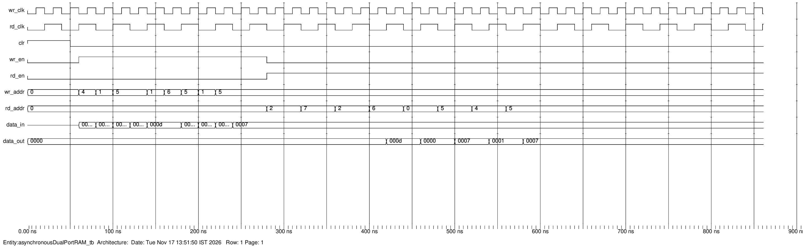
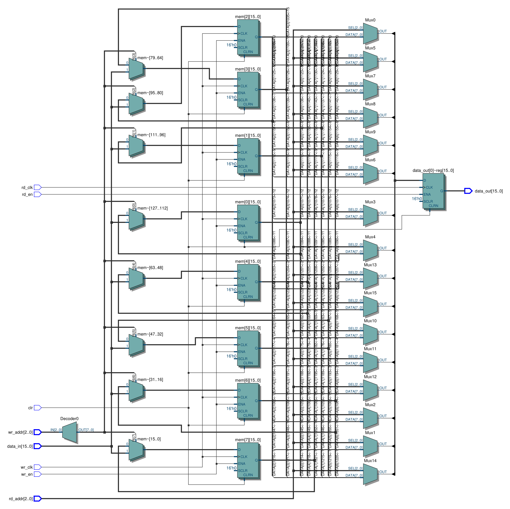

# Dual-clock RAM

[Topic index](../README.md)

Icarus Verilog compiles the RTL and the saved testbench.

The saved testbench uses a 20 ns write clock and a 40 ns read clock. The read port samples on the rising edge of its own clock.

**ModelSim waveform (saved testbench)**



**Quartus RTL schematic**



[Saved testbench VCD](../waveforms/data/asynchronousDualPortRAM-original.vcd) · [Saved testbench WLF](../waveforms/data/asynchronousDualPortRAM-original.wlf)

## RTL: asynchronousDualPortRAM.v

[Editable source](../rtl/asynchronousDualPortRAM.v)

```verilog
// 8 * 16 RAM
// depth is 8 and width is 16

module asynchronousDualPortRAM #(
    parameter aw= 3 ,
    parameter dw =16
) (
    input wire wr_clk , rd_clk  ,
    //input wire rst ,
    input wire [aw-1:0] wr_addr , rd_addr ,
    input wire [dw-1:0] data_in ,
    input wire wr_en , rd_en ,
    input wire clr , // asynchronous clear
    output reg [dw-1:0] data_out
);   // 9 signals and 2 parameters
integer i ;
localparam depth = (1<< aw) ;
reg [dw-1:0] mem [0:depth -1] ;

always @(posedge wr_clk or posedge clr ) begin
    if(clr)begin
        for(i=0 ; i<depth ; i=i+1 ) begin
            mem[i]<= 16'b0; // this will also pad 0's then why we prefer using 16'd0

        end
end else begin
    if(wr_en)begin
        mem[wr_addr] <= data_in ;

    end
end
end

// read operation
always @(posedge rd_clk or posedge clr )begin
    if(clr)begin
        data_out <= 16'd0 ;
end else begin
    if(rd_en) begin
        data_out <= mem[rd_addr] ;
    end
end
end
endmodule
```

## Testbench: asynchronousDualPortRAM_tb.v

[Editable testbench](../tb/asynchronousDualPortRAM_tb.v) · Simulation top: `asynchronousDualPortRAM_tb`

```verilog
`timescale 1ns/1ps
module asynchronousDualPortRAM_tb ;
parameter aw =3 ;
parameter dw = 16 ;
reg wr_clk , rd_clk , clr ;
reg [aw-1:0] rd_addr , wr_addr ;
reg [dw-1:0] data_in ;
reg wr_en , rd_en ;
wire [dw-1:0] data_out ;


reg [dw-1:0] output_value ;


asynchronousDualPortRAM #(
    .aw(aw),
    .dw(dw)
) dut (
    .wr_clk(wr_clk),
    .rd_clk(rd_clk),
    .clr(clr),
    .rd_addr(rd_addr),
    .wr_addr(wr_addr),
    .data_in(data_in),
    .wr_en(wr_en),
    .rd_en(rd_en),
    .data_out(data_out)
);
integer i , j ;
// Verification
//1) to activate the clear asynchronous
// 2) write task , wrt neg edge of write clock
//3) read task wrt neg edge of read clock
task initialize();
  begin
    wr_clk =1'b0 ;
    rd_clk= 1'b0 ;
    clr = 1'b0 ;
    wr_en = 1'b0 ;
    rd_en = 1'b0 ;
    wr_addr = {aw{1'b0}} ;
    rd_addr = {aw{1'b0}} ;

  end
endtask
always #10 wr_clk= ~ wr_clk ;
always #20 rd_clk = ~rd_clk ;

task clear_dut;
  begin
    clr = 1'b1;
    #50;  // 1 for first 50 ns
    clr = 1'b0 ;
  end
endtask
// task to write into memory
task write_memory;
// to give stimulus wrt write clock
  input [aw-1:0] write_address ;
  input write_enable ;
  input read_enable ;
  input [dw-1:0] data_input ;
  begin
    @(negedge wr_clk ) ;
    wr_addr = write_address ;
    wr_en = write_enable ;
    rd_en = read_enable;
    data_in = data_input ;
     @(posedge wr_clk);
    #1;

  end
endtask
task read_memory;
  input [aw-1:0] read_address;
  input read_enable ;
  input write_enable ;
  output [dw-1:0] read_value ;

  begin
    @(negedge rd_clk );
    rd_addr = read_address ;
    rd_en = read_enable ;
    wr_en = write_enable ;
    @(posedge rd_clk);
    #1;
    read_value = data_out ;
  end
endtask
// To check it further .
initial begin
    initialize;
    clear_dut ;
    repeat (10)
      write_memory({$random}% 8 ,1'b1, 1'b0 ,{$random}% 16  ) ;
    repeat (10)
      read_memory({$random}% 8 , 1'b1, 1'b0 , output_value) ;
    #200;
    $finish;
end
endmodule
```
