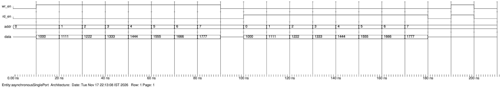
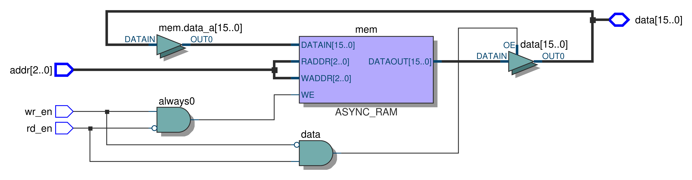

# Parameterized asynchronous single-port RAM

[Topic index](../README.md)

Icarus Verilog compiles the RTL. The saved testbench fails to elaborate.

ModelSim drove the RTL ports directly. The trace shows eight words written and read back at the default configuration, eight entries of 16 bits. The bus releases in idle and when both enables are high. The course exercise calls for 16 entries of 8 bits.

**ModelSim waveform (direct port stimulus)**



**Quartus RTL schematic**



[Direct port stimulus VCD](../waveforms/data/asynchronousSinglePort-direct.vcd) · [Direct port stimulus WLF](../waveforms/data/asynchronousSinglePort-direct.wlf)

## RTL: asynchronousSinglePort.v

[Editable source](../rtl/asynchronousSinglePort.v)

```verilog
module asynchronousSinglePort #(
    parameter aw = 3,
    parameter dw = 16
) (
    inout [dw-1:0] data,
    input wire wr_en , rd_en ,
    input wire [aw-1:0] addr
);
// no clock since asynchronous ,

localparam depth = (1<< aw) ;
reg [dw-1:0] mem [0:depth-1] ;

always @(data, wr_en , rd_en ,addr  )begin
    if(wr_en && ~rd_en )begin
        mem[addr] = data ;

    end

end
assign data = (rd_en && !wr_en )? mem[addr] : {dw{1'bz}};
endmodule
```

## Testbench: asynchronousSinglePort_tb.v

[Editable testbench](../tb/asynchronousSinglePort_tb.v) · Simulation top: `asynchronousSinglePort_tb`

```verilog
`timescale 1ns/1ps
// the timeprecision cant be greater then timeunits
// NOV 11 : 12:00 pm to 1:00 pm

module asynchronousSinglePort_tb ;

parameter aw = 3 ;
parameter dw = 16;
wire data ; // since its a inout port , and we need to connect matching data type


integer i ;
reg [dw-1:0] temporary_storage ;

reg wr_en , rd_en ;
reg [aw-1:0] addr ;
asynchronousSinglePort dut (aw,dw,data,wr_en,rd_en,addr );
//40.20
// to test if reading is working
//rd_en = 1 wr_en =0 ; and address to read form
// to inpout port form the tb i need to connect a wire
task initialize();
  wr_en = 1'b0 ;
  rd_en = 1'b0;
  addr = 3'b000;
  data = 16'd0 ;

endtask
task write_memory();
  begin
    wr_en = 1'b1 ;
    rd_en = 1'b0 ;
  end
endtask
task read_memory();
  begin
    wr_en = 1'b0 ;
    rd_en = 1'b1 ;

  end
endtask

task write_data(input [2:0] address , input [15:0] dataVal );
  begin
    addr= address ;
    temporary_storage = dataVal ;
    // its writing on a temporary variable
  end
endtask


task read_data(input [2:0] address) ;
  begin
    addr = address ;

  end
endtask

initial begin
    initialize;
    #10 ;
    write_memory;
    for(i=0 ; i< 8 ; i = i+1 )begin
        write_data(i,{$random} % 65536);
        // Q why are we doing % 65536
        //2 power 16 ok comment on that

        #10 ;
    end
    read_memory;
    for(i=0; i<8; i=i+1)begin
        read_data(i);
        #10 ;

    end
    #1000;
    $finish;
end
assign data = (wr_en && !rd_en ) ? temporary_storage : 16'bz;

// this is the data going out of the tb ;
// so its basically data_out

// i will drive the data line when wr_en is active
endmodule
```

## Current compiler diagnostic

```text
Topic05/tb/asynchronousSinglePort_tb.v:26: error: data is not a valid l-value in asynchronousSinglePort_tb.initialize.
Topic05/tb/asynchronousSinglePort_tb.v:9:      : data is declared here as wire.
Topic05/tb/asynchronousSinglePort_tb.v:17: error: Wrong number of ports. Expecting 4, got 6.
2 error(s) during elaboration.
```
