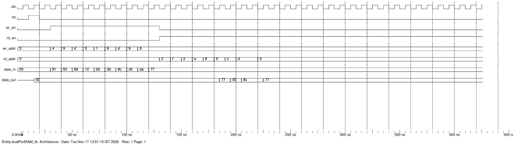
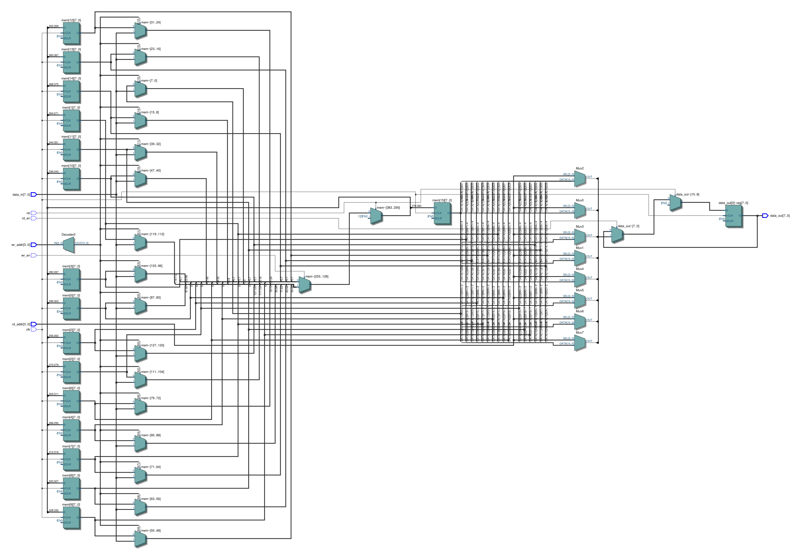

# Synchronous dual-port RAM

[Topic index](../README.md)

Icarus Verilog compiles the RTL and the saved testbench.

The saved testbench resets the memory and uses separate random addresses for writes and reads. A read can return the reset value of an unwritten address.

**ModelSim waveform (saved testbench)**



**Quartus RTL schematic**



[Saved testbench VCD](../waveforms/data/dualPortRAM-original.vcd) · [Saved testbench WLF](../waveforms/data/dualPortRAM-original.wlf)

## RTL: dualPortRam.v

[Editable source](../rtl/dualPortRam.v)

```verilog
// 16 * 8 dual port ram
// depth is 16 and width is 8
//reg  [7:0] mem [0:15]
// wr_addr and rd_addr are both 4 bits : since aw = 4 to address a depth of 16
// signals are , clk , rst , wr_addr ,rd_addr , wr_en , rd_en , data_in , data_out 8 signals
module dualPortRAM #(
    parameter aw= 4 ,
    parameter dw =8
) (
    input wire clk , rst ,
    input wire [aw-1:0] wr_addr , rd_addr ,
    input wire [dw-1:0] data_in ,
    input wire wr_en , rd_en ,
    output reg [dw-1:0] data_out
);
integer i ;
localparam depth= (1<< aw ) ;
reg [dw-1:0] mem [0: depth-1] ; // 2 to the power aw
always @(posedge clk) begin
    if(rst)begin
        data_out <= 8'd0 ;
        for(i=0; i<depth ; i = i +1 )begin
            mem[i] <= 8'd0 ;
        end
end else begin
    if(wr_en)begin
        mem[wr_addr] <= data_in ;  // if case will not create any latch cause we want that, behaviour
    end
    if(rd_en) begin
        data_out <= mem[rd_addr] ;

    end
end
end
endmodule
```

## Testbench: dualPortRAM_tb.v

[Editable testbench](../tb/dualPortRAM_tb.v) · Simulation top: `dualPortRAM_tb`

```verilog
`timescale 1ns/1ps
module dualPortRAM_tb;
parameter aw = 4 ;
parameter dw = 8 ;
reg clk , rst ;
reg [aw-1:0] wr_addr , rd_addr;
reg wr_en , rd_en ;
reg [dw-1:0] data_in ;
wire [dw-1:0] data_out ;


dualPortRAM  #(
    .aw(aw),
    .dw(dw)
) dut (
    .clk(clk) ,
    .rst(rst) ,
    .wr_addr(wr_addr) ,
    .rd_addr(rd_addr) ,
    .wr_en(wr_en),
    .rd_en(rd_en),
    .data_in(data_in),
    .data_out(data_out)
);
// to verify
/*
1) reset working -> active for 1 clock pulse
2) write working -> activate wr_en , then wr_addr , and then the data .
3) read working ->           rd_en , then rd_addr , then i can read the data .
read working
to give input at the negative edge ,
*/
parameter period = 10 ;
initial begin
    clk= 1'b0 ;
    rst= 1'b0 ;
    wr_addr= 1'b0;
    rd_addr= 1'b0 ;
    wr_en= 1'b0 ;
    rd_en = 1'b0 ;
    data_in= 8'd0 ;

end


always begin
     #(period/2) ;
     clk = 1'b1 ;
     #(period/2) ;
     clk = 1'b0 ;
end
task applyReset ;
begin
    @(negedge clk);
    rst = 1'b1 ;
    @(negedge clk );
    rst = 1'b0 ;
end
endtask

task writeInput;
  input write_enable ;
  input [aw-1:0] write_address;
  input [dw-1:0] write_data;
  input read_enable;
  begin
    @(negedge clk);
    wr_en = write_enable ;
    wr_addr = write_address ; // why am i not assigning , using <= non blocking in task
    data_in = write_data ;
    rd_en = read_enable ;
    $display("Data written at an address : %0d , is %0d " , wr_addr , data_in);
  end
endtask

reg [dw-1:0] captured_data;
task readInput;
  input read_enable ;
  input [aw-1:0] read_address ;
  output [dw-1:0] read_data;
  input write_enable ;
  begin
    @(negedge clk);
    rd_en = read_enable ;
    rd_addr = read_address ;
        wr_en = write_enable ;
    // Data will be read , and its ready for the assignment , but in a non blocking assignment .
    @(posedge clk);
    #1;
    read_data = data_out ;
    // captured data received the read_data argument when it returns
    $display("Data read from location %0d ,is %0d " , read_address , read_data) ;

  end
endtask
initial begin
    applyReset;
    repeat (10)
      writeInput(1'b1 , {$random} % 16 , {$random}% 256 , 1'b0 ) ; // wr_en, wr_addr , wr_data(8 bits wide )
    repeat (10)
      readInput(1'b1 , {$random} % 16 , captured_data , 1'b0 ) ;
    #200;
    $finish ;

end
endmodule
```
