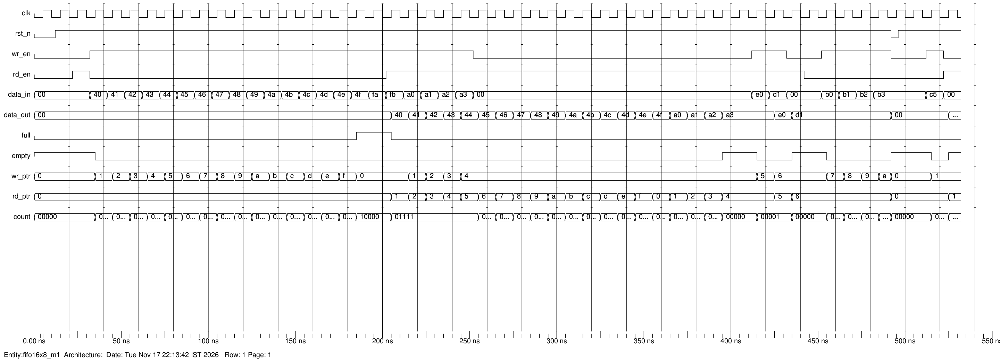
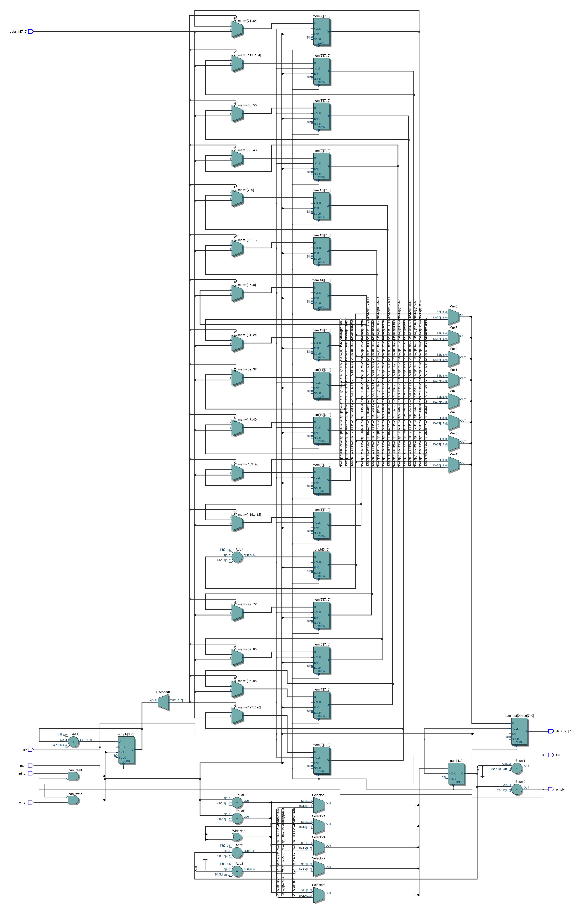
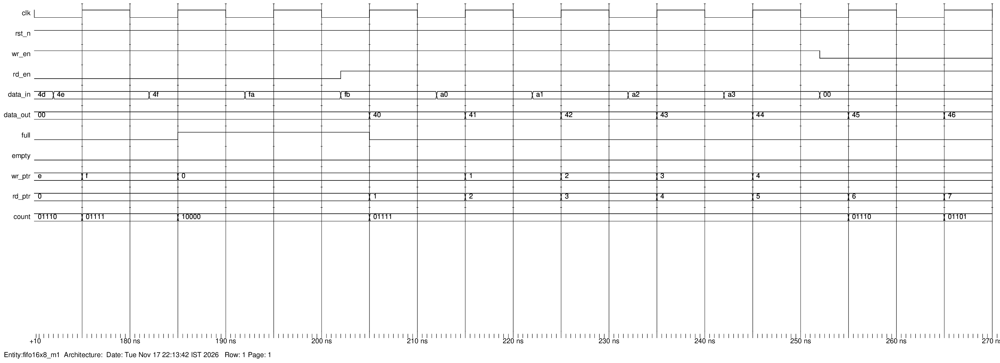
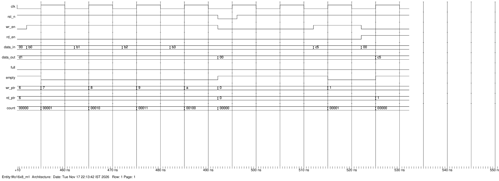
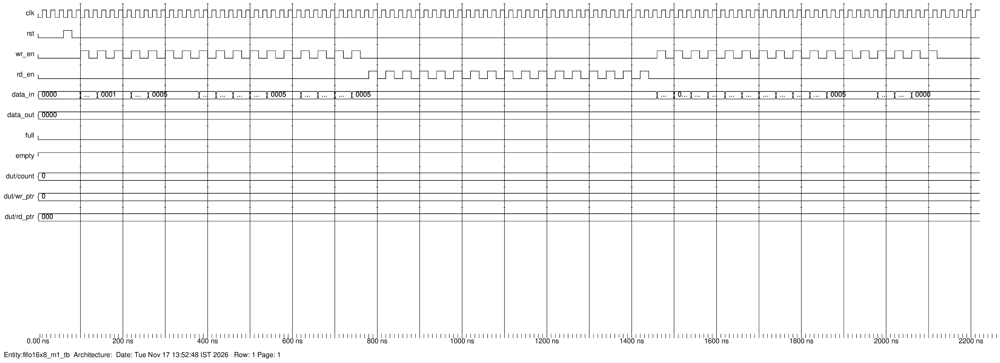

# FIFO using an occupancy counter

[Topic index](../README.md)

Icarus Verilog compiles the RTL and the saved testbench.

M1 uses a copy of the M2 testbench with the testbench and DUT module names changed. The saved testbench selects eight entries of 16 bits and holds active-low reset during the transfer attempts.

The direct port run uses the default 16 entries of 8 bits. It records 27 accepted writes, 23 accepted reads and 5 simultaneous transfers. With both requests high, the design accepts only the read at full and only the write at empty.

**ModelSim waveform (direct port stimulus)**



**Quartus RTL schematic**



[Direct port stimulus VCD](../waveforms/data/fifo16x8_m1-direct.vcd) · [Direct port stimulus WLF](../waveforms/data/fifo16x8_m1-direct.wlf)

<details>
<summary>Full boundary, asynchronous reset and saved testbench views</summary>







[Saved testbench VCD](../waveforms/data/fifo16x8_m1-original.vcd) · [Saved testbench WLF](../waveforms/data/fifo16x8_m1-original.wlf)

</details>

## RTL: fifo16x8_m1.v

[Editable source](../rtl/fifo16x8_m1.v)

```verilog
//12 th november
// 16 * 8 fifo
// 16 wide and 8 deep
// [15:0] mem [0:7] ;

module fifo16x8_m1 #(
    parameter aw= 4,
    parameter dw= 8
)(
    input wire clk ,rst_n,
    input wr_en , rd_en ,
    input wire [dw-1:0] data_in ,
    output reg [dw-1:0] data_out ,
    output wire full, empty
);
localparam depth = (1<< aw) ;
reg [aw:0] count ;
reg [aw-1:0] wr_ptr , rd_ptr ;
reg [dw-1:0] mem [0:depth-1] ;
wire can_read ;
wire can_write;
assign can_read = (rd_en && !empty ) ;
assign can_write = (wr_en && !full) ;
assign empty = (count == 5'd0) ;
assign full = (count == depth ) ;
integer i  ;
// write operation
always @(posedge clk or negedge rst_n )begin
    if(!rst_n)begin
      for(i=0;i<depth ; i = i +1 )begin
        mem[i] <= {dw{1'b0}};
        wr_ptr<= {(aw){1'b0}} ;

    end
    end  else if(can_write)begin
        mem[wr_ptr] <= data_in; // although it wont matter if i write it first or second
        wr_ptr<= wr_ptr+ 1'b1 ;
end else begin
    wr_ptr<= wr_ptr ;
end
end
// read operation
always @(posedge clk or negedge rst_n )begin
    if(!rst_n)begin
        rd_ptr <= {(aw){1'b0}};
        data_out <= {dw{1'b0}} ;

    end else if(can_read)begin
        data_out <= mem[rd_ptr] ;
        rd_ptr <= rd_ptr+1'b1;
end else begin
    rd_ptr<= rd_ptr;
end
end
always @(posedge clk or negedge rst_n) begin
    if (!rst_n) begin
        count <= {aw+1{1'b0}};
end else begin
    case ({can_read , can_write})
        2'b01: count <= count + 1'b1;
        //  what should i do here , 1'b1 or i need specific bits like {aw+1{1'd1}}
        2'b10: count <= count - 1'b1 ;
        default : count <= count ;
    endcase
end
end
// read operation
// When reset is active , the empty will be high .
// externally we dont know where, we are writing .
// I cant give the address, its managed internally named wr_ptr and rd_ptr
// if wr_en and fifo is full
// 1) can use a counter when i write , then when its, = depth i.e count == 16
// 2) when i should read , rd_en
// 3) when reading i have to decrement the counter .
// 4) generate the empty signal when count ==0 ;
// 5) count ==0 , i.e fifo empty , and read pointer and write pointer are not at 0 , rather lets say both are at location 5
// not necessarily read_ptr and wr_ptr will be at location 0 for being empty
// count may have to increment and decrement
// nope we cant do that increment and decrement , i.e we cant do parallel read and write operation
endmodule
// read pointer msb bit and right pointer msb bit are not same , and lsb bits are same
// method 2
// wr_ptr [4:0] == rd_ptr[4:0] then its empty
// no restriction of doing parallel read and write operation
//
```

## Testbench: fifo16x8_m1_tb.v

[Editable testbench](../tb/fifo16x8_m1_tb.v) · Simulation top: `fifo16x8_m1_tb`

```verilog
`timescale 1ns / 1ps
module fifo16x8_m1_tb;
  parameter aw = 3;
  parameter dw= 16;
  reg clk , rst ;
  reg [dw-1:0] data_in ;
  reg wr_en , rd_en ;
  wire [dw-1:0] data_out ;
  wire full , empty ;
fifo16x8_m1 #(aw,dw) dut (clk,rst,wr_en,rd_en,data_in,data_out , full, empty) ;
// generate a clock pulse
// activate the reset
parameter cycle = 20 ;
task initializeDut();  // will be called at time 0
  begin
    clk = 1'b0 ;
    rst = 1'b0 ;
    wr_en = 1'b0 ;
    rd_en = 1'b0 ;
    data_in = {dw{1'b0}} ;

  end
endtask
always #(cycle/2) clk= ~clk ;
task reset_dut();
  begin
    @(negedge clk );
    rst= 1'b1 ;
    @(negedge clk );
    rst = 1'b0 ;

  end
endtask
// task for writing in the memory location
task write_inFifo(input [dw-1:0] dataInput ) ;
  begin
    @(negedge clk );
    wr_en = 1'b1  ;
    data_in =dataInput;
    @(negedge clk );
    wr_en = 1'b0 ;
  end
endtask
// task to read from memory
task read_FromFifo();
  begin
    @(negedge clk );
    rd_en = 1'b1  ;
    @(negedge clk );
    rd_en = 1'b0 ;
  end
endtask
initial begin
    initializeDut ;
    #50;
    reset_dut;
    repeat (17) begin
        write_inFifo({$random} % 8 ) ; // mod 8 cause i want to write 8 bits of data , i.e 0 to 7

    end
    repeat (17) // will read 16 time depth is 16 not 17 time , ite gonna be empty
      read_FromFifo() ;
    repeat (17)
     write_inFifo({$random} % 8 ) ;
    #100;
    $finish;

end
endmodule
```
