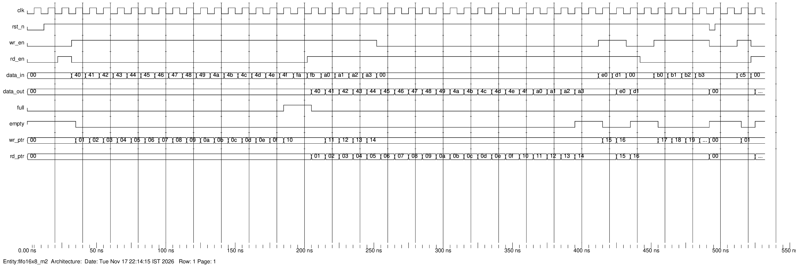
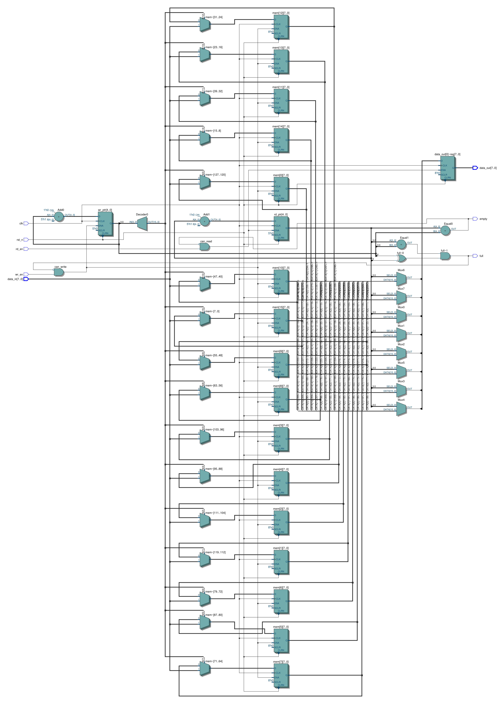
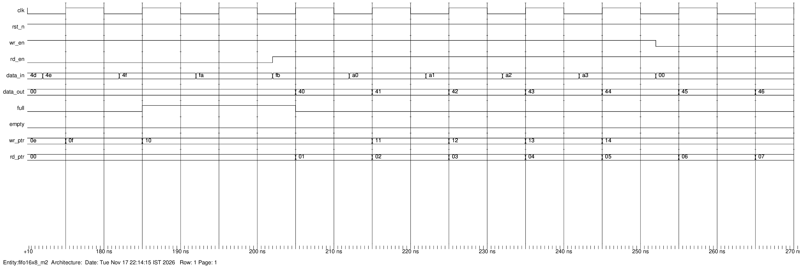
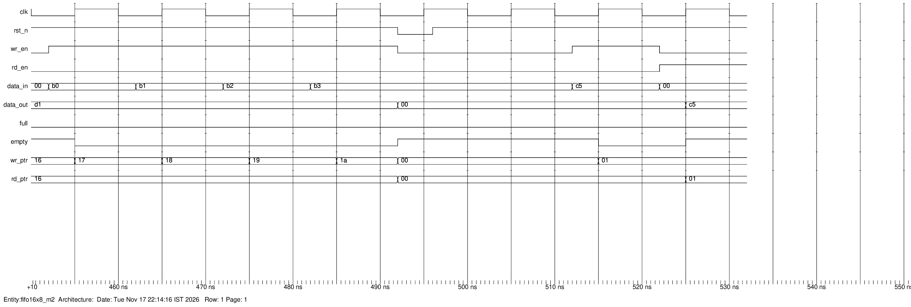
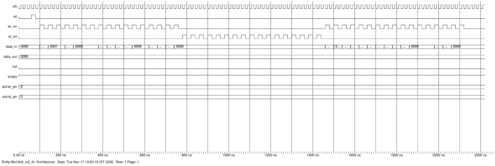

# FIFO using extended pointers

[Topic index](../README.md)

Icarus Verilog compiles the RTL and the saved testbench.

The saved testbench selects eight entries of 16 bits and holds active-low reset during the transfer attempts. The design uses an extra pointer bit to distinguish equal addresses at full and empty.

The direct port run uses the default 16 entries of 8 bits. It records 27 accepted writes, 23 accepted reads and 5 simultaneous transfers. With both requests high, the design accepts only the read at full and only the write at empty.

**ModelSim waveform (direct port stimulus)**



**Quartus RTL schematic**



[Direct port stimulus VCD](../waveforms/data/fifo16x8_m2-direct.vcd) · [Direct port stimulus WLF](../waveforms/data/fifo16x8_m2-direct.wlf)

<details>
<summary>Full boundary, asynchronous reset and saved testbench views</summary>







[Saved testbench VCD](../waveforms/data/fifo16x8_m2-original.vcd) · [Saved testbench WLF](../waveforms/data/fifo16x8_m2-original.wlf)

</details>

## RTL: fifo16x8_m2.v

[Editable source](../rtl/fifo16x8_m2.v)

```verilog
module fifo16x8_m2 #(
    parameter aw= 4,
    parameter dw= 8
)(
    input wire clk ,rst_n,
    input wr_en , rd_en ,
    input wire [dw-1:0] data_in ,
    output reg [dw-1:0] data_out ,
    output wire full, empty
);
localparam depth = (1<< aw) ;

//reg [depth:0] count ;
reg [aw:0] wr_ptr , rd_ptr ;
reg [dw-1:0] mem [0:depth-1] ;

// this is method 2 .
// the pointers are of aw+1 in size , aw was needed to cover all the location equal to depth , now ne need a additional bit for wrap conditions

wire can_read ;
wire can_write;
assign can_read = (rd_en && !empty ) ;
assign can_write = (wr_en && !full) ;
// in this method the empty and full will change
assign empty = (wr_ptr == rd_ptr ) ;
assign full = (wr_ptr[aw-1:0] == rd_ptr[aw-1:0] && wr_ptr[aw]!= rd_ptr[aw]) ;

integer i  ;
// write operation
always @(posedge clk or negedge rst_n )begin
    if(!rst_n)begin
      for(i=0;i<depth ; i = i +1 )begin
        mem[i] <= {dw{1'b0}};
        wr_ptr<= {(aw+1){1'b0}} ;

    end
    end  else if(can_write)begin
        mem[wr_ptr[aw-1:0]] <= data_in; // although it wont matter if i write it first or second
        wr_ptr<= wr_ptr+ 1'b1 ;
end else begin
    wr_ptr<= wr_ptr ;
end
end
// read operation
always @(posedge clk or negedge rst_n )begin
    if(!rst_n)begin
        rd_ptr <= {(aw+1){1'b0}};
        data_out <= {dw{1'b0}} ;

    end else if(can_read)begin
        data_out <= mem[rd_ptr[aw-1:0]] ;
        rd_ptr <= rd_ptr+1'b1;
end else begin
    rd_ptr<= rd_ptr;
end
end
// no block for count needed
endmodule
// MSB WILL DECIDE THE FIFO IS FULL OR EMPTY
// after 15 , wr_ptr value is 16, im using lsb bits, to point to the locations
// upper bit is indicating that im doing now the second iteration .
// Hence rd_ptr and wr_ptr and both pointing to the samem location , and the msb bit of read pointer and write, pointer is not equal
// i.e wr_ptr moved depth forward , from rd_ptr. Hence for full we are writing extra
// for empty : both read and write pointer are pointing to the same location
```

## Testbench: fifo16x8_m2_tb.v

[Editable testbench](../tb/fifo16x8_m2_tb.v) · Simulation top: `fifo16x8_m2_tb`

```verilog
`timescale 1ns / 1ps
module fifo16x8_m2_tb;
  parameter aw = 3;
  parameter dw= 16;
  reg clk , rst ;
  reg [dw-1:0] data_in ;
  reg wr_en , rd_en ;
  wire [dw-1:0] data_out ;
  wire full , empty ;
fifo16x8_m2 #(aw,dw) dut (clk,rst,wr_en,rd_en,data_in,data_out , full, empty) ;
// generate a clock pulse
// activate the reset
parameter cycle = 20 ;
task initializeDut();  // will be called at time 0
  begin
    clk = 1'b0 ;
    rst = 1'b0 ;
    wr_en = 1'b0 ;
    rd_en = 1'b0 ;
    data_in = {dw{1'b0}} ;

  end
endtask
always #(cycle/2) clk= ~clk ;
task reset_dut();
  begin
    @(negedge clk );
    rst= 1'b1 ;
    @(negedge clk );
    rst = 1'b0 ;

  end
endtask
// task for writing in the memory location
task write_inFifo(input [dw-1:0] dataInput ) ;
  begin
    @(negedge clk );
    wr_en = 1'b1  ;
    data_in =dataInput;
    @(negedge clk );
    wr_en = 1'b0 ;
  end
endtask
// task to read from memory
task read_FromFifo();
  begin
    @(negedge clk );
    rd_en = 1'b1  ;
    @(negedge clk );
    rd_en = 1'b0 ;
  end
endtask
initial begin
    initializeDut ;
    #50;
    reset_dut;
    repeat (17) begin
        write_inFifo({$random} % 8 ) ; // mod 8 cause i want to write 8 bits of data , i.e 0 to 7

    end
    repeat (17) // will read 16 time depth is 16 not 17 time , ite gonna be empty
      read_FromFifo() ;
    repeat (17)
     write_inFifo({$random} % 8 ) ;
    #100;
    $finish;

end
endmodule
```
